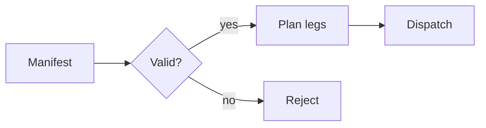
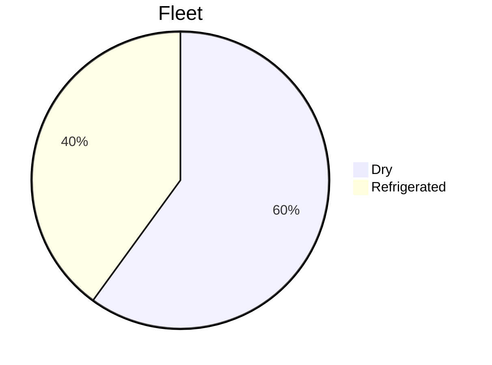

# Diagrams and math while typing

Type in this paragraph with the preview open and watch the diagrams below for flicker.



Inline math $E = mc^2$ and a display equation:

$$
\sum_{i=1}^{n} w_i x_i \le C
$$

```{mermaid}
sequenceDiagram
  participant P as Planner
  participant T as Tracker
  P->>T: emit legs
  T-->>P: completion
```

An invalid equation must stay readable: $\frac{1}{$.



Final paragraph.
