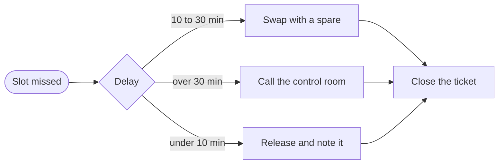

# Depot throughput review

Three months ago a vehicle needed 112 minutes between coming back from a route and leaving on the next one. Dispatch had learned to plan around that number.

This review explains what changed. We moved two checks earlier in the sequence and gave the depot leads one dashboard instead of four. We saved **27 minutes** per vehicle.

## Getting started

:::{card} Install the tooling
:header: Takes about a minute
:footer: Works on Linux, macOS and Windows

Pick your package manager below, then open any Markdown file.
:::

::::{tab-set}
:::{tab-item} Python
:sync: python
Install it with `pip install depot-tools`.
:::
:::{tab-item} Node
:sync: node
:selected:
Install it with `npm install depot-tools`.
:::
:::{tab-item} Shell
:sync: shell
Install it with `brew install depot-tools`.
:::
::::

## What a turnaround contains

A turnaround has four stages and they always run in the same order. Charging dominates the total, so the biggest saving came from starting it earlier.

:::{tip}
Start charging while the inspection is still running.
:::

| Stage | Before | After | Change |
|---|---|---|---|
| Arrival | 9 min | 5 min | -4 min |
| Inspection | 31 min | 18 min | -13 min |
| Charging | 62 min | 55 min | -7 min |
| Release | 10 min | 7 min | -3 min |

## The trend

The chart plots the median turnaround per month.

```vega-lite
{
  "width": 560,
  "height": 220,
  "data": { "values": [
    { "month": "Jun", "minutes": 112 }, { "month": "Jul", "minutes": 101 },
    { "month": "Aug", "minutes": 91 }, { "month": "Sep", "minutes": 85 }
  ] },
  "layer": [
    { "mark": { "type": "line", "point": true, "strokeWidth": 3 } },
    { "mark": { "type": "text", "dy": -14, "fontSize": 13 }, "encoding": { "text": { "field": "minutes", "type": "quantitative" } } }
  ],
  "encoding": {
    "x": { "field": "month", "type": "ordinal", "sort": ["Jun", "Jul", "Aug", "Sep"], "title": "Month", "axis": { "labelAngle": 0 } },
    "y": { "field": "minutes", "type": "quantitative", "title": "Median turnaround (min)", "scale": { "domain": [70, 120] } }
  }
}
```

## When a vehicle misses its slot

The depot lead owns the decision, and the control room is only told when the delay reaches the third path.



## Conclusion

The faster turnaround came from ordering the work differently, not from adding resources. The next step needs hardware: chargers for the three depots that lack them.
