# Depot throughput review

Three months ago a vehicle needed an average of 112 minutes between coming back from a route and leaving on the next one. Dispatch had learned to plan around that number.

We moved two checks earlier in the sequence and gave the depot leads one dashboard instead of four. The combined effect is the 27 minutes shown below.

The retry budget is exceeded when three consecutive calls fail, and the client then gives up.

## Pick your setup

::::{tab-set}
:::{tab-item} Python
:sync: python
Install it with `pip install studio`.
:::
:::{tab-item} Node
:sync: node
:selected:
Install it with `npm install studio`.
:::
:::{tab-item} Shell
:sync: shell
Install it with `brew install studio`.
:::
::::

:::{card} Claude Code
:header: Since v2.1.154
:footer: Documented in the workflows guide

- Saved in `.claude/workflows/`, run as `/<name>`.
- Runs in the CLI, the Desktop app and the IDE extensions.
:::

## The trend

The chart plots the median turnaround per month.

```vega-lite
{
  "width": 560,
  "height": 220,
  "data": { "values": [
    { "month": "Jun", "minutes": 112 }, { "month": "Jul", "minutes": 101 },
    { "month": "Aug", "minutes": 91 }, { "month": "Sep", "minutes": 85 }
  ] },
  "layer": [
    { "mark": { "type": "line", "point": true, "strokeWidth": 3 } },
    { "mark": { "type": "text", "dy": -14, "fontSize": 13 }, "encoding": { "text": { "field": "minutes", "type": "quantitative" } } }
  ],
  "encoding": {
    "x": { "field": "month", "type": "ordinal", "sort": ["Jun", "Jul", "Aug", "Sep"], "title": "Month", "axis": { "labelAngle": 0 } },
    "y": { "field": "minutes", "type": "quantitative", "title": "Median turnaround (min)", "scale": { "domain": [70, 120] } }
  }
}
```

## When a vehicle misses its slot

```mermaid
flowchart LR
  A([Slot missed]) --> B{Delay}
  B -->|under 10 min| C[Release and note it]
  B -->|10 to 30 min| D[Swap with a spare]
  B -->|over 30 min| E[Call the control room]
  D --> F[Close the ticket]
  E --> F
  C --> F
```



Most late releases end on the first path.

## Conclusion

The faster turnaround came from ordering the work differently, not from adding resources.
