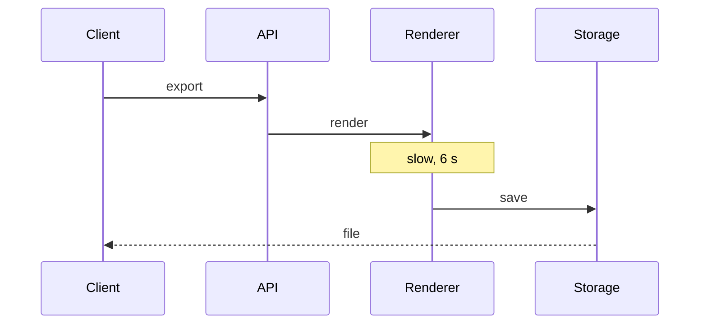

# Export service: latency analysis and optimisation plan

:::{note}
**TL;DR** p95 export latency is 8.2 s. The plan brings it under 1 s in three steps.
:::

:::::{grid} 3
:gutter: 2

::::{grid-item-card} p50
**3.1 s** → 0.4 s
::::

::::{grid-item-card} p95
**8.2 s** → 0.9 s
::::

::::{grid-item-card} Errors
**2.4 %** → 0.5 %
::::
:::::

## Where the time goes



## Measured and projected p95

```vega-lite
{
  "width": 400,
  "height": 220,
  "data": { "values": [
    { "week": 1, "p95": 7.1, "kind": "Measured" },
    { "week": 2, "p95": 7.6, "kind": "Measured" },
    { "week": 3, "p95": 8.0, "kind": "Measured" },
    { "week": 4, "p95": 8.2, "kind": "Measured" },
    { "week": 4, "p95": 8.2, "kind": "Projected" },
    { "week": 5, "p95": 4.6, "kind": "Projected" },
    { "week": 6, "p95": 2.1, "kind": "Projected" },
    { "week": 7, "p95": 0.9, "kind": "Projected" }
  ] },
  "mark": { "type": "line", "point": true },
  "encoding": {
    "x": { "field": "week", "type": "quantitative", "title": "Week" },
    "y": { "field": "p95", "type": "quantitative", "title": "p95 (s)" },
    "color": { "field": "kind", "type": "nominal", "title": null, "legend": { "orient": "bottom" } },
    "strokeDash": { "field": "kind", "type": "nominal", "legend": null,
      "scale": { "domain": ["Measured", "Projected"], "range": [[1, 0], [6, 4]] } }
  }
}
```

## Plan

1. Cache rendered files by document and version: p95 8.2 s → 4.6 s.
2. Render in a worker pool, off the request path: → 2.1 s.
3. Stream the file while saving it: → 0.9 s.

## Projection per endpoint

| Endpoint | Calls/day | p50 | p95 | Step 1 | Step 2 | Step 3 | Gain |
| --- | --- | --- | --- | --- | --- | --- | --- |
| /export/pdf | 41,000 | 3.4 s | 8.2 s | 4.6 s | 2.1 s | 0.9 s | 89 % |
| /export/html | 28,500 | 2.2 s | 5.9 s | 3.1 s | 1.4 s | 0.7 s | 88 % |
| /export/docx | 9,300 | 4.8 s | 11.4 s | 6.3 s | 3.0 s | 1.3 s | 89 % |
| /export/csv | 17,800 | 0.9 s | 2.6 s | 1.2 s | 0.7 s | 0.4 s | 85 % |
| /export/zip | 3,100 | 6.7 s | 15.0 s | 9.8 s | 4.2 s | 1.8 s | 88 % |
