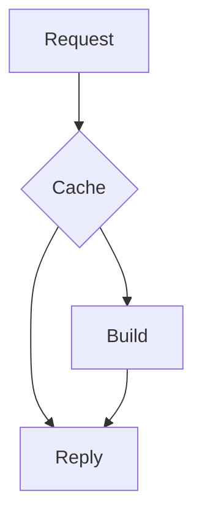

# Add a cache to the export service

Exports are slow because every request rebuilds the same file. We keep recent results in memory
and serve repeats directly.

:::{card} Goal
:header: Why
Cut the median export time from 8 s to under 1 s for repeated requests.
:::

## Request flow

On a cache miss we build the file once, store it, and reply. Later requests skip the build.

## Cost

| Item | Before | After |
|---|---|---|
| Median export | 8 s | 0.9 s |
| Memory | 0.5 GB | 1.5 GB |
| Stale window | none | 5 min |

## Steps

1. Add a cache layer behind the export route.
2. Key entries by document and version.
3. Expire entries after five minutes.
4. Add a metric for the hit rate.

:::{card} Risk
:header: Watch out
Stale files after an edit. Mitigation: the version is part of the key.
:::
