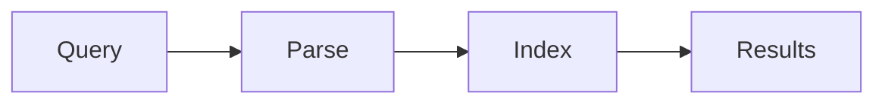
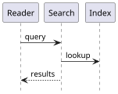

# Search service: design note

A query goes from the search box to the index and back in under 200 ms.





```vega-lite
{
  "width": 380,
  "height": 30,
  "data": { "values": [
    { "week": "W1", "p95": 240 },
    { "week": "W2", "p95": 210 },
    { "week": "W3", "p95": 195 },
    { "week": "W4", "p95": 170 },
    { "week": "W5", "p95": 160 }
  ] },
  "mark": { "type": "line", "point": true },
  "encoding": {
    "x": { "field": "week", "type": "ordinal", "title": null, "axis": { "labelAngle": 0 } },
    "y": { "field": "p95", "type": "quantitative", "title": "p95 (ms)" }
  }
}
```

## Capacity

```vega
{
  "width": 320, "height": 80, "padding": 5,
  "data": [{ "name": "table", "values": [
    { "region": "EU", "queries": 42 }, { "region": "US", "queries": 55 }, { "region": "Asia", "queries": 31 }
  ] }],
  "scales": [
    { "name": "x", "type": "band", "domain": { "data": "table", "field": "region" }, "range": "width", "padding": 0.2 },
    { "name": "y", "domain": { "data": "table", "field": "queries" }, "nice": true, "range": "height" }
  ],
  "axes": [{ "orient": "bottom", "scale": "x" }, { "orient": "left", "scale": "y", "tickCount": 3 }],
  "marks": [{ "type": "rect", "from": { "data": "table" }, "encode": { "enter": {
    "x": { "scale": "x", "field": "region" }, "width": { "scale": "x", "band": 1 },
    "y": { "scale": "y", "field": "queries" }, "y2": { "scale": "y", "value": 0 } } } }]
}
```

$$
t_{\mathrm{query}} = t_{\mathrm{parse}} + \sum_{i=1}^{n} t_{\mathrm{shard},i}
$$

```svg
<svg viewBox="0 0 240 60" width="300" role="img" aria-label="Box, service and index">
  <rect x="4" y="4" width="70" height="52" rx="8" fill="var(--surface)" stroke="var(--border)"/>
  <text x="39" y="35" text-anchor="middle" fill="var(--text)" font-size="13">Box</text>
  <rect x="85" y="4" width="70" height="52" rx="8" fill="var(--surface)" stroke="var(--accent)"/>
  <text x="120" y="35" text-anchor="middle" fill="var(--accent)" font-size="13">Service</text>
  <rect x="166" y="4" width="70" height="52" rx="8" fill="var(--green)"/>
  <text x="201" y="35" text-anchor="middle" fill="var(--surface)" font-size="13">Index</text>
</svg>
```
