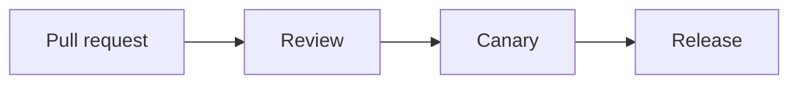
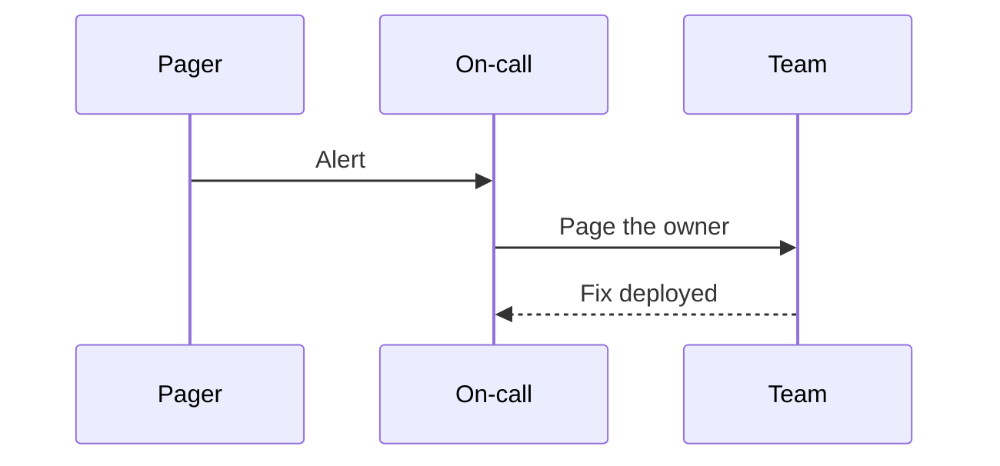

# Platform report, 2026

What the platform team shipped this year, service by service.

::::{grid} 1 1 3 3
:::{grid-item-card} Uptime
99.95 %
^^^
Across the five services.
:::
:::{grid-item-card} Deploys
1,046
^^^
Up 18 % on last year.
:::
:::{grid-item-card} Incidents
7
^^^
None longer than one hour.
:::
::::

## Deploys by service

| Service | Team | Region | Tier | Jan | Feb | Mar | Apr | May | Jun | Jul | Aug | Sep | Oct | Nov | Dec |
| --- | --- | --- | --- | --: | --: | --: | --: | --: | --: | --: | --: | --: | --: | --: | --: |
| checkout-api | payments | eu-west | gold | 21 | 24 | 19 | 26 | 28 | 25 | 22 | 18 | 27 | 30 | 29 | 24 |
| search-index | discovery | us-east | gold | 17 | 15 | 20 | 18 | 22 | 21 | 19 | 16 | 23 | 25 | 24 | 20 |
| notifications | messaging | eu-west | silver | 12 | 14 | 11 | 15 | 13 | 16 | 12 | 10 | 14 | 17 | 15 | 13 |
| media-store | content | ap-south | silver | 8 | 9 | 7 | 10 | 11 | 9 | 8 | 6 | 10 | 12 | 11 | 9 |
| auth-gateway | identity | us-east | gold | 14 | 13 | 16 | 15 | 17 | 18 | 15 | 12 | 16 | 19 | 18 | 15 |

## How a change ships



```vega-lite
{
  "width": 520,
  "height": 120,
  "data": { "values": [
    { "quarter": "Q1", "deploys": 236 },
    { "quarter": "Q2", "deploys": 271 },
    { "quarter": "Q3", "deploys": 237 },
    { "quarter": "Q4", "deploys": 302 }
  ] },
  "mark": "bar",
  "encoding": {
    "x": { "field": "quarter", "type": "nominal" },
    "y": { "field": "deploys", "type": "quantitative" }
  }
}
```

## Incident response



```vega
{
  "width": 520,
  "height": 120,
  "padding": 5,
  "data": [{ "name": "restore", "values": [
    { "month": "Jan", "minutes": 52 },
    { "month": "Mar", "minutes": 41 },
    { "month": "May", "minutes": 38 },
    { "month": "Jul", "minutes": 33 },
    { "month": "Sep", "minutes": 29 },
    { "month": "Nov", "minutes": 24 }
  ] }],
  "scales": [
    { "name": "x", "type": "point", "range": "width", "domain": { "data": "restore", "field": "month" } },
    { "name": "y", "type": "linear", "range": "height", "zero": true, "nice": true, "domain": { "data": "restore", "field": "minutes" } }
  ],
  "axes": [
    { "orient": "bottom", "scale": "x" },
    { "orient": "left", "scale": "y", "title": "Minutes to restore" }
  ],
  "marks": [
    { "type": "line", "from": { "data": "restore" }, "encode": { "enter": {
      "x": { "scale": "x", "field": "month" }, "y": { "scale": "y", "field": "minutes" }, "strokeWidth": { "value": 2 } } } },
    { "type": "symbol", "from": { "data": "restore" }, "encode": { "enter": {
      "x": { "scale": "x", "field": "month" }, "y": { "scale": "y", "field": "minutes" } } } }
  ]
}
```

## On-call

| Week | Primary | Backup |
| --- | --- | --- |
| 1 | Ana | Ben |
| 2 | Cleo | Dev |

## Next year

::::{grid} 1 1 3 3
:::{grid-item-card} Faster canary
Cut the canary to 20 minutes.
:::
:::{grid-item-card} One dashboard
Merge the three status pages.
:::
:::{grid-item-card} Fewer pages
Page the owner, not the rota.
:::
::::
