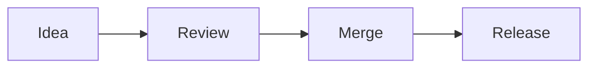

# Team handbook

How a change goes from an idea to a release.

::::{tab-set}
:::{tab-item} Review
Every change gets one approving review.
:::
:::{tab-item} Release
We release on Thursday, after the smoke tests.
:::
::::
