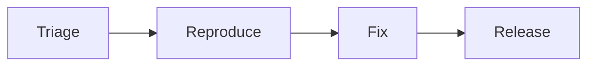

# Support handbook

A ticket goes from triage to a fix in one working day.

:::{tip}
Tag the ticket before you start: the chart below counts tags.
:::



```vega-lite
{
  "width": 360,
  "height": 110,
  "data": { "values": [
    { "tag": "bug", "count": 14 },
    { "tag": "question", "count": 9 },
    { "tag": "feature", "count": 5 }
  ] },
  "mark": "bar",
  "encoding": {
    "x": { "field": "count", "type": "quantitative" },
    "y": { "field": "tag", "type": "nominal", "sort": "-x" }
  }
}
```
