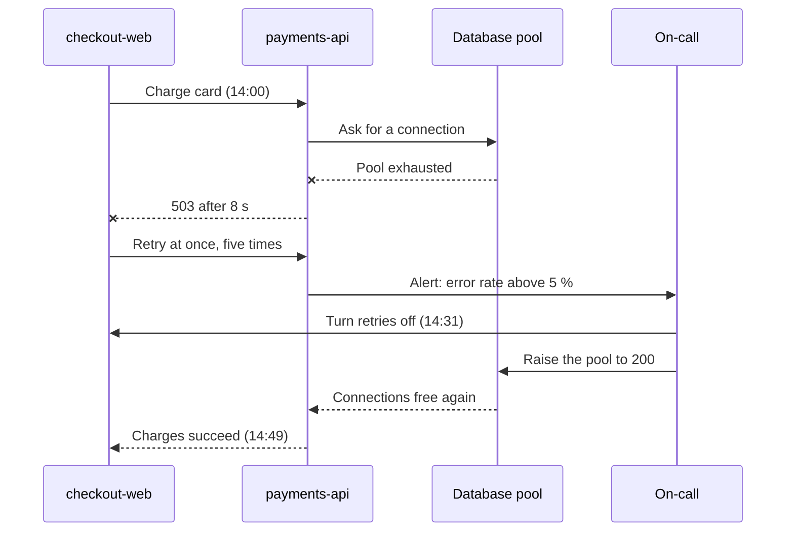

# Checkout outage, 14 October

For 47 minutes, one checkout in four failed. A retry storm from `checkout-web` drained the
connection pool of `payments-api`, and the failures spread to every service that waits on it.

::::{grid} 3
:gutter: 2

:::{grid-item-card} 47 minutes
Duration
^^^
From the first alert at 14:02 to full recovery at 14:49.
:::

:::{grid-item-card} 18,420 checkouts
Failed
^^^
Card payments only. No customer was charged twice.
:::

:::{grid-item-card} 3 regions
Reach
^^^
All of Europe, and the east coast of the United States.
:::
::::

## Impact by service

| Service | Mitigation | Team | Region | Peak errors | p95 latency | Failed requests | Customers saw it | Alert | Recovered | Follow-up |
| --- | --- | --- | --- | ---: | ---: | ---: | --- | --- | --- | --- |
| `checkout-web` | Retries off | Storefront | eu-west | 26 % | 8.4 s | 18,420 | Yes | 14:02 | 14:41 | PAY-2210 |
| `payments-api` | Pool raised | Payments | eu-west | 31 % | 12.1 s | 22,907 | Yes | 14:03 | 14:38 | PAY-2211 |
| `fraud-check` | Fail open | Risk | eu-west | 12 % | 3.2 s | 4,116 | No | 14:09 | 14:44 | RISK-871 |
| `orders` | Queue paused | Fulfilment | eu-west | 9 % | 1.9 s | 2,380 | No | 14:11 | 14:46 | ORD-1302 |
| `payments-api` | Pool raised | Payments | us-east | 14 % | 5.6 s | 6,204 | Yes | 14:12 | 14:49 | PAY-2212 |

## Timeline



## Error rate

```vega-lite
width: 760
height: 250
data:
  values:
    - {time: "13:55", errors: 0.2}
    - {time: "14:00", errors: 0.4}
    - {time: "14:05", errors: 9}
    - {time: "14:10", errors: 21}
    - {time: "14:15", errors: 26}
    - {time: "14:20", errors: 31}
    - {time: "14:25", errors: 29}
    - {time: "14:30", errors: 27}
    - {time: "14:35", errors: 14}
    - {time: "14:40", errors: 6}
    - {time: "14:45", errors: 2}
    - {time: "14:50", errors: 0.3}
mark: {type: area, line: {color: "#F2822B"}, color: "#F2822B", opacity: 0.35, interpolate: monotone}
encoding:
  x: {field: time, type: ordinal, title: Time, axis: {labelAngle: 0}}
  y: {field: errors, type: quantitative, title: Failed checkouts (%)}
```

## Root cause

The client retried at once, with no backoff, so every failure added five more requests.

```{code-block} python
:caption: checkout-web, before the fix
:emphasize-lines: 3-5
:linenos:

def charge(order: Order) -> Receipt:
    for attempt in range(5):
        try:
            return payments.charge(order, timeout=8)
        except ServiceUnavailable:
            continue
    raise CheckoutFailed(order.id)
```

## Decision

The new retry budget stays at five attempts per checkout, with a backoff between them.

Which fix do we ship first?

- (x) Retry budget in `checkout-web`, this week (recommended)
- ( ) Circuit breaker in `payments-api`, next sprint
