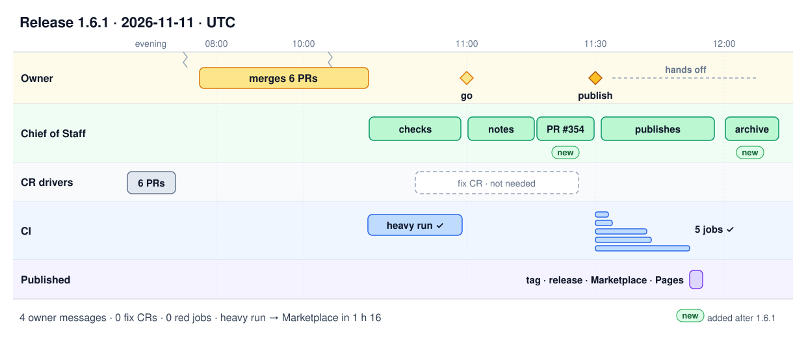

# How we ship

Markdown OKF-Schema Studio is built by one owner and a team of AI agents running in Claude Code.
The owner decides; the agents do the work and prove it. This page describes the workflow as it
runs today, then follows one real release, 1.6.1, from the first merge to the Marketplace.

In the two days before this page was written, the workflow landed 17 changes and 2 releases
(1.6.0 and 1.6.1), each one a reviewed, tested pull request.

## Who does what

The owner talks to one agent, the **Chief of Staff**. Everything else is delegated.

| Role | What it does |
| --- | --- |
| Owner | Files ideas, answers the grill, says "go", merges pull requests, decides releases. |
| Chief of Staff | Keeps the backlog, grills the owner (only the questions that change the result, each with a recommended answer), turns answers into a written specification, starts the run, reports. |
| Foreman | Runs a batch of changes in parallel: one CR driver per change, a heartbeat every 10 minutes, a cap on open pull requests. |
| CR driver | Owns one change request from its first round to a mergeable pull request. |
| Coder | Writes the tests first (they must fail on the old code), then the change. Never commits. |
| Inspector | Reviews each round's diff against the specification and the project rules; approves or sends it back. |
| Verifier | Starts fresh on the pushed commit and proves each claim of the specification with a command and its output, checks the before/after screenshots and the pull request text. |
| Stack driver | Orders, rebases and ships a stack of dependent pull requests. |
| Release driver | Runs a release from the notes to the archive (in small runs, the Chief of Staff takes this role). |

## A change request, from idea to merge

Each change is a folder that moves through stages: **inbox → backlog (P1 to P4) → request →
pull request → archive**. The owner acts at four points only: triage, the grill, the go, the
merge.

| Step | What happens |
| --- | --- |
| 1. Pick and grill | The Chief of Staff proposes the next item and asks the questions that change the result. |
| 2. Specify | The answers become a change specification: behaviour, files, requirements, tests, acceptance checks. |
| 3. Open | One branch and one worktree per change, from fresh `main`. |
| 4. Rounds | Coder, then Inspector. At most 3 rounds per change, all causes together; beyond that the owner decides. |
| 5. Pull request | Opened as a **draft**, with a fixed template: summary, deliverables, changes, impacts with before/after screenshots, blast radius, test plan, and the decisions the agents took alone. |
| 6. CI | Every check green at the pushed commit; a change to rendering or editing also runs the heavy jobs (real VS Code windows) on its branch. |
| 7. Verify | The Verifier proves the specification at that exact commit. |
| 8. Ready | Only then the pull request leaves draft: a non-draft pull request always means "you can merge". |
| 9. Land | The owner merges (rebase, linear history). The change is archived with a report and a retro. |

## The rules that keep it honest

- **Tests first.** A new test must fail on the code before the change.
- **Requirements are traced.** Each behaviour is a requirement anchored in the code and its tests;
  the [requirements report](../requirements.html) is generated from them.
- **Screenshots or it did not happen.** A visible change shows before and after, in light and dark
  when themes matter. No screenshot, not mergeable.
- **The heavy CI is the gate.** The real VS Code jobs (integration, stress) run on every push to
  `main` and on demand on a branch. A release starts only from a green heavy run on `main`.
- **One commit per pull request.** Branches are rebased and amended; history stays linear.
- **Small fixes fix themselves.** When CI fails for a clear, small reason, the agent fixes it,
  reruns the failing tests locally, amends and pushes, and reports in one line.
- **Ask only on danger.** The agents decide routine steps alone. They ask before a merge, a
  release, a public post, discarding work or rewriting `main`, and when blocked.
- **Retro at the end.** Every landed change and every release records what cost time, its root
  cause and the process fix. The owner picks the fixes; each one becomes a change of its own.

## Release 1.6.1, hour by hour

1.6.1 is a patch release: seven fixes to table editing and to the properties table, found by an
exploratory QA campaign the day before. The figure shows every step on its real time.

| Time (UTC) | Event |
| --- | --- |
| Evening before | The agents open the six fixes as a stack of draft pull requests, each with its tests and screenshots. |
| 07:36 → 10:37 | The owner merges the stack, plus a process change (the Verifier step). Asked beforehand: "once merged, check the heavy pipeline and tell me if a release is worth it". |
| 10:37 → 10:59 | The heavy run on `main` (integration and stress, real VS Code) is green on that exact commit. |
| ~11:00 | The Chief of Staff counts seven user-visible fixes and proposes a patch, 1.6.1. The owner: "yes, do it now". |
| 11:00 → 11:16 | Release notes and a three-post announcement thread written from the changelog, with a before/after picture; one version commit; version pull request [#354](https://github.com/gsemet/markdown-okf-schema-studio/pull/354) opened. |
| 11:16 → 11:30 | The owner reviews the notes and the thread in the pull request: "OK to publish, you can merge". |
| 11:30 → 11:52 | The version push runs every job again: static checks on Linux and Windows, visual, integration, stress. All green. |
| 11:52 → 11:55 | Tag `v1.6.1`, GitHub release with the VSIX and its images, Marketplace publication, site deployed. Nobody touched it. |
| ~12:05 | The release is checked (tag, release page, Marketplace, site) and archived with its report. |

In numbers: 4 owner messages, 0 fix changes, 0 red jobs, 1 h 16 from the heavy run on `main` to
the Marketplace, 14 minutes from the version pull request to its merge.

## What the release taught us

The same afternoon, two remarks of the owner became two process changes, each one a small pull
request with the same workflow:

- The version pull request now shows the release notes and the announcement thread **rendered**
  in its description, so the owner reviews exactly what will be published, and comments on the
  delivered files.
- Every change and every release now ends with a **retro**: what cost time, why, and the fix to
  the process.

The workflow is described in full in the repository: [CONTRIBUTING.md](../CONTRIBUTING.md) for the
build and release mechanics, and the agent guidelines under `.agents/guidelines/`.
