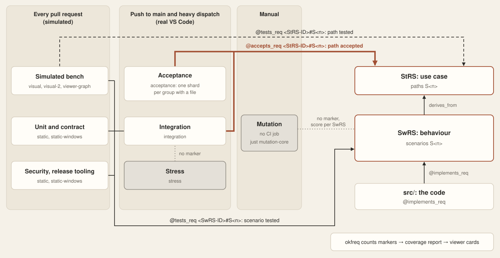

# How we test

Every behaviour of Markdown OKF-Schema Studio is written as a requirement. A test proves a
requirement by naming it with a marker, a comment such as `@tests_req <SwRS-ID>#S<n>`.

okfreq, the requirements tool of the project, counts the markers. The CI jobs prove that the tests
pass. This page follows one use case from its paths to the tests that prove them, and ends with what
is not enforced yet.

## Two levels of requirements

- A **StRS** (stakeholder requirement) is a use case. The paths of its `### Main paths` section are
  declared in its `scenarios:` frontmatter as `S1`, `S2` and so on, and headed
  `#### Path S<n>: <title>`.
- A **SwRS** (software requirement) is one behaviour, derived from a StRS (`derives_from`). Its
  transition scenarios are declared the same way and headed
  `### Scenario S<n> (<kind>): <title>`.
- Code that implements a SwRS carries `@implements_req <SwRS-ID>`, with no fragment.

One example, from the `trust-security` area:

- The use case
  [StRS-MDOKFSTUDIO-TRUST-001](../requirements/tiers/strs/trust-security/StRS-MDOKFSTUDIO-TRUST-001.md),
  "A document opens editable whatever the trust, with narrow reads outside a trusted folder", has
  path `S1`, "Edit in an untrusted workspace". The file
  `test/integration/acceptance/trust-security.restricted.acceptance.ts` walks it in a Restricted
  Mode window and carries `@accepts_req StRS-MDOKFSTUDIO-TRUST-001#S1`.
- The behaviour
  [SwRS-MDOKFSTUDIO-TRUST-005](../requirements/tiers/swrs/trust-security/SwRS-MDOKFSTUDIO-TRUST-005.md),
  "The host handles the page messages of every preview, whatever the trust", derives from that use
  case. Its scenario `S1`, "Every write request type is handled", is tested for example in
  `test/session/blockReq.requirements.test.ts`, with
  `@tests_req SwRS-MDOKFSTUDIO-TRUST-005#S1`.

## The levels at a glance

- **Every pull request** runs the simulated levels, which open no VS Code window: unit, contract,
  security, release and tooling tests, and the simulated bench.
- **Every push to `main` and every heavy dispatch** also run the levels in a real VS Code window:
  integration, acceptance and stress.
- **Manual**: mutation testing runs only when someone starts it.

## Which test proves which requirement

| Test level | Where | Command | CI job, when | Proves | Marker |
| --- | --- | --- | --- | --- | --- |
| Unit | `test/build`, `test/core`, `test/host`, `test/host-memory`, `test/host-vscode`, `test/node-services`, `test/page`, `test/session`, `test/site` | `just unit` | `static`, `static-windows`; every pull request | SwRS scenario | `@tests_req <SwRS-ID>#S<n>` |
| Contract | `sphinx/tests`, `test/core/render/*.contract.ts` (no such file today) | `just contracts`, `just sphinx-check` | `static`, `static-windows`; every pull request | SwRS scenario (no contract test carries a marker today) | `@tests_req <SwRS-ID>#S<n>` |
| Security | `test/security` | `just security`, `just audit` | `static`, `static-windows`; every pull request | SwRS scenario; may accept a TRUST-014 path | `@tests_req <SwRS-ID>#S<n>`; `@accepts_req <StRS-ID>#S<n>` allowed for TRUST-014 |
| Release and tooling | `test/build/*.py` | `just release-tests` | `static`, `static-windows`; every pull request | SwRS scenario; may accept a CORE-007 path | `@tests_req <SwRS-ID>#S<n>`; `@accepts_req <StRS-ID>#S<n>` allowed for CORE-007 |
| Simulated bench | `test/visual`, `test/page/tableBreakout.test.ts`, `test/page/codeBlockBreakout.test.ts`, `test/site/requirementsViewer/*.browser.test.ts`, `test/site/galleryLinks.browser.test.ts`, `test/site/videoGallery.browser.test.ts` | `just ci-visual`, `just ci-viewer-graph` | `visual`, `visual-2`, `viewer-graph`; every pull request | SwRS scenario; StRS path **tested** | `@tests_req <SwRS-ID>#S<n>`, `@tests_req <StRS-ID>#S<n>` |
| Real VS Code integration | `test/integration` | `just ci-integration` | `integration`; push to `main`, heavy dispatch | SwRS scenario; StRS path **accepted** (suites that walk one) | `@tests_req <SwRS-ID>#S<n>`, `@accepts_req <StRS-ID>#S<n>` |
| Acceptance | `test/integration/acceptance` | `just ci-acceptance [GROUP]` | `acceptance` (one shard per group with a file); push to `main`, heavy dispatch | StRS path **accepted** | `@accepts_req <StRS-ID>#S<n>` |
| Stress | `test/shared/stressPlan.ts` | `just ci-stress [REPEAT]` | `stress`; push to `main`, heavy dispatch | that a passing test passes every time | none |
| Mutation | `src/core` against `test/core` | `just mutation-core [SAMPLE]` | none; manual | strength of the SwRS tests (score per SwRS) | none |

The jobs of every pull request also run on a push to `main` and on a manual dispatch.

The rules of the markers, which `just check-markers` holds:

- A SwRS scenario is **tested** by `@tests_req <SwRS-ID>#S<n>`, on any bench.
- A StRS path is **tested** by `@tests_req <StRS-ID>#S<n>` on a simulated walk of the path, outside
  `test/integration/`.
- A StRS path is **accepted** by `@accepts_req <StRS-ID>#S<n>` on a walk in a real VS Code window,
  under `test/integration/`.
- Some use cases have a product that is not the editor: StRS-MDOKFSTUDIO-CORE-007 (the release),
  StRS-MDOKFSTUDIO-CORE-008 (the site) and StRS-MDOKFSTUDIO-TRUST-014 (the built VSIX). They may be
  accepted on the test closest to their product, under `test/build`, `test/security`, `test/site` or
  `test/core`.
- `@accepts_req` never targets a SwRS. No new `@tests_req <StRS-ID>` goes under
  `test/integration/`.
- A test or acceptance marker on a requirement that declares `scenarios:` has a `#S<n>` fragment
  that names a declared id. On a requirement with no `scenarios:`, it has none.

## The test levels

### Unit tests

Node tests of the TypeScript code and of the repository's own tooling, in `test/build`, `test/core`,
`test/host` (a fake VS Code host harness, with `*.requirements.test.ts` files), `test/host-memory`,
`test/host-vscode`, `test/node-services`, `test/page`, `test/session` and `test/site`.

- Command: `just compile`, then `just unit`. `just check` runs both.
- CI job: `static` and `static-windows`, through `just ci-static`, on every pull request.
- Marker: `@tests_req <SwRS-ID>#S<n>`.

A unit test that needs Chromium is skipped where none can start, as in these CI jobs.

### Contract tests

The Python Sphinx source-mapping contract, with its tests and fixtures in `sphinx/tests`. A second
command runs the files `test/core/render/*.contract.ts`; no such file exists today.

- Command: `just sphinx-check`; `just contracts`, after `just compile`.
- CI job: `static` and `static-windows`, through `just ci-static`, on every pull request.
  `just check` runs `just contracts` but not `just sphinx-check`.
- Marker: `@tests_req <SwRS-ID>#S<n>`. The Sphinx contract carries none today.

### Security tests

The tests of `test/security`, and the online npm audit of the production dependencies. The folder
`test/release` holds a lockfile audit script, `audit-lockfile.mjs`, that no `just` target,
`package.json` script or workflow calls.

- Command: `just security`, after `just compile`; `just audit`.
- CI job: `static` and `static-windows`, through `just ci-static`, on every pull request.
  `just check` runs `just security` but not `just audit`.
- Marker: `@tests_req <SwRS-ID>#S<n>`; a TRUST-014 path may take `@accepts_req <StRS-ID>#S<n>`.

### Release and tooling tests

The Python tests of `test/build`: the release, the CI workflows, the run selection, the plugin
manifests, the visual checks (their two parts and the table bar layout), the unpacking of the built
VSIX and other repository checks (guideline isolation, main paths, merge commits, changelog).

- Command: `just release-tests`. `just check` runs it.
- CI job: `static` and `static-windows`, through `just ci-static`, on every pull request.
- Marker: `@tests_req <SwRS-ID>#S<n>`; a CORE-007 path may take `@accepts_req <StRS-ID>#S<n>`.

### Simulated bench

No VS Code window opens. `test/visual` drives the preview page with Playwright Chromium against a
mock host, and its screenshots feed the gallery. Some tests of `test/page` measure the real page in
Chromium: the table and code block breakout widths, the aligned-float layout, the style cost of one
comment and the selected text of a scroll. The use case map tests of `test/site/requirementsViewer` and
the gallery link and video gallery tests of `test/site` also run in Chromium.

- Command: `just ci-visual` (visual scenarios and those page tests); `just ci-viewer-graph` (use case
  map, gallery link and video gallery tests). The visual scenarios come in two parts:
  `just ci-visual 1` runs the first part and those page tests, `just ci-visual 2` the second part.
  With no part, `just ci-visual` runs both and merges their reports.
- CI job: `visual` (part 1), `visual-2` (part 2) and `viewer-graph`, on every pull request.
- Marker: `@tests_req <SwRS-ID>#S<n>`; a simulated walk of a StRS path carries
  `@tests_req <StRS-ID>#S<n>`.

### Real VS Code integration

The suites of `test/integration` run in real VS Code windows (trusted, Restricted Mode, standalone
file and others), with real keys and pointer input through `test/integration/realInput`.

- Command: `just ci-integration`.
- CI job: `integration`, on every push to `main` and every heavy dispatch
  (`gh workflow run ci.yml --ref <branch> -f heavy=true`), never on a pull request.
- Marker: `@tests_req <SwRS-ID>#S<n>`; a suite that walks a StRS path from end to end carries
  `@accepts_req <StRS-ID>#S<n>`.

### Acceptance

The acceptance files are `test/integration/acceptance/<group>[.<kind>].acceptance.ts`, with one
real VS Code launch per file. Each file declares its window: trusted, in Restricted Mode, or running
the built VSIX. An acceptance test walks one path of a use case in such a window and carries the
marker of that path. A human step is a simulated input: the test checks the gate, never a judgment.

Not every check of these files is an acceptance test. The checks of the built VSIX file of
`trust-security` read the texts of the manifest with the label of the preview tab, and the icon of
the installed package. They walk no path in full, so they carry no marker and accept no path.

Groups with acceptance files: `trust-security`.
The other groups have no acceptance file yet.

- Command: `just ci-acceptance [GROUP]`; with no group, it runs every group that has a file.
- CI job: `acceptance`, one shard per group that has an acceptance file, on every push to `main` and
  every heavy dispatch.
- Marker: `@accepts_req <StRS-ID>#S<n>`, on each test that walks a path.

### Stress

The flake-prone real-window scenarios of `test/shared/stressPlan.ts` run again and again, `REPEAT`
times, in a trusted window and then in a Restricted Mode window. Some scenarios of that file are not
part of a default run: they run only when `STUDIO_STRESS_SCENARIOS` (the `stress_scenarios` input of
a manual dispatch) names them.

- Command: `just ci-stress [REPEAT]`, meant for CI.
- CI job: `stress`, on every push to `main` and every heavy dispatch. A red run is advisory, except
  on a push that changes the version
  ([CI guidelines](../.agents/guidelines/ci.guidelines.md), rule 14).
- Marker: none. Stress proves no requirement of its own: it checks that a passing scenario passes
  every time.

### Mutation

StrykerJS changes the code of `src/core` and checks that the `test/core` tests fail. A second phase
runs what the first one missed against the tests of the other layers. The report,
`out/reports/mutation/summary.md`, gives a score per source folder and per SwRS: it measures how
well the SwRS tests catch a broken implementation. See [CONTRIBUTING](../CONTRIBUTING.md).

- Command: `just mutation-core [SAMPLE]`; a full run takes hours.
- CI job: none. It is manual.
- Marker: none.

### Repro tools and probes

The `toc-loop` job (`just ci-toc-loop`) repeats real-window steps to reproduce a flake. It runs only
on a manual dispatch that asks for it, and never gates a merge. The `perf-547` job
(`just ci-perf-547`) measures comments on a large generated document in a real window (issue 547),
the wait of a comment write for the Git user name, and, in plain Node, the time to index the comment
threads. It sets no limit and fails only when the measure cannot be taken. It runs only on a manual
dispatch with `perf_547=true`, and never gates a merge. The probes of `test/probe` measure
performance and frames and take chart screenshots. None of these jobs and probes has a marker of its
own.

The folders `test/shared` and `test/fixtures` hold shared code and data only.

## The e2e groups

The groups of
[`test/shared/e2eGroups.ts`](https://github.com/gsemet/markdown-okf-schema-studio/blob/main/test/shared/e2eGroups.ts)
are the scopes of okfreq, the areas of the requirements viewer, the first part of the visual
scenario ids, the folders of their captures, and the possible shards of the `acceptance` job. In
order: `rendering-core`, `code-blocks`, `gfm`, `myst`, `diagrams`, `frontmatter-schema`,
`frontmatter-editing`, `layout-width`, `theme-zoom`, `toolbar-navigation`, `block-editing`,
`palette-slash`, `table-editing`, `review-annotations`, `lifecycle-sync`, `trust-security`.

## From markers to coverage

`just check-markers`, part of `just check`, holds where a marker may sit: the fragment rules above,
`@accepts_req` only where it is allowed, at most 3 requirement IDs per marker block, and a source
marker on every in-force SwRS that is not exempt. It does not check whether a requirement is tested.

`just requirements-update` runs `okfreq update-coverage`, which writes `implemented_in_files` and
`tested_in_files` into the SwRS files.

The StRS coverage mode is `linked-swrs-and-validation-test`.

In this mode, okfreq counts a StRS as **covered** when all of these hold:

- at least one SwRS is linked to it;
- every linked SwRS has at least one test marker;
- at least one `@tests_req <StRS-ID>` names the StRS itself.

Acceptance markers are counted and shown, but they do not change whether a StRS is covered.

`just requirements-lint`, part of `just check`, runs these commands:

- `okfreq validate` fails on a structural error in a requirement, the configuration or the
  derivation graph, and on a broken requirement link;
- `okfreq lint --check` fails on a stale index or generated field, and on a badly headed log entry;
- `okfreq update-coverage --check` fails when the generated coverage fields are out of date;
- `scripts/check_main_paths.py` fails when a `### Main paths` section cites a SwRS that does not
  exist, is not active, or neither derives from the use case nor is one of its `depends_on`;
- `check:diagrams` fails on a use case diagram that Mermaid cannot parse.

Reports:

- `just requirements-report` writes the traceability report under `out/reports/requirements/`,
  with `requirements-trace.json`.
- `okfreq trace requirements --json` is the source of that file. Its `scenario_markers` list gives,
  for each test or acceptance marker that names a known requirement, the requirement, the scenario,
  the file and the line; the same marker repeated in one file is listed once.

The [requirements viewer](https://gsemet.github.io/markdown-okf-schema-studio/requirements/) of the
published site, deployed with each release, shows the counts. Its home has the cards "StRS paths
tested", "StRS paths accepted", "StRS covered" (it follows the coverage mode) and "SwRS scenarios
tested", and an area table with the columns "Paths tested" and "Paths accepted". A use case page
lists each path with the files that test and accept it. A behaviour page lists its scenarios with
their tests.

## What a count does not prove

okfreq counts markers. It never reads a test result. The proof that a marked test passes is the
green CI job that runs it:

- on a pull request: `static`, `static-windows`, `visual`, `visual-2` and `viewer-graph`;
- on a heavy run: `integration`, `acceptance` and `stress`. A version change is tagged as a release
  only when `checks` and these jobs are green
  ([CI guidelines](../.agents/guidelines/ci.guidelines.md), rule 14).

A green job does not prove that every marked test ran:

- `static` and `static-windows` have no Chromium, so they skip the unit tests that need it. `visual`,
  `visual-2` and `viewer-graph` run only the Chromium tests of the simulated bench. A marker on
  another Chromium test counts, but no CI job runs that test.
- The `visual` job runs on Linux. There the table width checks only report their differences from
  the Windows reference; they assert the widths on Windows.

These jobs run no test level:

- `release-check`: on a push to `main`, detects a version change;
- `report`: merges the reports of the stages into the review index;
- `checks`: the required status, which sums `static`, `static-windows`, `visual`, `visual-2`,
  `viewer-graph` and `report`;
- `gallery`: builds the gallery and the site on a heavy dispatch;
- `tag-release`: tags the release of a version change;
- `release`: starts the release workflow for that tag;
- `pages`: deploys the site of that tag.

## What is not enforced yet

- No check fails on a SwRS scenario with no test, or on a StRS path with no acceptance test. The
  viewer cards and the reports show them.
- For coverage, a SwRS counts as tested with one test marker, whatever the number of its scenarios.
- Acceptance files exist only for the groups of the line in the Acceptance section. The paths of the
  other groups are accepted, where they are, by real-window suites of `integration`, or not yet.
- The stricter mode of okfreq, `linked-swrs-and-acceptance-paths` (every declared scenario tested,
  every path accepted), is not the mode of the project yet.

## Keeping this page current

The test `test/site/howWeTest.test.ts` compares this page with the repository. It fails when:

- a relative link or image of this page leads to no file or folder;
- this page does not name, in code format, a folder directly under `test/`, `sphinx/tests`, a job of
  `ci.yml`, an e2e group or a marker verb;
- this page does not name an `okfreq` subcommand, a script of `scripts/` or an npm script that
  `just requirements-lint` runs;
- the coverage mode line differs from the mode of `requirements/config.yml`, or the section on what
  is not enforced yet is missing or left over for that mode;
- the line of the groups with acceptance files differs from the groups of the `acceptance` job;
- the diagram lacks a title or a description, or this page does not show it once with an alternative
  text.

The test does not see everything. A folder, job, e2e group, marker verb or lint command that the
repository has dropped can stay on this page without a failure, unless a link to it breaks. The test
does not check the commands of the test levels, the options of a lint command, when a level runs, or
what the diagram draws.

The [CI guidelines](../.agents/guidelines/ci.guidelines.md) make the author of a change that adds,
removes or renames a CI job, a test folder, an e2e group or an acceptance group, or changes when a
level runs, update this page in the same pull request. The
[requirements guidelines](../requirements/guidelines/project.guidelines.md) do the same for a change
to a marker verb, the bench convention, the commands of `just requirements-lint` or the coverage
mode.
