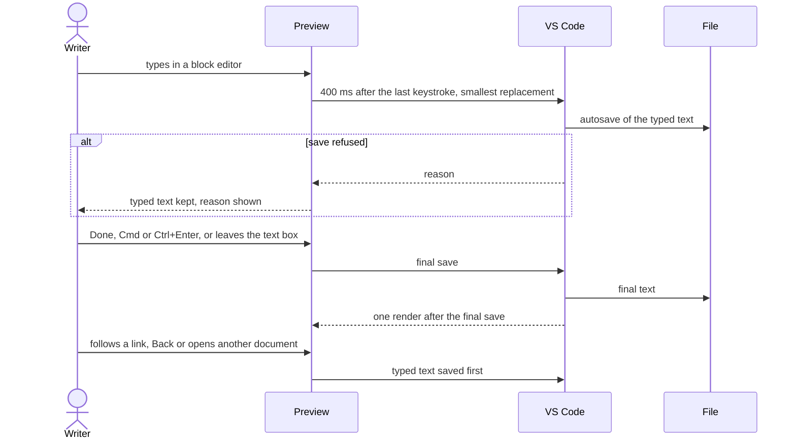

## Typed text is saved, survives updates and is never lost on leaving

### Normative behavior

While a writer types in a block editor, the Studio SHALL write the text into the document shortly after the last keystroke, keep the editor, its text and its caret whatever else changes in the preview, apply Done, Ctrl or Cmd+Enter or leaving the text box as keeping the text and Cancel or Escape as restoring the block, and save and close every open editor before the preview switches to another document.

### Preserved stakeholder intent

Writers expect typing in the preview to be as safe as typing in the text editor.

Writers expect one clear way to keep an edit and one to drop it, with no stray changes left in the file.

Writers expect the preview to stay still while they type, and to be told when a change elsewhere in the file overlaps their block.

Writers expect navigation never to throw away their last words, and expect the page not to jump while they edit.

As a writer, I never lose the text I typed in the preview, saved to my Markdown file as I type; I keep it or drop it with one clear action; and I leave the block, the file or the window with my last words saved first.

### Rationale and constraints

- The text is saved after a short pause in typing, and only what changed is written.
- The preview does not render again while the editor is open.
- Moving the focus into the palette, the link panel, the figure form or a native dialog is not leaving the editor.
- An editor whose text is unchanged closes without a message.
- Changes to the preview wait until the editor closes, then the newest one is shown; the Refresh command forces one refresh over an open editor.
- A change elsewhere in the file before the block moves the edit with it; a change inside the block ends the edit with an error and keeps the text.
- The page also sends a pending autosave at once when the window is hidden or closed.
- A save refused during the switch shows a warning that names the block and says the text was not saved; the open editors are saved before the page hides or leaves the document (see SwRS-MDOKFSTUDIO-BLOCK-205).
- Opening the editor with its edition palette does not move the text I clicked, and closing it does not move the page.
- After a save the edited block is shown at the same place on the screen.

### Use case diagram

Typing in a block editor, then finishing or leaving the document.

### Main paths

#### Path 1: Type, then finish

1. A block editor is open
   - SwRS-MDOKFSTUDIO-BLOCK-042: 400 milliseconds after the last keystroke the text is autosaved as the smallest single replacement
   - Option SwRS-MDOKFSTUDIO-BLOCK-042 (boundary): an autosave of unchanged text sends nothing
   - Option SwRS-MDOKFSTUDIO-BLOCK-193 (nominal): a render that arrives while the editor is open waits
   - Option SwRS-MDOKFSTUDIO-BLOCK-216 (refusal): a refused save keeps the typed text and says why
2. The typed text is in the document
   - SwRS-MDOKFSTUDIO-BLOCK-047: Done, Cmd or Ctrl+Enter, or leaving the text box commits the edit
   - Option SwRS-MDOKFSTUDIO-BLOCK-047 (refusal): the host refuses the final save
   - Option SwRS-MDOKFSTUDIO-BLOCK-053 (nominal): Cancel or Escape restores the saved text
3. The final text is saved
   - SwRS-MDOKFSTUDIO-BLOCK-058: the preview renders once after the final save
4. The preview shows the saved block once

#### Path 2: Leave while typing

1. A block editor is open
   - SwRS-MDOKFSTUDIO-BLOCK-205: a followed link, Back or another document saves the typed text first
2. The typed text is saved before the page leaves the document

<!-- okf:links:start -->
### Links

<!-- Generated from the frontmatter relations; edit them instead. -->

- Derived by:
  - [SwRS-MDOKFSTUDIO-BLOCK-042](../../swrs/block-editing/SwRS-MDOKFSTUDIO-BLOCK-042.md): Typing is autosaved as the smallest single replacement
  - [SwRS-MDOKFSTUDIO-BLOCK-047](../../swrs/block-editing/SwRS-MDOKFSTUDIO-BLOCK-047.md): Done, Cmd/Ctrl+Enter or leaving the text box commits the edit
  - [SwRS-MDOKFSTUDIO-BLOCK-053](../../swrs/block-editing/SwRS-MDOKFSTUDIO-BLOCK-053.md): Cancel and Escape restore the saved text
  - [SwRS-MDOKFSTUDIO-BLOCK-058](../../swrs/block-editing/SwRS-MDOKFSTUDIO-BLOCK-058.md): Every host source edit is one undo step, renders once and reports a failed apply
  - [SwRS-MDOKFSTUDIO-BLOCK-191](../../swrs/block-editing/SwRS-MDOKFSTUDIO-BLOCK-191.md): The host holds an open block edit and ends it when the block changes
  - [SwRS-MDOKFSTUDIO-BLOCK-193](../../swrs/block-editing/SwRS-MDOKFSTUDIO-BLOCK-193.md): Page updates wait while an inline editor is open
  - [SwRS-MDOKFSTUDIO-BLOCK-205](../../swrs/block-editing/SwRS-MDOKFSTUDIO-BLOCK-205.md): Open editors are saved before the page hides or leaves the document
  - [SwRS-MDOKFSTUDIO-BLOCK-216](../../swrs/block-editing/SwRS-MDOKFSTUDIO-BLOCK-216.md): A refused open or save keeps the typed text and says why
  - [SwRS-MDOKFSTUDIO-BLOCK-228](../../swrs/block-editing/SwRS-MDOKFSTUDIO-BLOCK-228.md): Opening, saving and closing an editor keep the reading position
  - [SwRS-MDOKFSTUDIO-BLOCK-244](../../swrs/block-editing/SwRS-MDOKFSTUDIO-BLOCK-244.md): previewEditClosed carries the id of the closed editor
  - [SwRS-MDOKFSTUDIO-BLOCK-245](../../swrs/block-editing/SwRS-MDOKFSTUDIO-BLOCK-245.md): previewEditFlushed carries the flush id and a flag
  - [SwRS-MDOKFSTUDIO-BLOCK-256](../../swrs/block-editing/SwRS-MDOKFSTUDIO-BLOCK-256.md): The host refuses a block edit whose first line is blank
  - [SwRS-MDOKFSTUDIO-TRUST-005](../../swrs/trust-security/SwRS-MDOKFSTUDIO-TRUST-005.md): The host handles the write requests of every preview, whatever the trust
  - [SwRS-MDOKFSTUDIO-TRUST-064](../../swrs/trust-security/SwRS-MDOKFSTUDIO-TRUST-064.md): Flush and editor watch messages are addressed by their own id
  - [SwRS-MDOKFSTUDIO-TRUST-065](../../swrs/trust-security/SwRS-MDOKFSTUDIO-TRUST-065.md): A page message is matched to the shown render or document by the gate of its type
- Depends on:
  - [SwRS-MDOKFSTUDIO-BLOCK-041](../../swrs/block-editing/SwRS-MDOKFSTUDIO-BLOCK-041.md): One edit at a time: an open editor blocks other edits, opens and refreshes
<!-- okf:links:end -->
