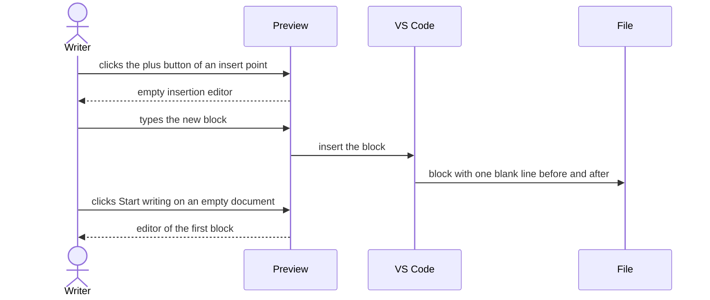

## A writer adds blocks and starts an empty document from the preview

### Normative behavior

When a writer clicks the insert point after a block in edit mode, or opens the preview of a document with no body in edit mode and uses the Start writing button or the Enter key, the Studio SHALL open an empty editor at that place and insert the typed text as a new block with one blank line on each side. When a writer types in a blank-line block of edit mode, the Studio SHALL write the typed text in place of that one blank line and keep the other blank lines around it, adding a blank line before or after the text only where Markdown needs one to separate it from a neighbouring block.

### Preserved stakeholder intent

Writers expect to extend a document from the preview, also after a figure or an image that ends the file.

Writers expect an empty document to be as easy to start as any other.

As a writer, I add a paragraph, a list or a heading between two blocks, or after the last one, and I open an empty file, or a file with only metadata, and start writing from the preview, without opening the text editor.

### Rationale and constraints

- Whitespace-only text inserts nothing and cancelling an inserted block removes it.
- A document with Windows line endings gets Windows line endings in the inserted text.
- The Start writing button is not offered when the render failed.
- Escape in the first editor brings the button back.

### Use case diagram

Adding a block between two blocks and starting an empty document.

### Main paths

#### Path S1: Add a block between two blocks

1. Edit mode is on
   - SwRS-MDOKFSTUDIO-BLOCK-087: the writer clicks the plus button of an insert point and an empty insertion editor opens
   - Option SwRS-MDOKFSTUDIO-BLOCK-087 (boundary): the properties table has an insert point too
2. An empty insertion editor is open
   - SwRS-MDOKFSTUDIO-BLOCK-094: the host writes the new block with one blank line before it and one after it
   - Option SwRS-MDOKFSTUDIO-BLOCK-094 (refusal): a whitespace-only new block writes nothing
3. The new block is in the document between its neighbours

#### Path S2: Start an empty document

1. Edit mode is on and the body of the document is empty
   - SwRS-MDOKFSTUDIO-BLOCK-102: the writer clicks Start writing and the editor of the first block opens
   - Option SwRS-MDOKFSTUDIO-BLOCK-253 (nominal): Enter on the selected Start writing button opens the same editor
2. The editor of the first block is open

#### Path S3: Write on a blank line

1. Edit mode is on and the document has extra blank lines
   - SwRS-MDOKFSTUDIO-BLOCK-266: each extra blank line shows as a blank-line block
2. A blank-line block is shown
   - SwRS-MDOKFSTUDIO-BLOCK-268: the writer types in it and the host writes the text in place of that one blank line, keeping the other blank lines
   - Option SwRS-MDOKFSTUDIO-BLOCK-269 (nominal): Delete removes that one blank line
3. The typed text is in the document where the blank line was

<!-- okf:links:start -->
### Links

<!-- Generated from the frontmatter relations; edit them instead. -->

- Derived by:
  - [SwRS-MDOKFSTUDIO-BLOCK-087](../../swrs/block-editing/SwRS-MDOKFSTUDIO-BLOCK-087.md): Edit mode places an insert point with a plus button after every body block
  - [SwRS-MDOKFSTUDIO-BLOCK-094](../../swrs/block-editing/SwRS-MDOKFSTUDIO-BLOCK-094.md): The host inserts a new block with clean blank lines
  - [SwRS-MDOKFSTUDIO-BLOCK-102](../../swrs/block-editing/SwRS-MDOKFSTUDIO-BLOCK-102.md): An empty body offers one Start writing button
  - [SwRS-MDOKFSTUDIO-BLOCK-253](../../swrs/block-editing/SwRS-MDOKFSTUDIO-BLOCK-253.md): Start writing is the keyboard selection of an empty document
  - [SwRS-MDOKFSTUDIO-BLOCK-264](../../swrs/block-editing/SwRS-MDOKFSTUDIO-BLOCK-264.md): An emptied top-level block or list item is deleted with its separator when the writer commits it
  - [SwRS-MDOKFSTUDIO-BLOCK-265](../../swrs/block-editing/SwRS-MDOKFSTUDIO-BLOCK-265.md): Delete block deletes the blocks of a selection with one separator in one undo step
  - [SwRS-MDOKFSTUDIO-BLOCK-266](../../swrs/block-editing/SwRS-MDOKFSTUDIO-BLOCK-266.md): Edit mode shows each shown blank line as a blank-line block
  - [SwRS-MDOKFSTUDIO-BLOCK-267](../../swrs/block-editing/SwRS-MDOKFSTUDIO-BLOCK-267.md): A blank-line block takes the arrows, Enter and a click
  - [SwRS-MDOKFSTUDIO-BLOCK-268](../../swrs/block-editing/SwRS-MDOKFSTUDIO-BLOCK-268.md): Typing or pasting in a blank-line block writes the text in place of that blank line
  - [SwRS-MDOKFSTUDIO-BLOCK-269](../../swrs/block-editing/SwRS-MDOKFSTUDIO-BLOCK-269.md): Removing a blank-line block removes that one blank line
<!-- okf:links:end -->
