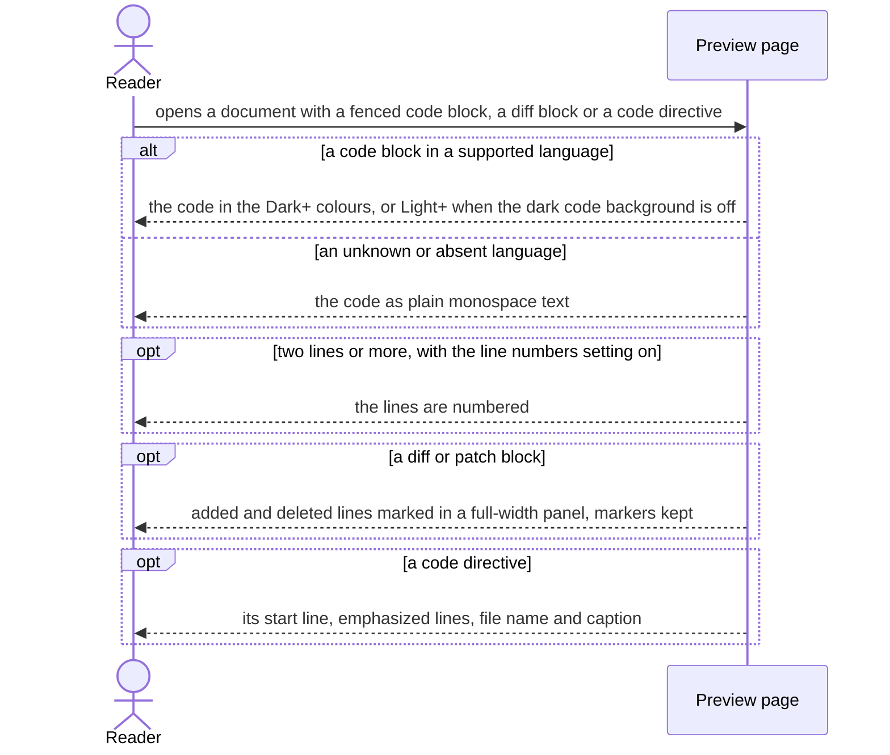

## A reader reads highlighted, numbered and diff code

### Normative behavior

When a writer previews a document with a fenced code block, a diff or patch block or a MyST code directive, the Studio SHALL show the code literally, with syntax highlighting in the Dark+ colours (Light+ when the dark code background setting is off) for a supported language, line numbers on a block of two lines or more when the line numbers setting is on, distinct treatments for added and deleted lines of a diff, and the line numbers, emphasized lines, file name and caption that a directive sets.

### Preserved stakeholder intent

Writers need code samples to read as they would in published documentation, in the language and colours of their editor. Reviewers need to see what a change adds and removes at a glance, and authors need listings that point readers at specific lines and name their source.

### Rationale and constraints

- Unsupported languages stay plain monospace text.
- Highlighting does not follow the VS Code theme: code uses the Dark+ colours in every preview theme, or the Light+ colours when the dark code background setting is off.
- A diff is a visualization only: no comparison and no per-line navigation. The literal markers stay in the text.
- Plain fences of two lines or more are numbered when the line numbers setting is on, which is the default. A MyST code directive also sets its start line, emphasized lines, file name and caption.

### Use case diagram

### Main paths

#### Path 1: Read highlighted code

1. A document holds a fenced code block
   - SwRS-MDOKFSTUDIO-CODE-001: the preview colours the keywords, strings, numbers and comments of the language named by the fence label
   - Option SwRS-MDOKFSTUDIO-CODE-001 (refusal): an unknown or absent language stays plain text
2. The code is coloured
   - SwRS-MDOKFSTUDIO-CODE-039: with the line numbers setting on, a block of two lines or more is numbered
   - Option SwRS-MDOKFSTUDIO-CODE-039 (boundary): a single line is never numbered
3. The lines of the code are numbered

#### Path 2: Review a diff

1. A document holds a diff block
   - SwRS-MDOKFSTUDIO-CODE-008: lines starting with + are marked as additions and lines starting with - as deletions
   - Option SwRS-MDOKFSTUDIO-CODE-008 (boundary): the first character decides the mark
2. Additions and deletions are marked in a full-width panel

<!-- okf:links:start -->
### Links

<!-- Generated from the frontmatter relations; edit them instead. -->

- Derived by:
  - [SwRS-MDOKFSTUDIO-CODE-001](../../swrs/code-blocks/SwRS-MDOKFSTUDIO-CODE-001.md): Fenced code in a supported language is highlighted, other code stays literal
  - [SwRS-MDOKFSTUDIO-CODE-002](../../swrs/code-blocks/SwRS-MDOKFSTUDIO-CODE-002.md): Resolve common fence labels to a supported grammar
  - [SwRS-MDOKFSTUDIO-CODE-003](../../swrs/code-blocks/SwRS-MDOKFSTUDIO-CODE-003.md): Read the fence label case-insensitively up to its first separator
  - [SwRS-MDOKFSTUDIO-CODE-004](../../swrs/code-blocks/SwRS-MDOKFSTUDIO-CODE-004.md): Leave unknown-language code as plain text
  - [SwRS-MDOKFSTUDIO-CODE-005](../../swrs/code-blocks/SwRS-MDOKFSTUDIO-CODE-005.md): Numbered, emphasized and diff blocks are wrapped into lines
  - [SwRS-MDOKFSTUDIO-CODE-006](../../swrs/code-blocks/SwRS-MDOKFSTUDIO-CODE-006.md): Show special characters once in highlighted code
  - [SwRS-MDOKFSTUDIO-CODE-007](../../swrs/code-blocks/SwRS-MDOKFSTUDIO-CODE-007.md): Code blocks use one font scale, one box and scroll long lines
  - [SwRS-MDOKFSTUDIO-CODE-008](../../swrs/code-blocks/SwRS-MDOKFSTUDIO-CODE-008.md): Diff blocks show additions and deletions
  - [SwRS-MDOKFSTUDIO-CODE-009](../../swrs/code-blocks/SwRS-MDOKFSTUDIO-CODE-009.md): Colour diff file header lines like ordinary lines
  - [SwRS-MDOKFSTUDIO-CODE-010](../../swrs/code-blocks/SwRS-MDOKFSTUDIO-CODE-010.md): Use system colours for diff lines in forced-colours mode
  - [SwRS-MDOKFSTUDIO-CODE-011](../../swrs/code-blocks/SwRS-MDOKFSTUDIO-CODE-011.md): Number and emphasize lines of MyST code directives
  - [SwRS-MDOKFSTUDIO-CODE-012](../../swrs/code-blocks/SwRS-MDOKFSTUDIO-CODE-012.md): Style fenced code blocks with one font scale and the code background
  - [SwRS-MDOKFSTUDIO-CODE-013](../../swrs/code-blocks/SwRS-MDOKFSTUDIO-CODE-013.md): Scroll long code lines inside their block
  - [SwRS-MDOKFSTUDIO-CODE-014](../../swrs/code-blocks/SwRS-MDOKFSTUDIO-CODE-014.md): A code directive shows its file name or caption above the code
  - [SwRS-MDOKFSTUDIO-CODE-015](../../swrs/code-blocks/SwRS-MDOKFSTUDIO-CODE-015.md): Render a captioned code directive as a figure with a reference target
  - [SwRS-MDOKFSTUDIO-CODE-016](../../swrs/code-blocks/SwRS-MDOKFSTUDIO-CODE-016.md): Keep code backgrounds soft and readable in the forced white and cream themes
  - [SwRS-MDOKFSTUDIO-CODE-028](../../swrs/code-blocks/SwRS-MDOKFSTUDIO-CODE-028.md): Join a code caption to its block as a title bar
  - [SwRS-MDOKFSTUDIO-CODE-030](../../swrs/code-blocks/SwRS-MDOKFSTUDIO-CODE-030.md): Never highlight inline code
  - [SwRS-MDOKFSTUDIO-CODE-031](../../swrs/code-blocks/SwRS-MDOKFSTUDIO-CODE-031.md): Show fenced code text literally
  - [SwRS-MDOKFSTUDIO-CODE-036](../../swrs/code-blocks/SwRS-MDOKFSTUDIO-CODE-036.md): Show diff blocks as a full-width square panel
  - [SwRS-MDOKFSTUDIO-CODE-037](../../swrs/code-blocks/SwRS-MDOKFSTUDIO-CODE-037.md): Fall back to escaped text lines when a grammar fails
  - [SwRS-MDOKFSTUDIO-CODE-038](../../swrs/code-blocks/SwRS-MDOKFSTUDIO-CODE-038.md): Colour YAML code text with the link colour in the forced white and cream themes
  - [SwRS-MDOKFSTUDIO-CODE-039](../../swrs/code-blocks/SwRS-MDOKFSTUDIO-CODE-039.md): Code lines are numbered and emphasized
  - [SwRS-MDOKFSTUDIO-CODE-040](../../swrs/code-blocks/SwRS-MDOKFSTUDIO-CODE-040.md): Code blocks sit on a dark Dark+ background in every preview theme by a setting
  - [SwRS-MDOKFSTUDIO-CORE-028](../../swrs/rendering-core/SwRS-MDOKFSTUDIO-CORE-028.md): Body text, headings, lists and block quotes are typeset readably
  - [SwRS-MDOKFSTUDIO-CORE-089](../../swrs/rendering-core/SwRS-MDOKFSTUDIO-CORE-089.md): Inline code is a readable tinted pill in text, links, tables and forced themes
- Supersedes:
  - [StRS-MDOKFSTUDIO-CODE-002](StRS-MDOKFSTUDIO-CODE-002.md): Read diffs as additions and deletions
  - [StRS-MDOKFSTUDIO-CODE-003](StRS-MDOKFSTUDIO-CODE-003.md): Read numbered, emphasized and captioned listings
<!-- okf:links:end -->
