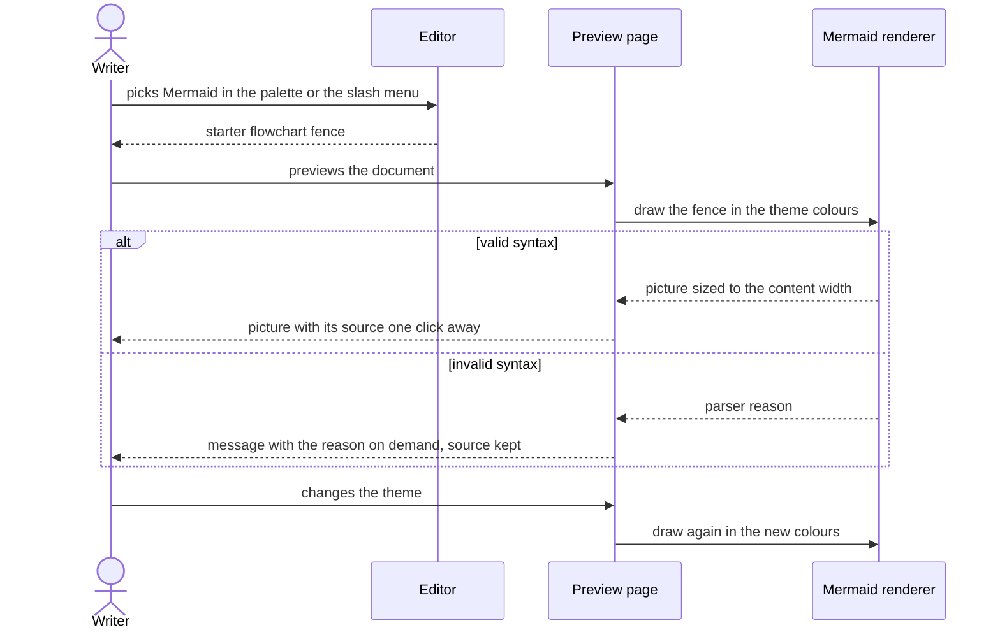

## A writer reads and inserts Mermaid diagrams that follow the theme

### Normative behavior

When a writer previews a document with a Mermaid fence or directive, or picks Mermaid in the edition palette or the slash menu, the Studio SHALL draw the diagram as a picture sized to the content width in the colours of the preview theme, keep its source available, show a message with the parser reason on demand when the syntax is invalid, and insert a starter flowchart fence that renders at once.

### Preserved stakeholder intent

Writers expect a Mermaid diagram written in a fence or a directive to appear as a picture in the preview with the text still reachable. Readers expect diagrams to look like part of the page in every preview theme, with every label legible. Writers expect typing, saving or an outside change not to make every diagram flash or vanish. They expect a clear, non-destructive signal when a diagram does not parse, and a valid starting diagram from the edit tools rather than a blank fence.

### Rationale and constraints

- Reading: a `mermaid` fence and a `{mermaid}` directive both produce the diagram, with its source in a collapsed "Diagram source" disclosure. The picture is drawn at its natural size, never enlarged, and scaled down to the content width.
- The renderer is loaded only when the document holds a Mermaid diagram, from the extension bundle and under the page's Content Security Policy.
- The picture is inert: scripts and links inside the diagram do nothing. Page tools leave diagrams alone, and a diagram being edited in the preview is hidden until the editor closes.
- Theme: the colours come from the preview theme variables and the diagrams are drawn again when the theme mode changes; when a variable is missing a built-in fallback keeps the diagram readable.
- Typing: unchanged diagrams stay drawn after a content patch and only new or changed ones are drawn.
- Failure: one message says the diagram could not be drawn and a collapsed section holds the parser's reason as plain text, never HTML; the source stays available.
- Insert: the "Mermaid" button and the "/Mermaid" slash entry insert a starter flowchart fence, in the GFM palette mode only.
- Message strings, limits and known issues are in the SwRS of each behaviour.

### Use case diagram

### Main paths

#### Path S1: Insert a diagram and read it

1. Edit mode is on with the GFM palette
   - SwRS-MDOKFSTUDIO-DIAG-017: the writer picks Mermaid and a starter flowchart fence is inserted with Start selected
   - Option SwRS-MDOKFSTUDIO-DIAG-017 (refusal): the Strict or MyST palette offers no Mermaid
2. A Mermaid fence is in the document
   - SwRS-MDOKFSTUDIO-DIAG-001: the preview renders the fence as one picture with its source in a collapsed "Diagram source" disclosure
   - Option SwRS-MDOKFSTUDIO-DIAG-001 (boundary): an empty fence is left blank, with no message
3. The diagram is drawn as a picture
   - SwRS-MDOKFSTUDIO-DIAG-005: the reader changes the theme
   - Option SwRS-MDOKFSTUDIO-DIAG-005 (boundary): the colours stay the same, nothing is redrawn
   - Option SwRS-MDOKFSTUDIO-DIAG-009 (nominal): a content update that replaces the node keeps the earlier picture
4. The diagram is redrawn in the new theme, labels kept

#### Path S2: Break a diagram

1. A Mermaid fence holds invalid syntax
   - SwRS-MDOKFSTUDIO-DIAG-015: the page cannot draw it and shows one message with a collapsed "Show the parser error" section
   - Option SwRS-MDOKFSTUDIO-DIAG-015 (boundary): a reason that holds markup is shown as text
2. A parser message shows and the source stays available

<!-- okf:links:start -->
### Links

<!-- Generated from the frontmatter relations; edit them instead. -->

- Derived by:
  - [SwRS-MDOKFSTUDIO-DIAG-001](../../swrs/diagrams/SwRS-MDOKFSTUDIO-DIAG-001.md): Mermaid fences become inert diagram pictures
  - [SwRS-MDOKFSTUDIO-DIAG-002](../../swrs/diagrams/SwRS-MDOKFSTUDIO-DIAG-002.md): The Mermaid renderer loads only when a Mermaid figure exists
  - [SwRS-MDOKFSTUDIO-DIAG-003](../../swrs/diagrams/SwRS-MDOKFSTUDIO-DIAG-003.md): Mermaid diagrams are drawn as inert pictures
  - [SwRS-MDOKFSTUDIO-DIAG-004](../../swrs/diagrams/SwRS-MDOKFSTUDIO-DIAG-004.md): Mermaid pictures keep their natural size within the content width
  - [SwRS-MDOKFSTUDIO-DIAG-005](../../swrs/diagrams/SwRS-MDOKFSTUDIO-DIAG-005.md): Mermaid colours follow the preview theme
  - [SwRS-MDOKFSTUDIO-DIAG-006](../../swrs/diagrams/SwRS-MDOKFSTUDIO-DIAG-006.md): Mermaid diagrams are drawn again when the theme changes
  - [SwRS-MDOKFSTUDIO-DIAG-007](../../swrs/diagrams/SwRS-MDOKFSTUDIO-DIAG-007.md): Mermaid falls back to built-in colours
  - [SwRS-MDOKFSTUDIO-DIAG-008](../../swrs/diagrams/SwRS-MDOKFSTUDIO-DIAG-008.md): Mermaid edge labels stay readable
  - [SwRS-MDOKFSTUDIO-DIAG-009](../../swrs/diagrams/SwRS-MDOKFSTUDIO-DIAG-009.md): Diagrams are drawn once per source and theme and late results are dropped
  - [SwRS-MDOKFSTUDIO-DIAG-010](../../swrs/diagrams/SwRS-MDOKFSTUDIO-DIAG-010.md): The Mermaid drawing cache keeps 64 drawings
  - [SwRS-MDOKFSTUDIO-DIAG-011](../../swrs/diagrams/SwRS-MDOKFSTUDIO-DIAG-011.md): A content patch draws only Mermaid diagrams not yet drawn
  - [SwRS-MDOKFSTUDIO-DIAG-012](../../swrs/diagrams/SwRS-MDOKFSTUDIO-DIAG-012.md): Mermaid draw passes run one at a time
  - [SwRS-MDOKFSTUDIO-DIAG-013](../../swrs/diagrams/SwRS-MDOKFSTUDIO-DIAG-013.md): Mermaid element ids stay unique for the page life
  - [SwRS-MDOKFSTUDIO-DIAG-014](../../swrs/diagrams/SwRS-MDOKFSTUDIO-DIAG-014.md): A late Mermaid result for a replaced theme is not shown
  - [SwRS-MDOKFSTUDIO-DIAG-015](../../swrs/diagrams/SwRS-MDOKFSTUDIO-DIAG-015.md): Invalid Mermaid shows one message with the parser reason
  - [SwRS-MDOKFSTUDIO-DIAG-016](../../swrs/diagrams/SwRS-MDOKFSTUDIO-DIAG-016.md): An invalid Mermaid diagram keeps exactly one error
  - [SwRS-MDOKFSTUDIO-DIAG-017](../../swrs/diagrams/SwRS-MDOKFSTUDIO-DIAG-017.md): The Mermaid action inserts a starter flowchart in GFM mode
  - [SwRS-MDOKFSTUDIO-DIAG-018](../../swrs/diagrams/SwRS-MDOKFSTUDIO-DIAG-018.md): Mermaid is offered in the GFM palette mode only
  - [SwRS-MDOKFSTUDIO-DIAG-019](../../swrs/diagrams/SwRS-MDOKFSTUDIO-DIAG-019.md): Comment quotes are never wrapped inside diagrams
  - [SwRS-MDOKFSTUDIO-DIAG-020](../../swrs/diagrams/SwRS-MDOKFSTUDIO-DIAG-020.md): Selecting text inside a diagram offers no comment
  - [SwRS-MDOKFSTUDIO-DIAG-021](../../swrs/diagrams/SwRS-MDOKFSTUDIO-DIAG-021.md): Diagrams can use the wider column in Auto width
  - [SwRS-MDOKFSTUDIO-DIAG-022](../../swrs/diagrams/SwRS-MDOKFSTUDIO-DIAG-022.md): A diagram under edit is hidden
  - [SwRS-MDOKFSTUDIO-DIAG-116](../../swrs/diagrams/SwRS-MDOKFSTUDIO-DIAG-116.md): A late Mermaid error for a replaced key is not shown
  - [SwRS-MDOKFSTUDIO-DIAG-129](../../swrs/diagrams/SwRS-MDOKFSTUDIO-DIAG-129.md): A diagram renderer script loads only when the page holds a figure of its engine
- Supersedes:
  - [StRS-MDOKFSTUDIO-DIAG-002](StRS-MDOKFSTUDIO-DIAG-002.md): Mermaid diagrams follow the preview theme
  - [StRS-MDOKFSTUDIO-DIAG-003](StRS-MDOKFSTUDIO-DIAG-003.md): Mermaid diagrams stay in place while typing
  - [StRS-MDOKFSTUDIO-DIAG-004](StRS-MDOKFSTUDIO-DIAG-004.md): Understand why a Mermaid diagram failed
  - [StRS-MDOKFSTUDIO-DIAG-005](StRS-MDOKFSTUDIO-DIAG-005.md): Insert a Mermaid diagram from the edit tools
<!-- okf:links:end -->
