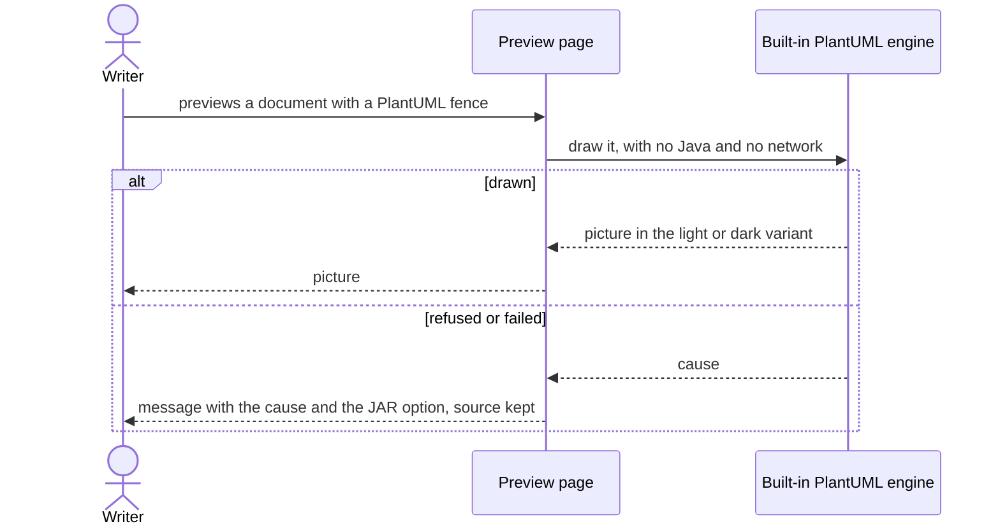

## A writer reads PlantUML diagrams without any setup

### Normative behavior

When a writer previews a document with a PlantUML fence or directive, the Studio SHALL draw it with the bundled engine, in the preview colours, without Java or network, and show a message that names the cause and the JAR option and keep the source readable when the bundled engine cannot draw it.

### Preserved stakeholder intent

Writers expect PlantUML to work from the first preview, without Java, Graphviz, a JAR, a process or network access. They expect unchanged diagrams not to be redrawn when they edit nearby text or flip the theme, and a failed or unsupported diagram to say why and how to proceed, never to disappear.

### Rationale and constraints

- Reading: `plantuml` fences and `{plantuml}` or `{uml}` directives produce a diagram, with the source in a collapsed "Diagram source" disclosure. The `@startuml` wrapper is the writer's.
- The default engine is bundled and runs in the preview page: it starts no process, reads no executable or JAR, sends nothing over the network, and works in Restricted Mode. Its script is loaded only when the page has a PlantUML diagram, under the unchanged Content Security Policy.
- Pictures follow the light or dark variant of the preview, are inert and stay inside the content width.
- The engine is pinned to an exact version of `@plantuml/core`, because earlier versions are GPL, and its licence is packaged with it.
- Typing: unchanged diagrams are kept and not drawn again; a result that was refused, or superseded by a newer render, is never shown in place of it.
- Failure: a refused directive (URL, library, `theme ... from`) shows one message naming the directive and its line, and a failed or oversized source shows its cause; both give the JAR option hint, no picture, and keep the source.
- Limits, exact messages and known issues are in the SwRS of each behaviour.

### Use case diagram

### Main paths

#### Path 1: Read a PlantUML diagram

1. The document holds a PlantUML diagram
   - SwRS-MDOKFSTUDIO-DIAG-023: the built-in engine draws the fence or directive as one inert centred picture
   - Option SwRS-MDOKFSTUDIO-DIAG-023 (boundary): the text is kept as written
   - Option SwRS-MDOKFSTUDIO-DIAG-039 (nominal): a content patch draws only the new diagrams
2. The diagram is drawn as a picture in the light or dark variant of the preview

#### Path 2: Learn why a diagram has no picture

1. The document holds a PlantUML diagram
   - SwRS-MDOKFSTUDIO-DIAG-032: the built-in engine fails or refuses a library, a URL or too long a source and shows one message that says why
   - Option SwRS-MDOKFSTUDIO-DIAG-032 (boundary): a source over 1 MiB
2. A message says why there is no picture

<!-- okf:links:start -->
### Links

<!-- Generated from the frontmatter relations; edit them instead. -->

- Derived by:
  - [SwRS-MDOKFSTUDIO-DIAG-019](../../swrs/diagrams/SwRS-MDOKFSTUDIO-DIAG-019.md): Comment quotes are never wrapped inside diagrams
  - [SwRS-MDOKFSTUDIO-DIAG-020](../../swrs/diagrams/SwRS-MDOKFSTUDIO-DIAG-020.md): Selecting text inside a diagram offers no comment
  - [SwRS-MDOKFSTUDIO-DIAG-022](../../swrs/diagrams/SwRS-MDOKFSTUDIO-DIAG-022.md): A diagram under edit is hidden
  - [SwRS-MDOKFSTUDIO-DIAG-023](../../swrs/diagrams/SwRS-MDOKFSTUDIO-DIAG-023.md): PlantUML fences become centred inert pictures drawn by the built-in engine
  - [SwRS-MDOKFSTUDIO-DIAG-024](../../swrs/diagrams/SwRS-MDOKFSTUDIO-DIAG-024.md): The useJar and jarPath settings choose the PlantUML engine
  - [SwRS-MDOKFSTUDIO-DIAG-026](../../swrs/diagrams/SwRS-MDOKFSTUDIO-DIAG-026.md): The built-in engine starts no process
  - [SwRS-MDOKFSTUDIO-DIAG-028](../../swrs/diagrams/SwRS-MDOKFSTUDIO-DIAG-028.md): The built-in PlantUML script loads only when needed
  - [SwRS-MDOKFSTUDIO-DIAG-029](../../swrs/diagrams/SwRS-MDOKFSTUDIO-DIAG-029.md): Built-in PlantUML diagrams are drawn as inert pictures
  - [SwRS-MDOKFSTUDIO-DIAG-030](../../swrs/diagrams/SwRS-MDOKFSTUDIO-DIAG-030.md): Built-in diagrams follow the light or dark preview
  - [SwRS-MDOKFSTUDIO-DIAG-031](../../swrs/diagrams/SwRS-MDOKFSTUDIO-DIAG-031.md): The built-in engine needs nothing outside the extension
  - [SwRS-MDOKFSTUDIO-DIAG-032](../../swrs/diagrams/SwRS-MDOKFSTUDIO-DIAG-032.md): The built-in engine refuses what needs a URL, a library or more than 1 MiB
  - [SwRS-MDOKFSTUDIO-DIAG-033](../../swrs/diagrams/SwRS-MDOKFSTUDIO-DIAG-033.md): The library loaders of the built-in engine refuse every request
  - [SwRS-MDOKFSTUDIO-DIAG-034](../../swrs/diagrams/SwRS-MDOKFSTUDIO-DIAG-034.md): The file loader refuses local files without a render or a host
  - [SwRS-MDOKFSTUDIO-DIAG-035](../../swrs/diagrams/SwRS-MDOKFSTUDIO-DIAG-035.md): A theme read from a folder is refused
  - [SwRS-MDOKFSTUDIO-DIAG-036](../../swrs/diagrams/SwRS-MDOKFSTUDIO-DIAG-036.md): Unsupported directives inside included files name the file
  - [SwRS-MDOKFSTUDIO-DIAG-037](../../swrs/diagrams/SwRS-MDOKFSTUDIO-DIAG-037.md): A built-in engine failure shows its reason
  - [SwRS-MDOKFSTUDIO-DIAG-038](../../swrs/diagrams/SwRS-MDOKFSTUDIO-DIAG-038.md): The built-in engine refuses a source over 1 MiB
  - [SwRS-MDOKFSTUDIO-DIAG-039](../../swrs/diagrams/SwRS-MDOKFSTUDIO-DIAG-039.md): Built-in pictures are kept by source and drawn one at a time
  - [SwRS-MDOKFSTUDIO-DIAG-040](../../swrs/diagrams/SwRS-MDOKFSTUDIO-DIAG-040.md): The built-in result cache keeps 64 results
  - [SwRS-MDOKFSTUDIO-DIAG-041](../../swrs/diagrams/SwRS-MDOKFSTUDIO-DIAG-041.md): Results with refused includes are not kept
  - [SwRS-MDOKFSTUDIO-DIAG-042](../../swrs/diagrams/SwRS-MDOKFSTUDIO-DIAG-042.md): The built-in engine draws one diagram at a time
  - [SwRS-MDOKFSTUDIO-DIAG-043](../../swrs/diagrams/SwRS-MDOKFSTUDIO-DIAG-043.md): A superseded built-in render does not overwrite a newer one
  - [SwRS-MDOKFSTUDIO-DIAG-044](../../swrs/diagrams/SwRS-MDOKFSTUDIO-DIAG-044.md): A content patch draws only new built-in diagrams
  - [SwRS-MDOKFSTUDIO-DIAG-045](../../swrs/diagrams/SwRS-MDOKFSTUDIO-DIAG-045.md): A changed included file redraws the diagrams that read files
  - [SwRS-MDOKFSTUDIO-DIAG-053](../../swrs/diagrams/SwRS-MDOKFSTUDIO-DIAG-053.md): Served include files are watched and redraw their diagrams
  - [SwRS-MDOKFSTUDIO-DIAG-079](../../swrs/diagrams/SwRS-MDOKFSTUDIO-DIAG-079.md): The built-in engine is pinned to an exact version
  - [SwRS-MDOKFSTUDIO-DIAG-080](../../swrs/diagrams/SwRS-MDOKFSTUDIO-DIAG-080.md): The built-in engine bundle and licence are packaged
  - [SwRS-MDOKFSTUDIO-DIAG-081](../../swrs/diagrams/SwRS-MDOKFSTUDIO-DIAG-081.md): PlantUML pictures are contained in the content width
  - [SwRS-MDOKFSTUDIO-DIAG-082](../../swrs/diagrams/SwRS-MDOKFSTUDIO-DIAG-082.md): PlantUML messages use the error style
  - [SwRS-MDOKFSTUDIO-DIAG-083](../../swrs/diagrams/SwRS-MDOKFSTUDIO-DIAG-083.md): The PlantUML source disclosure is styled like Mermaid's
  - [SwRS-MDOKFSTUDIO-DIAG-112](../../swrs/diagrams/SwRS-MDOKFSTUDIO-DIAG-112.md): Unsupported directives never reach the engine or the host
  - [SwRS-MDOKFSTUDIO-DIAG-115](../../swrs/diagrams/SwRS-MDOKFSTUDIO-DIAG-115.md): A theme switch between light and dark redraws built-in diagrams
  - [SwRS-MDOKFSTUDIO-DIAG-119](../../swrs/diagrams/SwRS-MDOKFSTUDIO-DIAG-119.md): PlantUML pictures are centred
- Depends on:
  - [SwRS-MDOKFSTUDIO-DIAG-009](../../swrs/diagrams/SwRS-MDOKFSTUDIO-DIAG-009.md): Diagrams are drawn once per source and theme and late results are dropped
  - [SwRS-MDOKFSTUDIO-DIAG-129](../../swrs/diagrams/SwRS-MDOKFSTUDIO-DIAG-129.md): A diagram renderer script loads only when the page holds a figure of its engine
- Supersedes:
  - [StRS-MDOKFSTUDIO-DIAG-008](StRS-MDOKFSTUDIO-DIAG-008.md): Understand why a bundled PlantUML diagram is not drawn
  - [StRS-MDOKFSTUDIO-DIAG-010](StRS-MDOKFSTUDIO-DIAG-010.md): Keep PlantUML pictures in place while typing
<!-- okf:links:end -->
