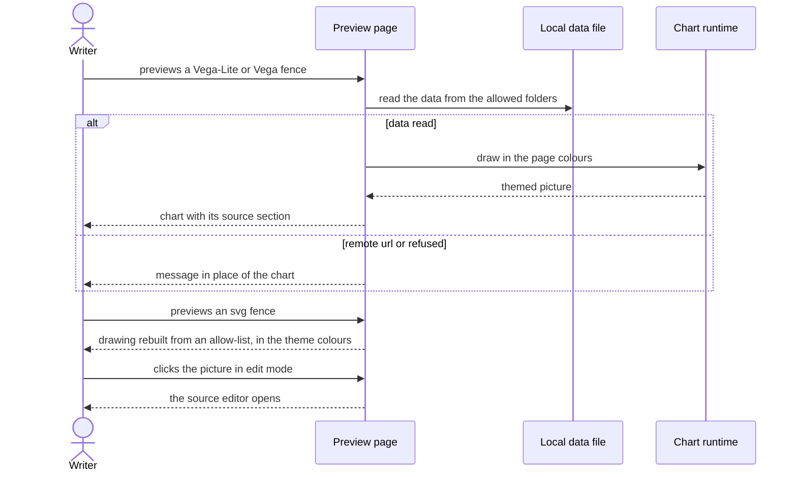

## A writer reads charts and drawings in the page

### Normative behavior

When a document holds a Vega-Lite or Vega chart fence or an inline SVG, the Studio SHALL show it themed in the page without executing or fetching anything, and lead from a click on a picture to its source.

### Preserved stakeholder intent

A writer puts a Vega-Lite or Vega chart fence (inline data, or a CSV file next to the document) or an inline SVG in the document and sees it themed in the page, with nothing executed or fetched, and a click on a picture leads to its source.

### Rationale and constraints

- The page keeps its content security policy: no code is built from a string and no request leaves the page; remote chart data is refused with a message.
- A chart data file is read under the rules of the include directive (document folder or workspace, size bound).
- An SVG is rebuilt from an allow-list; nothing that runs script or loads a resource survives.
- The charts and pictures take their colours from the preview theme, in every palette mode.

### Use case diagram

### Main paths

#### Path 1: Read a chart in the page

1. A document holds a Vega-Lite or Vega fence
   - SwRS-MDOKFSTUDIO-DIAG-121: the fence becomes a chart figure with a source section kept for the HTML export
   - Option SwRS-MDOKFSTUDIO-DIAG-122 (refusal): chart data comes only from a file inside the allowed folders; a remote url shows a message
2. The page has a chart figure
   - SwRS-MDOKFSTUDIO-DIAG-124: the chart runtime loads with the chart and needs no eval
3. The chart is drawn in the colours of the page
   - SwRS-MDOKFSTUDIO-DIAG-123: the chart is a themed live SVG with a hover detail, or the error shows in its place

#### Path 2: Read a drawing in the page

1. A document holds an svg fence or a raw svg block
   - SwRS-MDOKFSTUDIO-DIAG-125: the SVG is rebuilt from an allow-list and drawn inline
2. The drawing is in the page
   - SwRS-MDOKFSTUDIO-DIAG-126: the picture takes its colours from the preview theme
3. The writer clicks the picture in edit mode
   - SwRS-MDOKFSTUDIO-DIAG-127: the source editor of the block opens

<!-- okf:links:start -->
### Links

<!-- Generated from the frontmatter relations; edit them instead. -->

- Derived by:
  - [SwRS-MDOKFSTUDIO-DIAG-121](../../swrs/diagrams/SwRS-MDOKFSTUDIO-DIAG-121.md): Vega-Lite and Vega fences become chart figures
  - [SwRS-MDOKFSTUDIO-DIAG-122](../../swrs/diagrams/SwRS-MDOKFSTUDIO-DIAG-122.md): Chart data files are read through the resource policy
  - [SwRS-MDOKFSTUDIO-DIAG-123](../../swrs/diagrams/SwRS-MDOKFSTUDIO-DIAG-123.md): Charts are live themed SVG views with a hover detail and errors in place
  - [SwRS-MDOKFSTUDIO-DIAG-124](../../swrs/diagrams/SwRS-MDOKFSTUDIO-DIAG-124.md): Chart expressions are evaluated without eval under an unchanged policy
  - [SwRS-MDOKFSTUDIO-DIAG-125](../../swrs/diagrams/SwRS-MDOKFSTUDIO-DIAG-125.md): SVG blocks are drawn inline after the sanitizer rebuilt them
  - [SwRS-MDOKFSTUDIO-DIAG-126](../../swrs/diagrams/SwRS-MDOKFSTUDIO-DIAG-126.md): A picture takes its colours from the preview theme
  - [SwRS-MDOKFSTUDIO-DIAG-127](../../swrs/diagrams/SwRS-MDOKFSTUDIO-DIAG-127.md): A click on a picture opens its source editor
- Depends on:
  - [SwRS-MDOKFSTUDIO-DIAG-009](../../swrs/diagrams/SwRS-MDOKFSTUDIO-DIAG-009.md): Diagrams are drawn once per source and theme and late results are dropped
  - [SwRS-MDOKFSTUDIO-DIAG-129](../../swrs/diagrams/SwRS-MDOKFSTUDIO-DIAG-129.md): A diagram renderer script loads only when the page holds a figure of its engine
<!-- okf:links:end -->
