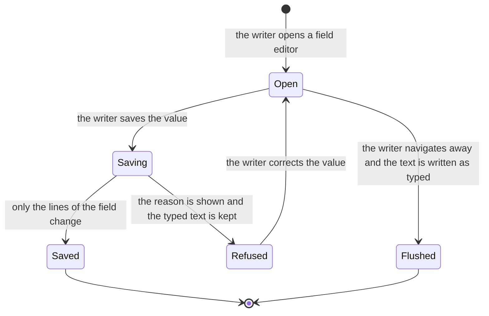

## Metadata edits keep the source intact, follow the schema and never lose text

### Normative behavior

When a writer edits a metadata field, the Studio SHALL change only the lines of that field, refuse with a reason any edit whose result would not parse, would alter other keys, does not match the schema, targets a stale preview or targets a file that VS Code holds read-only, and save typed text instead of dropping it when the writer navigates away.

### Preserved stakeholder intent

As a writer or reviewer, I expect a metadata edit to leave comments, quoting, line endings and the rest of the document unchanged, with the diff containing only the edited field; I am protected from saving metadata that the schema rejects or that no longer matches the document, and I do not lose what I typed when I follow a link or go back.

### Rationale and constraints

- Quoting style, folded or literal headers, comments, fences, the body and line endings are preserved; anchored or aliased values fall back to a whole-block rewrite.
- Every edit is re-parsed and refused when it would lose, duplicate or corrupt a key; a refusal explains itself and never leaves the document half-edited.
- Trust does not refuse a metadata edit: it works in Restricted Mode and for a file outside every workspace folder as in a trusted workspace. A file that VS Code holds read-only is refused with the reason "This file is read-only in VS Code.", as is every other write.
- The schema check covers type, enum, null and conditional rules; link problems do not block a save.
- When a writer navigates away or the preview needs to flush an open field editor, the typed text is saved as is, without the type and schema check, instead of being dropped, and a warning shows if it is refused.
- A plain save refused by the host is saved again as a flush when a navigation waits for it; a save that gets no result still lets the navigation go after a bounded wait.
- While a field editor is open, the page does not replace the properties table under it.

### Use case diagram

### Main paths

#### Path S1: Save a value without side effects

1. A field editor is open
   - SwRS-MDOKFSTUDIO-FMEDIT-043: the save changes only the lines of its field and keeps comments, quoting, spacing and line endings
   - Option SwRS-MDOKFSTUDIO-FMEDIT-043 (refusal): an edit that loses or corrupts a key is refused
   - Option SwRS-MDOKFSTUDIO-FMEDIT-016 (refusal): a value that breaks the YAML, the field type or the schema is refused and nothing changes
   - Option SwRS-MDOKFSTUDIO-FMEDIT-067 (nominal): a navigation saves the typed text as a flush
2. The value is saved on the lines of its field and the diff holds only the edited field

<!-- okf:links:start -->
### Links

<!-- Generated from the frontmatter relations; edit them instead. -->

- Derived by:
  - [SwRS-MDOKFSTUDIO-BLOCK-193](../../swrs/block-editing/SwRS-MDOKFSTUDIO-BLOCK-193.md): Page updates wait while an inline editor is open
  - [SwRS-MDOKFSTUDIO-FMEDIT-002](../../swrs/frontmatter-editing/SwRS-MDOKFSTUDIO-FMEDIT-002.md): A field editor does not open while another editor is open
  - [SwRS-MDOKFSTUDIO-FMEDIT-016](../../swrs/frontmatter-editing/SwRS-MDOKFSTUDIO-FMEDIT-016.md): The host refuses a value that breaks YAML, the field type or the schema, and ignores a malformed save message
  - [SwRS-MDOKFSTUDIO-FMEDIT-018](../../swrs/frontmatter-editing/SwRS-MDOKFSTUDIO-FMEDIT-018.md): A null value is refused for a field that is not nullable
  - [SwRS-MDOKFSTUDIO-FMEDIT-024](../../swrs/frontmatter-editing/SwRS-MDOKFSTUDIO-FMEDIT-024.md): A click on a field name renames the key
  - [SwRS-MDOKFSTUDIO-FMEDIT-025](../../swrs/frontmatter-editing/SwRS-MDOKFSTUDIO-FMEDIT-025.md): Enter or leaving the key editor renames the key
  - [SwRS-MDOKFSTUDIO-FMEDIT-029](../../swrs/frontmatter-editing/SwRS-MDOKFSTUDIO-FMEDIT-029.md): Remove field deletes exactly the lines of a non-required field
  - [SwRS-MDOKFSTUDIO-FMEDIT-030](../../swrs/frontmatter-editing/SwRS-MDOKFSTUDIO-FMEDIT-030.md): Remove field deletes exactly the lines of the field
  - [SwRS-MDOKFSTUDIO-FMEDIT-032](../../swrs/frontmatter-editing/SwRS-MDOKFSTUDIO-FMEDIT-032.md): The host refuses to remove a required field
  - [SwRS-MDOKFSTUDIO-FMEDIT-039](../../swrs/frontmatter-editing/SwRS-MDOKFSTUDIO-FMEDIT-039.md): An added field is a single inserted line in the file's line endings
  - [SwRS-MDOKFSTUDIO-FMEDIT-043](../../swrs/frontmatter-editing/SwRS-MDOKFSTUDIO-FMEDIT-043.md): A frontmatter edit changes only the lines of its field
  - [SwRS-MDOKFSTUDIO-FMEDIT-044](../../swrs/frontmatter-editing/SwRS-MDOKFSTUDIO-FMEDIT-044.md): Anchored or aliased values fall back to a whole-block rewrite
  - [SwRS-MDOKFSTUDIO-FMEDIT-045](../../swrs/frontmatter-editing/SwRS-MDOKFSTUDIO-FMEDIT-045.md): A frontmatter edit that loses or corrupts a key is refused
  - [SwRS-MDOKFSTUDIO-FMEDIT-046](../../swrs/frontmatter-editing/SwRS-MDOKFSTUDIO-FMEDIT-046.md): Values ending in three dots or dashes stay inside the block
  - [SwRS-MDOKFSTUDIO-FMEDIT-047](../../swrs/frontmatter-editing/SwRS-MDOKFSTUDIO-FMEDIT-047.md): A value that does not fit the field type is refused
  - [SwRS-MDOKFSTUDIO-FMEDIT-048](../../swrs/frontmatter-editing/SwRS-MDOKFSTUDIO-FMEDIT-048.md): A schema error on the edited field refuses the save
  - [SwRS-MDOKFSTUDIO-FMEDIT-049](../../swrs/frontmatter-editing/SwRS-MDOKFSTUDIO-FMEDIT-049.md): Only errors of the edited field block a save
  - [SwRS-MDOKFSTUDIO-FMEDIT-051](../../swrs/frontmatter-editing/SwRS-MDOKFSTUDIO-FMEDIT-051.md): A save in an untrusted workspace is refused
  - [SwRS-MDOKFSTUDIO-FMEDIT-052](../../swrs/frontmatter-editing/SwRS-MDOKFSTUDIO-FMEDIT-052.md): A save from an older render is refused with a reopen hint
  - [SwRS-MDOKFSTUDIO-FMEDIT-053](../../swrs/frontmatter-editing/SwRS-MDOKFSTUDIO-FMEDIT-053.md): A save VS Code rejects is reported
  - [SwRS-MDOKFSTUDIO-FMEDIT-054](../../swrs/frontmatter-editing/SwRS-MDOKFSTUDIO-FMEDIT-054.md): A frontmatter save message names its editor and field, or is ignored
  - [SwRS-MDOKFSTUDIO-FMEDIT-058](../../swrs/frontmatter-editing/SwRS-MDOKFSTUDIO-FMEDIT-058.md): Refresh is blocked while a field editor is open
  - [SwRS-MDOKFSTUDIO-FMEDIT-059](../../swrs/frontmatter-editing/SwRS-MDOKFSTUDIO-FMEDIT-059.md): A checkbox toggle is refused while a field editor is open
  - [SwRS-MDOKFSTUDIO-FMEDIT-060](../../swrs/frontmatter-editing/SwRS-MDOKFSTUDIO-FMEDIT-060.md): A properties update waits until the field editor closes
  - [SwRS-MDOKFSTUDIO-FMEDIT-061](../../swrs/frontmatter-editing/SwRS-MDOKFSTUDIO-FMEDIT-061.md): A content patch closes the field editor
  - [SwRS-MDOKFSTUDIO-FMEDIT-062](../../swrs/frontmatter-editing/SwRS-MDOKFSTUDIO-FMEDIT-062.md): Boundary navigation does not step into the properties table
  - [SwRS-MDOKFSTUDIO-FMEDIT-063](../../swrs/frontmatter-editing/SwRS-MDOKFSTUDIO-FMEDIT-063.md): The properties table is never part of a block selection or move
  - [SwRS-MDOKFSTUDIO-FMEDIT-064](../../swrs/frontmatter-editing/SwRS-MDOKFSTUDIO-FMEDIT-064.md): The insert point after the table has no move buttons
  - [SwRS-MDOKFSTUDIO-FMEDIT-067](../../swrs/frontmatter-editing/SwRS-MDOKFSTUDIO-FMEDIT-067.md): A navigation saves the open field editor as an unchecked flush
  - [SwRS-MDOKFSTUDIO-FMEDIT-068](../../swrs/frontmatter-editing/SwRS-MDOKFSTUDIO-FMEDIT-068.md): A flush save is written without the type and schema check
  - [SwRS-MDOKFSTUDIO-FMEDIT-069](../../swrs/frontmatter-editing/SwRS-MDOKFSTUDIO-FMEDIT-069.md): A refused flush warns that the typed text was dropped
  - [SwRS-MDOKFSTUDIO-FMEDIT-070](../../swrs/frontmatter-editing/SwRS-MDOKFSTUDIO-FMEDIT-070.md): A normal frontmatter save carries no flush flag
  - [SwRS-MDOKFSTUDIO-FMEDIT-071](../../swrs/frontmatter-editing/SwRS-MDOKFSTUDIO-FMEDIT-071.md): A refused plain save is saved again as a flush before a navigation
  - [SwRS-MDOKFSTUDIO-FMEDIT-072](../../swrs/frontmatter-editing/SwRS-MDOKFSTUDIO-FMEDIT-072.md): Block selection and block moves ignore input while a field editor is open
  - [SwRS-MDOKFSTUDIO-FMEDIT-073](../../swrs/frontmatter-editing/SwRS-MDOKFSTUDIO-FMEDIT-073.md): The figure editor and the Start writing Enter shortcut ignore input while a field editor is open
  - [SwRS-MDOKFSTUDIO-FMEDIT-079](../../swrs/frontmatter-editing/SwRS-MDOKFSTUDIO-FMEDIT-079.md): A null value is refused when a conditional rule forbids it
  - [SwRS-MDOKFSTUDIO-FMEDIT-080](../../swrs/frontmatter-editing/SwRS-MDOKFSTUDIO-FMEDIT-080.md): The figure editor and insert points ignore input while a field editor is open
  - [SwRS-MDOKFSTUDIO-FMEDIT-083](../../swrs/frontmatter-editing/SwRS-MDOKFSTUDIO-FMEDIT-083.md): A save for a missing field or revision is refused as stale
  - [SwRS-MDOKFSTUDIO-FMEDIT-085](../../swrs/frontmatter-editing/SwRS-MDOKFSTUDIO-FMEDIT-085.md): Hiding or closing the page saves the open field editor as a flush
- Depends on:
  - [SwRS-MDOKFSTUDIO-BLOCK-041](../../swrs/block-editing/SwRS-MDOKFSTUDIO-BLOCK-041.md): One edit at a time: an open editor blocks other edits, opens and refreshes
  - [SwRS-MDOKFSTUDIO-BLOCK-058](../../swrs/block-editing/SwRS-MDOKFSTUDIO-BLOCK-058.md): Every host source edit is one undo step, renders once and reports a failed apply
  - [SwRS-MDOKFSTUDIO-BLOCK-109](../../swrs/block-editing/SwRS-MDOKFSTUDIO-BLOCK-109.md): The up and down arrows of an insert point move its block
- Supersedes:
  - [StRS-MDOKFSTUDIO-FMEDIT-009](StRS-MDOKFSTUDIO-FMEDIT-009.md): Refuse metadata edits that break the schema or the document state
  - [StRS-MDOKFSTUDIO-FMEDIT-010](StRS-MDOKFSTUDIO-FMEDIT-010.md): Keep typed metadata text when leaving the editor
  - [StRS-MDOKFSTUDIO-FMEDIT-011](StRS-MDOKFSTUDIO-FMEDIT-011.md): Keep metadata editing separate from other editing
<!-- okf:links:end -->
