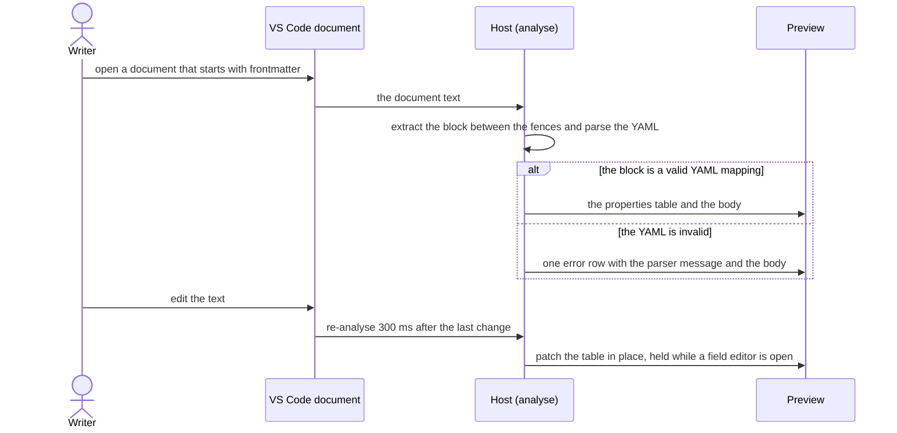

## Frontmatter appears as a readable, configurable properties table

### Normative behavior

When a writer opens a document that starts with YAML frontmatter, the Studio SHALL show it as a properties table at the top of the preview, escaping every value, in a compact YAML-like form that fits the preview width, that follows the frontmatter settings and that refreshes in place shortly after the last edit, and, when the frontmatter is invalid, explains why while the body still renders.

### Preserved stakeholder intent

As a writer, I read my document metadata as a table above the text, safely, without opening the YAML; I read values in the form I typed them, hide the Description column when I need room, turn the table off or adjust how frontmatter is checked, and see validation results update while I type.

### Rationale and constraints

- A block needs a first-line fence and a closing fence alone on its line; a document without a closing fence has no frontmatter. CRLF fences are accepted.
- Invalid YAML shows one row "Invalid frontmatter YAML: {parser message}" and an error badge of 1; a list, a scalar or an empty block shows "Invalid frontmatter YAML: Frontmatter is not a mapping."; the body of the document still renders.
- Frontmatter without a string type, or whose type has no schema, shows a generic two-column table in source key order.
- Values read like YAML in a lean table that fits the preview width and never pushes the page sideways.
- A toggle in the column headers collapses and restores the Description column; the choice survives a refresh and a narrow preview starts collapsed.
- The frontmatter table setting is a boolean, on by default; off, the body still renders and neither the table nor the raw YAML is shown.
- The frontmatter is re-analysed 300 ms after the last change; while a field editor is open the new table waits.

### Use case diagram

### Main paths

#### Path S1: Read and fold the properties

1. A document starts with a `---` line and a YAML mapping
   - SwRS-MDOKFSTUDIO-FMSCHEMA-001: the page shows the frontmatter as a properties table above the body
   - Option SwRS-MDOKFSTUDIO-FMSCHEMA-001 (refusal): YAML that does not parse shows one error row "Invalid frontmatter YAML" with the parser message, and the body still renders
   - Option SwRS-MDOKFSTUDIO-FMSCHEMA-001 (refusal): an opening fence without a closing fence
   - Option SwRS-MDOKFSTUDIO-FMSCHEMA-004 (nominal): with the propertiesTable setting off, neither the table nor the raw text shows
2. The properties table is shown
   - SwRS-MDOKFSTUDIO-FMSCHEMA-090: the writer presses the toggle next to the title and the table is hidden below the header
   - Option SwRS-MDOKFSTUDIO-FMSCHEMA-006 (nominal): each value is shown as YAML reads it, a boolean as a read-only checkbox
   - Option SwRS-MDOKFSTUDIO-FMSCHEMA-005 (nominal): without a type, a two-column Names and Values table lists the keys in source order
3. The table is hidden below its header

#### Path S2: Edit the frontmatter

1. The properties table is shown
   - SwRS-MDOKFSTUDIO-FMSCHEMA-043: the page re-analyses the frontmatter 300 ms after the last change and replaces the table
   - Option SwRS-MDOKFSTUDIO-FMSCHEMA-043 (boundary): while a field editor is open the new table is held back
2. The properties table shows the new frontmatter

<!-- okf:links:start -->
### Links

<!-- Generated from the frontmatter relations; edit them instead. -->

- Derived by:
  - [SwRS-MDOKFSTUDIO-FMSCHEMA-001](../../swrs/frontmatter-schema/SwRS-MDOKFSTUDIO-FMSCHEMA-001.md): The frontmatter block is found by its fences and parsed as a YAML mapping
  - [SwRS-MDOKFSTUDIO-FMSCHEMA-002](../../swrs/frontmatter-schema/SwRS-MDOKFSTUDIO-FMSCHEMA-002.md): A document without a closing fence has no frontmatter
  - [SwRS-MDOKFSTUDIO-FMSCHEMA-003](../../swrs/frontmatter-schema/SwRS-MDOKFSTUDIO-FMSCHEMA-003.md): Frontmatter fences accept Windows line endings
  - [SwRS-MDOKFSTUDIO-FMSCHEMA-004](../../swrs/frontmatter-schema/SwRS-MDOKFSTUDIO-FMSCHEMA-004.md): The propertiesTable setting hides the table while the body renders
  - [SwRS-MDOKFSTUDIO-FMSCHEMA-005](../../swrs/frontmatter-schema/SwRS-MDOKFSTUDIO-FMSCHEMA-005.md): Without a schema the table lists the keys in source order, escaped
  - [SwRS-MDOKFSTUDIO-FMSCHEMA-006](../../swrs/frontmatter-schema/SwRS-MDOKFSTUDIO-FMSCHEMA-006.md): Property values read like YAML in a lean table
  - [SwRS-MDOKFSTUDIO-FMSCHEMA-007](../../swrs/frontmatter-schema/SwRS-MDOKFSTUDIO-FMSCHEMA-007.md): Boolean values show as read-only checkboxes
  - [SwRS-MDOKFSTUDIO-FMSCHEMA-008](../../swrs/frontmatter-schema/SwRS-MDOKFSTUDIO-FMSCHEMA-008.md): Long lists are cut after fifty items
  - [SwRS-MDOKFSTUDIO-FMSCHEMA-009](../../swrs/frontmatter-schema/SwRS-MDOKFSTUDIO-FMSCHEMA-009.md): Empty lists and null values show as YAML tokens
  - [SwRS-MDOKFSTUDIO-FMSCHEMA-010](../../swrs/frontmatter-schema/SwRS-MDOKFSTUDIO-FMSCHEMA-010.md): The properties table has a lean frame
  - [SwRS-MDOKFSTUDIO-FMSCHEMA-011](../../swrs/frontmatter-schema/SwRS-MDOKFSTUDIO-FMSCHEMA-011.md): The table fits a narrow preview
  - [SwRS-MDOKFSTUDIO-FMSCHEMA-012](../../swrs/frontmatter-schema/SwRS-MDOKFSTUDIO-FMSCHEMA-012.md): Every table value is HTML-escaped
  - [SwRS-MDOKFSTUDIO-FMSCHEMA-013](../../swrs/frontmatter-schema/SwRS-MDOKFSTUDIO-FMSCHEMA-013.md): The properties section maps to source line 1
  - [SwRS-MDOKFSTUDIO-FMSCHEMA-014](../../swrs/frontmatter-schema/SwRS-MDOKFSTUDIO-FMSCHEMA-014.md): The Description column collapses and the choice is kept per document
  - [SwRS-MDOKFSTUDIO-FMSCHEMA-015](../../swrs/frontmatter-schema/SwRS-MDOKFSTUDIO-FMSCHEMA-015.md): The Description choice is remembered per document
  - [SwRS-MDOKFSTUDIO-FMSCHEMA-016](../../swrs/frontmatter-schema/SwRS-MDOKFSTUDIO-FMSCHEMA-016.md): Narrow previews start with the Description column collapsed
  - [SwRS-MDOKFSTUDIO-FMSCHEMA-017](../../swrs/frontmatter-schema/SwRS-MDOKFSTUDIO-FMSCHEMA-017.md): Invalid YAML gives one error row and an error badge
  - [SwRS-MDOKFSTUDIO-FMSCHEMA-018](../../swrs/frontmatter-schema/SwRS-MDOKFSTUDIO-FMSCHEMA-018.md): Frontmatter that is not a mapping gives an error row
  - [SwRS-MDOKFSTUDIO-FMSCHEMA-043](../../swrs/frontmatter-schema/SwRS-MDOKFSTUDIO-FMSCHEMA-043.md): The table is refreshed in place after edits, after the field editor closes
  - [SwRS-MDOKFSTUDIO-FMSCHEMA-044](../../swrs/frontmatter-schema/SwRS-MDOKFSTUDIO-FMSCHEMA-044.md): A new table waits while a field editor is open
  - [SwRS-MDOKFSTUDIO-FMSCHEMA-045](../../swrs/frontmatter-schema/SwRS-MDOKFSTUDIO-FMSCHEMA-045.md): A frontmatter setting change re-analyses the open previews
  - [SwRS-MDOKFSTUDIO-FMSCHEMA-075](../../swrs/frontmatter-schema/SwRS-MDOKFSTUDIO-FMSCHEMA-075.md): The body still renders when the table is off
  - [SwRS-MDOKFSTUDIO-FMSCHEMA-076](../../swrs/frontmatter-schema/SwRS-MDOKFSTUDIO-FMSCHEMA-076.md): Invalid YAML does not stop the body from rendering
  - [SwRS-MDOKFSTUDIO-FMSCHEMA-090](../../swrs/frontmatter-schema/SwRS-MDOKFSTUDIO-FMSCHEMA-090.md): The frontmatter properties table collapses under its header and is shown again on every page load
- Supersedes:
  - [StRS-MDOKFSTUDIO-FMSCHEMA-002](StRS-MDOKFSTUDIO-FMSCHEMA-002.md): Invalid frontmatter is explained and the body still renders
  - [StRS-MDOKFSTUDIO-FMSCHEMA-003](StRS-MDOKFSTUDIO-FMSCHEMA-003.md): Property values read like YAML
  - [StRS-MDOKFSTUDIO-FMSCHEMA-004](StRS-MDOKFSTUDIO-FMSCHEMA-004.md): The Description column can be collapsed
  - [StRS-MDOKFSTUDIO-FMSCHEMA-005](StRS-MDOKFSTUDIO-FMSCHEMA-005.md): Frontmatter settings control the table and apply live
  - [StRS-MDOKFSTUDIO-FMSCHEMA-013](StRS-MDOKFSTUDIO-FMSCHEMA-013.md): The table follows edits to the document
<!-- okf:links:end -->
