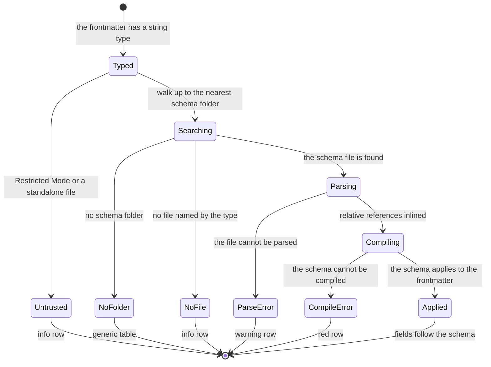

## A document finds its schema and schema problems are reported

### Normative behavior

When a document's frontmatter has a string type, the Studio SHALL look for the matching schema file in the nearest schema folder, load it in YAML, JSON or JSON5 with its references inlined, and tell the writer when none applies or when the schema cannot be used, without hiding the metadata.

### Preserved stakeholder intent

As a writer of Open Knowledge Format documents, I get schema-aware metadata simply by setting the type and learn when no schema is found; as a schema author, I write schemas in the format I prefer, reuse shared definitions, see at once that my schema is broken and why, and see my edits applied to my documents.

### Rationale and constraints

- The schema folder is the first _schema (preferred) or _schemas folder found walking up from the folder of the document to the workspace folder root; the schema file is {type}.schema.yaml, .yml, .json or .json5 whose stem equals the type, case-insensitively.
- A missing schema file shows an info row and an info badge; no schema folder gives the generic table with no info row; the info row appears only when the frontmatter has a string type.
- In Restricted Mode, and for a standalone file outside the workspace, no schema is looked up and an info row says that schema validation requires a trusted workspace.
- A relative reference that is a whole node is inlined from the schema folder; JSON5 support is minimal (comments only).
- A schema that cannot be parsed gives the generic table with a warning row, an empty schema file leaves the type without schema with an informational row, and a schema that cannot be compiled shows a red row counted as one error while the fields stay listed.
- A schema edit is used at the next analysis (a document change, refresh, re-render or settings change); open previews are not refreshed by it.

### Use case diagram

### Main paths

#### Path S1: A schema is found and loaded

1. The frontmatter has a string `type`
   - SwRS-MDOKFSTUDIO-FMSCHEMA-019: the page walks up to the nearest `_schema` folder and picks the file named by the type
   - Option SwRS-MDOKFSTUDIO-FMSCHEMA-019 (refusal): no schema folder, or no file for the type
2. A schema file is found
   - SwRS-MDOKFSTUDIO-FMSCHEMA-023: the page loads it from YAML, JSON or JSON5, inlining its relative `$ref` references
   - Option SwRS-MDOKFSTUDIO-FMSCHEMA-023 (refusal): a schema that cannot be parsed shows a row of the table
3. The schema is loaded
   - SwRS-MDOKFSTUDIO-FMSCHEMA-027: an edit of the schema is used at the next analysis, without refreshing the open preview by itself
4. The next analysis uses the new content of the schema

#### Path S2: No schema is looked up

1. The frontmatter has no string `type`
   - SwRS-MDOKFSTUDIO-FMSCHEMA-005: the page shows a two-column Names and Values table of the keys in source order
   - Option SwRS-MDOKFSTUDIO-FMSCHEMA-005 (refusal): markup in a name or a value is shown as text
2. The generic Names and Values table is shown

<!-- okf:links:start -->
### Links

<!-- Generated from the frontmatter relations; edit them instead. -->

- Derived by:
  - [SwRS-MDOKFSTUDIO-FMSCHEMA-005](../../swrs/frontmatter-schema/SwRS-MDOKFSTUDIO-FMSCHEMA-005.md): Without a schema the table lists the keys in source order, escaped
  - [SwRS-MDOKFSTUDIO-FMSCHEMA-019](../../swrs/frontmatter-schema/SwRS-MDOKFSTUDIO-FMSCHEMA-019.md): A typed document finds its schema in the nearest schema folder
  - [SwRS-MDOKFSTUDIO-FMSCHEMA-020](../../swrs/frontmatter-schema/SwRS-MDOKFSTUDIO-FMSCHEMA-020.md): The schema file is chosen by the type name
  - [SwRS-MDOKFSTUDIO-FMSCHEMA-021](../../swrs/frontmatter-schema/SwRS-MDOKFSTUDIO-FMSCHEMA-021.md): A missing schema file is reported as an info row
  - [SwRS-MDOKFSTUDIO-FMSCHEMA-022](../../swrs/frontmatter-schema/SwRS-MDOKFSTUDIO-FMSCHEMA-022.md): Schema lookup is off in Restricted Mode and for standalone files
  - [SwRS-MDOKFSTUDIO-FMSCHEMA-023](../../swrs/frontmatter-schema/SwRS-MDOKFSTUDIO-FMSCHEMA-023.md): Schemas in YAML, JSON or JSON5 with relative references compile or report a row
  - [SwRS-MDOKFSTUDIO-FMSCHEMA-024](../../swrs/frontmatter-schema/SwRS-MDOKFSTUDIO-FMSCHEMA-024.md): Relative schema references are inlined from the schema folder
  - [SwRS-MDOKFSTUDIO-FMSCHEMA-025](../../swrs/frontmatter-schema/SwRS-MDOKFSTUDIO-FMSCHEMA-025.md): A schema that cannot be parsed gives a warning row
  - [SwRS-MDOKFSTUDIO-FMSCHEMA-026](../../swrs/frontmatter-schema/SwRS-MDOKFSTUDIO-FMSCHEMA-026.md): A schema that cannot be compiled gives a red row
  - [SwRS-MDOKFSTUDIO-FMSCHEMA-027](../../swrs/frontmatter-schema/SwRS-MDOKFSTUDIO-FMSCHEMA-027.md): Schema edits are picked up on the next analysis
  - [SwRS-MDOKFSTUDIO-FMSCHEMA-028](../../swrs/frontmatter-schema/SwRS-MDOKFSTUDIO-FMSCHEMA-028.md): Editing a schema does not refresh open previews by itself
  - [SwRS-MDOKFSTUDIO-FMSCHEMA-077](../../swrs/frontmatter-schema/SwRS-MDOKFSTUDIO-FMSCHEMA-077.md): The no-lookup info row appears only for typed documents
  - [SwRS-MDOKFSTUDIO-FMSCHEMA-078](../../swrs/frontmatter-schema/SwRS-MDOKFSTUDIO-FMSCHEMA-078.md): At most 64 resolved schemas are kept
  - [SwRS-MDOKFSTUDIO-FMSCHEMA-088](../../swrs/frontmatter-schema/SwRS-MDOKFSTUDIO-FMSCHEMA-088.md): The generic table is shown when no schema lookup is made
- Supersedes:
  - [StRS-MDOKFSTUDIO-FMSCHEMA-007](StRS-MDOKFSTUDIO-FMSCHEMA-007.md): Schema files can be written in several formats and share parts
  - [StRS-MDOKFSTUDIO-FMSCHEMA-008](StRS-MDOKFSTUDIO-FMSCHEMA-008.md): Schema problems are reported without hiding the metadata
  - [StRS-MDOKFSTUDIO-FMSCHEMA-009](StRS-MDOKFSTUDIO-FMSCHEMA-009.md): Schema edits are picked up on the next analysis
<!-- okf:links:end -->
