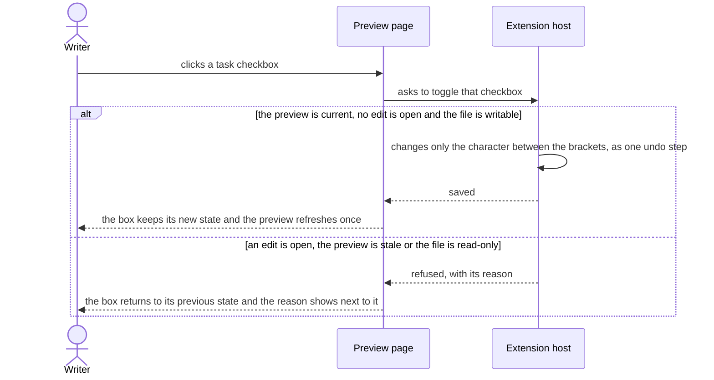

## A writer toggles task checkboxes from the preview

### Normative behavior

When a writer clicks a checkbox in the preview, the Studio SHALL change only that checkbox in the source as one undoable step, or refuse with a reason when the preview is stale or the file is read-only in VS Code, each refusal returning the box to its previous state.

### Preserved stakeholder intent

Writers and reviewers expect to tick a task checkbox without opening an editor, and expect the source to stay otherwise untouched.

### Rationale and constraints

- A toggle is refused while an edit is open, when the preview is out of date, and for a file that VS Code holds read-only; the box then returns to its previous state.

### Use case diagram

### Main paths

#### Path S1: Tick a task

1. A task-list item holds [ ]
   - SwRS-MDOKFSTUDIO-GFM-016: the page renders a checkbox in place of the bullet
   - Option SwRS-MDOKFSTUDIO-GFM-016 (refusal): a marker with another meaning stays literal
2. The task shows a checkbox
   - SwRS-MDOKFSTUDIO-GFM-021: a click edits only the character between the brackets
   - Option SwRS-MDOKFSTUDIO-GFM-021 (refusal): the host refuses the toggle, the checkbox reverts and the reason shows next to it
   - Option SwRS-MDOKFSTUDIO-BLOCK-041 (nominal): an open block editor makes the toggle refused with its reason
3. The source holds [x] for the task
   - SwRS-MDOKFSTUDIO-BLOCK-058: the edit is one undo step and the preview refreshes once
4. The checkbox is shown ticked

<!-- okf:links:start -->
### Links

<!-- Generated from the frontmatter relations; edit them instead. -->

- Derived by:
  - [SwRS-MDOKFSTUDIO-GFM-016](../../swrs/gfm/SwRS-MDOKFSTUDIO-GFM-016.md): Task list markers render as checkboxes with their source position
  - [SwRS-MDOKFSTUDIO-GFM-017](../../swrs/gfm/SwRS-MDOKFSTUDIO-GFM-017.md): Task-list checkboxes sit in the bullet gutter
  - [SwRS-MDOKFSTUDIO-GFM-018](../../swrs/gfm/SwRS-MDOKFSTUDIO-GFM-018.md): Checkbox markers stay literal where they have another meaning
  - [SwRS-MDOKFSTUDIO-GFM-019](../../swrs/gfm/SwRS-MDOKFSTUDIO-GFM-019.md): CRLF documents keep exact checkbox columns
  - [SwRS-MDOKFSTUDIO-GFM-020](../../swrs/gfm/SwRS-MDOKFSTUDIO-GFM-020.md): The webview keeps checkbox inputs
  - [SwRS-MDOKFSTUDIO-GFM-021](../../swrs/gfm/SwRS-MDOKFSTUDIO-GFM-021.md): Clicking a checkbox toggles one source character
  - [SwRS-MDOKFSTUDIO-GFM-022](../../swrs/gfm/SwRS-MDOKFSTUDIO-GFM-022.md): A checkbox toggle is one undo step
  - [SwRS-MDOKFSTUDIO-GFM-023](../../swrs/gfm/SwRS-MDOKFSTUDIO-GFM-023.md): A pending toggle blocks further clicks
  - [SwRS-MDOKFSTUDIO-GFM-024](../../swrs/gfm/SwRS-MDOKFSTUDIO-GFM-024.md): A refused toggle reverts the checkbox with a reason
  - [SwRS-MDOKFSTUDIO-GFM-025](../../swrs/gfm/SwRS-MDOKFSTUDIO-GFM-025.md): Checkbox clicks are refused during an open edit
  - [SwRS-MDOKFSTUDIO-GFM-026](../../swrs/gfm/SwRS-MDOKFSTUDIO-GFM-026.md): Read-only previews disable checkboxes
  - [SwRS-MDOKFSTUDIO-GFM-027](../../swrs/gfm/SwRS-MDOKFSTUDIO-GFM-027.md): The host validates checkbox toggle messages
  - [SwRS-MDOKFSTUDIO-GFM-028](../../swrs/gfm/SwRS-MDOKFSTUDIO-GFM-028.md): Content patches clear pending toggles
  - [SwRS-MDOKFSTUDIO-GFM-039](../../swrs/gfm/SwRS-MDOKFSTUDIO-GFM-039.md): Radio choice lists render as a radio group and a click moves the selection in the source
- Depends on:
  - [SwRS-MDOKFSTUDIO-BLOCK-041](../../swrs/block-editing/SwRS-MDOKFSTUDIO-BLOCK-041.md): One edit at a time: an open editor blocks other edits, opens and refreshes
  - [SwRS-MDOKFSTUDIO-BLOCK-058](../../swrs/block-editing/SwRS-MDOKFSTUDIO-BLOCK-058.md): Every host source edit is one undo step, renders once and reports a failed apply
<!-- okf:links:end -->
