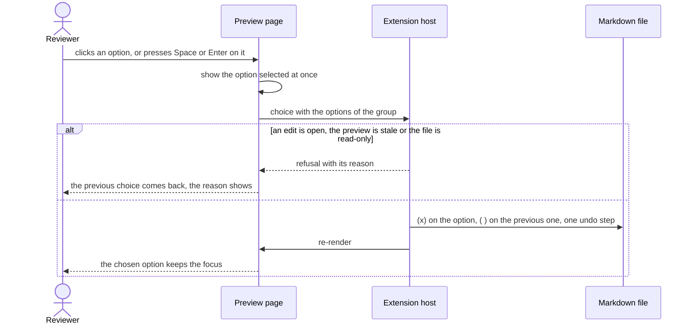

## A writer or reviewer decides between the options of a plan with one click

### Normative behavior

When a list holds radio choices written as '( )' and '(x)' items, the Studio SHALL show them as one choice group in the preview and, when the writer or reviewer picks an option, SHALL move the '(x)' to it in the source as one undoable step, or refuse with a reason and keep the previous choice.

### Preserved stakeholder intent

A reviewer of an agent's plan picks one of the '( )'/'(x)' options in the preview, and at most two source lines change in one undo step; on GitHub the text stays readable.

### Rationale and constraints

- The choice is written in plain Markdown text ('( )' and '(x)' at the start of list items), so the file stays readable where no Studio runs.
- A choice is refused while an edit is open, when the preview is out of date, and for a file that VS Code holds read-only; the previous choice then comes back and the reason shows next to the option.

### Use case diagram

### Main paths

#### Path S1: Choose a radio option

1. A list holds consecutive items that start with '( )' or '(x)'
   - SwRS-MDOKFSTUDIO-GFM-040: the page renders them as one radio group
   - Option SwRS-MDOKFSTUDIO-GFM-040 (boundary): only consecutive items form a group
2. The items are shown as a radio group
   - SwRS-MDOKFSTUDIO-GFM-041: a click on an unselected option writes '(x)' on it and '( )' on the previous one, as one undo step
   - Option SwRS-MDOKFSTUDIO-GFM-041 (refusal): an open editor or a refused choice writes nothing
3. The chosen option is selected

<!-- okf:links:start -->
### Links

<!-- Generated from the frontmatter relations; edit them instead. -->

- Derived by:
  - [SwRS-MDOKFSTUDIO-GFM-040](../../swrs/gfm/SwRS-MDOKFSTUDIO-GFM-040.md): A radio choice list renders as a radio group
  - [SwRS-MDOKFSTUDIO-GFM-041](../../swrs/gfm/SwRS-MDOKFSTUDIO-GFM-041.md): Choosing an option moves the (x)
<!-- okf:links:end -->
