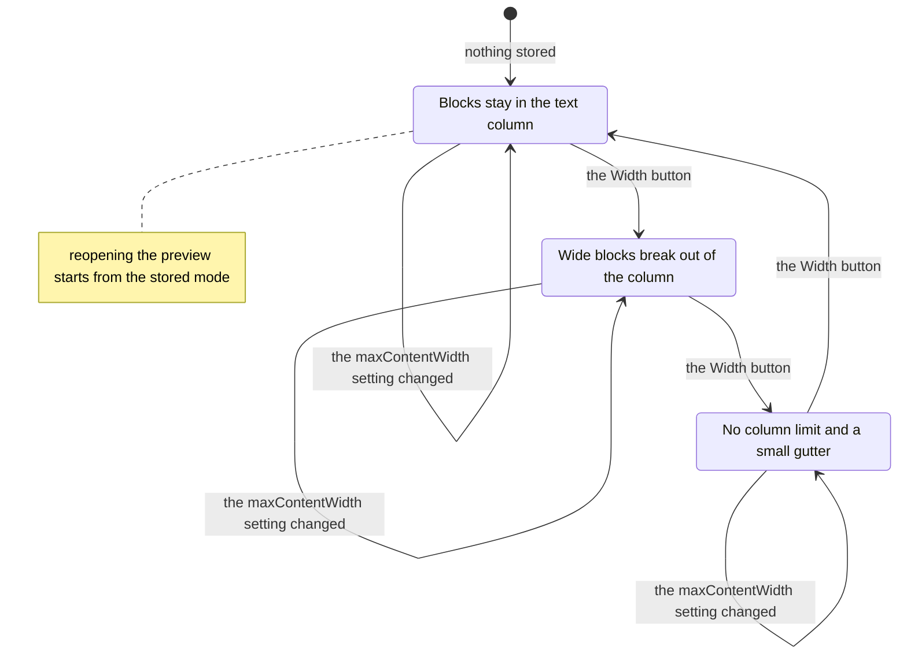

## A reader chooses how wide the text column is

### Normative behavior

When a writer or team sets the maximum width of the text column or a reader presses the Width button, the Studio SHALL limit and centre the column of every preview to that width, cycle between Margin, Auto and Full width modes, remember the mode for the workspace, and follow later changes of the setting.

### Preserved stakeholder intent

As a writer or team, I choose how wide the text column is, from a narrow measure to the whole pane, and every open preview follows; as a reader, I switch between a narrow reading column, a column that lets wide content out, and the full pane with one button, the choice is still there when I come back, I see wide tables, pictures and diagrams in full in Auto when the pane has room, and I can rely on Margin to keep everything in a readable column and on Full width to use the whole pane.

### Rationale and constraints

- The setting maxContentWidth limits and centres the column, 0 lifts the limit, an invalid value falls back to the default, and open previews follow a change without reloading the editor.
- The Width button goes Margin, Auto, Full width, then Margin again, and its icon, label and tooltip say which mode is active.
- The choice is kept for the workspace; at start the saved page state wins over the stored workspace preference, which wins over Margin.
- Margin keeps tables, code blocks and figures inside the text column; they scroll or wrap instead of leaving it.
- In Auto, a table, figure, image, code block or Mermaid diagram wider than the column uses the available width, centred and clear of the pane edges; elements that are not wider are left alone, and an element being edited keeps the column width.
- Full width removes the column limit and keeps a small gutter on each side.
- In every mode, content narrower than the column is centred at its own width and the page stays readable beside the open table of contents.

### Use case diagram

The Width button cycles the three modes, and the setting applies in each of them.

### Main paths

#### Path S1: Change the width mode

1. The text column is as wide as the setting says
   - SwRS-MDOKFSTUDIO-LAYOUT-020: the reader presses the Width button and the mode goes Margin, Auto, Full width, back to Margin, keeping the reading line
   - Option SwRS-MDOKFSTUDIO-LAYOUT-020 (boundary): no reading position is known yet
2. The width mode has changed
   - SwRS-MDOKFSTUDIO-LAYOUT-023: in Auto, a table, figure, image, code block or Mermaid diagram wider than the column is widened up to the available area
   - Option SwRS-MDOKFSTUDIO-LAYOUT-022 (nominal): in Full width the column limit is lifted and the page keeps a 16 px gutter
   - Option SwRS-MDOKFSTUDIO-LAYOUT-044 (nominal): in Auto, a table whose column minimums fit stays inside the text column
3. Wide content is drawn at the width it needs
   - SwRS-MDOKFSTUDIO-LIFE-169: the page keeps the choice in the saved panel state and the host stores it for the workspace
   - Option SwRS-MDOKFSTUDIO-LIFE-169 (refusal): the host refuses a value outside the table
4. The width choice is kept for the workspace

#### Path S2: Set the width in the settings

1. The setting maxContentWidth is changed
   - SwRS-MDOKFSTUDIO-LAYOUT-002: the page shows a text column exactly that wide, centred in a wider pane
   - Option SwRS-MDOKFSTUDIO-LAYOUT-002 (boundary): a value of 0 lifts the limit
2. The text column is as wide as the setting says

<!-- okf:links:start -->
### Links

<!-- Generated from the frontmatter relations; edit them instead. -->

- Derived by:
  - [SwRS-MDOKFSTUDIO-DIAG-021](../../swrs/diagrams/SwRS-MDOKFSTUDIO-DIAG-021.md): Diagrams can use the wider column in Auto width
  - [SwRS-MDOKFSTUDIO-LAYOUT-002](../../swrs/layout-width/SwRS-MDOKFSTUDIO-LAYOUT-002.md): The text column width follows the maxContentWidth setting
  - [SwRS-MDOKFSTUDIO-LAYOUT-003](../../swrs/layout-width/SwRS-MDOKFSTUDIO-LAYOUT-003.md): The maximum content width is rounded and capped at 2400
  - [SwRS-MDOKFSTUDIO-LAYOUT-004](../../swrs/layout-width/SwRS-MDOKFSTUDIO-LAYOUT-004.md): A width of zero lifts the column limit
  - [SwRS-MDOKFSTUDIO-LAYOUT-005](../../swrs/layout-width/SwRS-MDOKFSTUDIO-LAYOUT-005.md): Each rendered page carries the width rule
  - [SwRS-MDOKFSTUDIO-LAYOUT-006](../../swrs/layout-width/SwRS-MDOKFSTUDIO-LAYOUT-006.md): Open previews follow a change of the width setting
  - [SwRS-MDOKFSTUDIO-LAYOUT-020](../../swrs/layout-width/SwRS-MDOKFSTUDIO-LAYOUT-020.md): The Width button cycles Margin, Auto and Full and keeps the reading line
  - [SwRS-MDOKFSTUDIO-LAYOUT-021](../../swrs/layout-width/SwRS-MDOKFSTUDIO-LAYOUT-021.md): A width mode choice is saved for the workspace
  - [SwRS-MDOKFSTUDIO-LAYOUT-022](../../swrs/layout-width/SwRS-MDOKFSTUDIO-LAYOUT-022.md): Margin keeps blocks in the column and Full removes the limit
  - [SwRS-MDOKFSTUDIO-LAYOUT-023](../../swrs/layout-width/SwRS-MDOKFSTUDIO-LAYOUT-023.md): Auto width lets wide blocks break out of the column
  - [SwRS-MDOKFSTUDIO-LAYOUT-024](../../swrs/layout-width/SwRS-MDOKFSTUDIO-LAYOUT-024.md): Auto width excludes the open table-of-contents column
  - [SwRS-MDOKFSTUDIO-LAYOUT-025](../../swrs/layout-width/SwRS-MDOKFSTUDIO-LAYOUT-025.md): Auto measures a wide table uncapped and rounds up
  - [SwRS-MDOKFSTUDIO-LAYOUT-026](../../swrs/layout-width/SwRS-MDOKFSTUDIO-LAYOUT-026.md): Auto leaves edited and relatively sized elements in the column
  - [SwRS-MDOKFSTUDIO-LAYOUT-027](../../swrs/layout-width/SwRS-MDOKFSTUDIO-LAYOUT-027.md): Auto uses the author's pixel width for an image breakout
  - [SwRS-MDOKFSTUDIO-LAYOUT-028](../../swrs/layout-width/SwRS-MDOKFSTUDIO-LAYOUT-028.md): Full width removes the column limit
  - [SwRS-MDOKFSTUDIO-LAYOUT-029](../../swrs/layout-width/SwRS-MDOKFSTUDIO-LAYOUT-029.md): Narrow tables and figures are centred in every width mode
  - [SwRS-MDOKFSTUDIO-LAYOUT-030](../../swrs/layout-width/SwRS-MDOKFSTUDIO-LAYOUT-030.md): A paragraph holding only an image is marked as a figure
  - [SwRS-MDOKFSTUDIO-LAYOUT-031](../../swrs/layout-width/SwRS-MDOKFSTUDIO-LAYOUT-031.md): Auto measures wide elements again when the layout changes
  - [SwRS-MDOKFSTUDIO-LAYOUT-036](../../swrs/layout-width/SwRS-MDOKFSTUDIO-LAYOUT-036.md): A negative or non-numeric width falls back to 960
  - [SwRS-MDOKFSTUDIO-LAYOUT-038](../../swrs/layout-width/SwRS-MDOKFSTUDIO-LAYOUT-038.md): The saved width mode is restored when the page starts
  - [SwRS-MDOKFSTUDIO-LAYOUT-039](../../swrs/layout-width/SwRS-MDOKFSTUDIO-LAYOUT-039.md): Full width centres the content with gutters of at least 15 px
  - [SwRS-MDOKFSTUDIO-LAYOUT-040](../../swrs/layout-width/SwRS-MDOKFSTUDIO-LAYOUT-040.md): A width mode change keeps the reading line
  - [SwRS-MDOKFSTUDIO-LAYOUT-041](../../swrs/layout-width/SwRS-MDOKFSTUDIO-LAYOUT-041.md): A width mode change measures the first-element clearance again
  - [SwRS-MDOKFSTUDIO-LAYOUT-044](../../swrs/layout-width/SwRS-MDOKFSTUDIO-LAYOUT-044.md): Auto keeps a table in the column when its minimum widths fit
- Depends on:
  - [SwRS-MDOKFSTUDIO-LIFE-169](../../swrs/lifecycle-sync/SwRS-MDOKFSTUDIO-LIFE-169.md): A view choice made on the page is stored for the workspace
  - [SwRS-MDOKFSTUDIO-LIFE-170](../../swrs/lifecycle-sync/SwRS-MDOKFSTUDIO-LIFE-170.md): A new page starts each view choice from the panel, stored or default value
- Supersedes:
  - [StRS-MDOKFSTUDIO-LAYOUT-006](StRS-MDOKFSTUDIO-LAYOUT-006.md): One button switches the width mode
  - [StRS-MDOKFSTUDIO-LAYOUT-007](StRS-MDOKFSTUDIO-LAYOUT-007.md): Auto width lets wide content break out of the column
  - [StRS-MDOKFSTUDIO-LAYOUT-008](StRS-MDOKFSTUDIO-LAYOUT-008.md): Margin and Full width modes frame the content predictably
<!-- okf:links:end -->
