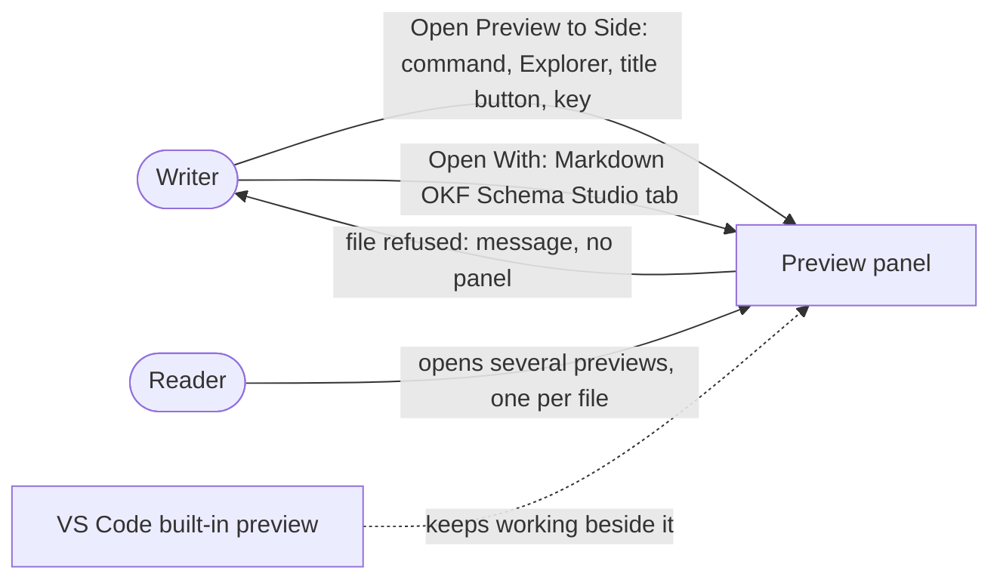

## A writer opens previews beside the editor or as tabs, beside the built-in preview

### Normative behavior

When a writer or reader asks for a preview of a Markdown file, the Studio SHALL show its rendered preview in the editor group beside the text editor, or as a tab that stays on the file for the Open With choice, while leaving the built-in Markdown preview, its commands and its settings untouched.

### Preserved stakeholder intent

As a writer, I open a rendered preview of the Markdown file I am editing beside the editor, from the command palette, the Explorer, the editor title or a keyboard shortcut; as a reader, I open a Markdown file straight as a preview in its own tab, without changing the editor that Markdown files open in by default, and I keep the built-in Markdown preview next to it without either breaking the other.

### Rationale and constraints

- Asking again for a preview reuses the preview that is already open instead of opening a second one.
- A file that is not a saved Markdown file gets an explanation instead of a preview.
- The Studio is not the default editor of Markdown files unless the reader makes it so with the editor association of VS Code (`workbench.editorAssociations`); by default the reader opts in for each file.
- The tab opens at once and fills in when the render ends.
- The Studio changes none of the built-in Markdown preview settings; its only write outside its own settings is the one-time restore of the `*.md` editor association, with the removal of the retired Studio settings.
- Files that a reader opens while the side preview has focus are shown in another editor group than the preview, so the preview is not replaced by them.
- Closing the preview releases the group it locked, but never a group that holds anything else.
- Several previews can be open at once, the side preview and one or more Open With tabs; each keeps its own state, render and file watching, and shows its own document and its own place.
- Refresh Preview acts on one preview, the newest one still open.

### Use case diagram

### Main paths

#### Path 1: Open a side preview

1. A saved Markdown file is the active editor
   - SwRS-MDOKFSTUDIO-LIFE-003: the reader runs Open Preview to Side and a preview opens beside the editor, or is revealed if one is open
   - Option SwRS-MDOKFSTUDIO-LIFE-003 (refusal): a file that is not a saved .md file opens no preview and shows a message
2. A side preview is open beside the editor
   - SwRS-MDOKFSTUDIO-LIFE-151: the preview locks its editor group, so the files the reader opens next are shown in another group
   - Option SwRS-MDOKFSTUDIO-LIFE-149 (nominal): the built-in Markdown preview, its commands and its settings stay as they were, beside the Studio preview
   - Option SwRS-MDOKFSTUDIO-LIFE-038 (nominal): several previews can be open, each with its own state and only the newest following the active editor
3. The side preview is open and the editor group is locked

#### Path 2: Open as a tab

1. A saved Markdown file is the active editor
   - SwRS-MDOKFSTUDIO-LIFE-018: the reader opens it through Open With and the file shows in a tab that keeps showing it
   - Option SwRS-MDOKFSTUDIO-LIFE-018 (refusal): a document that is not a saved Markdown file is not opened
2. The file is shown in a Studio tab

<!-- okf:links:start -->
### Links

<!-- Generated from the frontmatter relations; edit them instead. -->

- Derived by:
  - [SwRS-MDOKFSTUDIO-LIFE-001](../../swrs/lifecycle-sync/SwRS-MDOKFSTUDIO-LIFE-001.md): The extension activates only on its own entry points
  - [SwRS-MDOKFSTUDIO-LIFE-003](../../swrs/lifecycle-sync/SwRS-MDOKFSTUDIO-LIFE-003.md): Open Preview to Side opens or reveals a side preview
  - [SwRS-MDOKFSTUDIO-LIFE-010](../../swrs/lifecycle-sync/SwRS-MDOKFSTUDIO-LIFE-010.md): Open Preview to Side checks the file it is given
  - [SwRS-MDOKFSTUDIO-LIFE-018](../../swrs/lifecycle-sync/SwRS-MDOKFSTUDIO-LIFE-018.md): The Open With editor shows its own Markdown file
  - [SwRS-MDOKFSTUDIO-LIFE-038](../../swrs/lifecycle-sync/SwRS-MDOKFSTUDIO-LIFE-038.md): Each preview has its own state and only the newest follows
  - [SwRS-MDOKFSTUDIO-LIFE-127](../../swrs/lifecycle-sync/SwRS-MDOKFSTUDIO-LIFE-127.md): A restored panel reopens its document or explains why it cannot
  - [SwRS-MDOKFSTUDIO-LIFE-149](../../swrs/lifecycle-sync/SwRS-MDOKFSTUDIO-LIFE-149.md): The Studio runs beside the built-in Markdown preview
  - [SwRS-MDOKFSTUDIO-LIFE-151](../../swrs/lifecycle-sync/SwRS-MDOKFSTUDIO-LIFE-151.md): A side preview locks its editor group
  - [SwRS-MDOKFSTUDIO-LIFE-171](../../swrs/lifecycle-sync/SwRS-MDOKFSTUDIO-LIFE-171.md): The manifest declares Agents window support
  - [SwRS-MDOKFSTUDIO-TRUST-072](../../swrs/trust-security/SwRS-MDOKFSTUDIO-TRUST-072.md): The extension contributes no language, grammar or editors entry
<!-- okf:links:end -->
