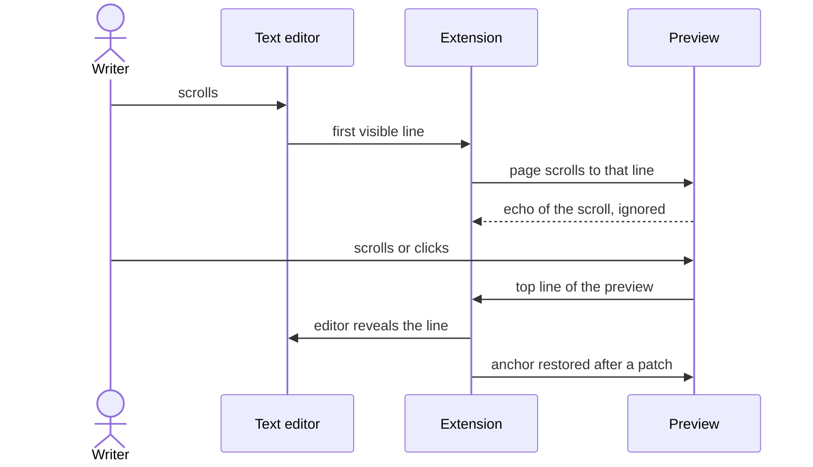

## The panes scroll together and the reading position survives updates

### Normative behavior

When a writer scrolls the text editor or a reader scrolls or clicks in the preview, the Studio SHALL bring the other pane to the same place in the document, as the scroll synchronization settings allow, and keep the preview on the same text when it updates, resizes or the text above it changes.

### Preserved stakeholder intent

As a writer, I scroll the source and the preview shows the same passage; as a reader, I scroll or click in the rendered text and the source editor shows where that text comes from; and I keep my place when images load, the pane is resized, the zoom changes or lines are added above me.

### Rationale and constraints

- Both panes share one anchor, a source line, so a long paragraph maps to the right place.
- Moving the preview because of the editor never scrolls the editor back.
- Showing the source line for the preview happens without any editor being opened for it; nothing happens when no text editor shows the file.
- Scrolling in either pane never edits the document.
- While a block or field editor is open its screen position is the anchor.
- The reader chooses in the settings whether the preview follows the editor and whether the editor follows the preview.
- A change of these settings reloads the preview page.

### Use case diagram

### Main paths

#### Path S1: Scroll one pane, the other follows

1. The editor and the preview show the same document
   - SwRS-MDOKFSTUDIO-LIFE-100: the editor is scrolled and the preview follows, as far as the setting allows
   - Option SwRS-MDOKFSTUDIO-LIFE-100 (refusal): with the setting off the preview does not follow the editor
2. The preview shows the line of the editor
   - SwRS-MDOKFSTUDIO-LIFE-108: the reader scrolls the preview or activates a block and the source line is revealed in the editor
   - Option SwRS-MDOKFSTUDIO-LIFE-108 (refusal): no visible text editor shows the file, so no editor moves
3. Both panes show the same source line

#### Path S2: The reading line survives an update

1. The preview is scrolled to a reading line
   - SwRS-MDOKFSTUDIO-LIFE-119: the page keeps its scroll anchor, a source line, through the rebuild or edit
   - Option SwRS-MDOKFSTUDIO-LIFE-119 (boundary): lines added or removed above the anchor
   - Option SwRS-MDOKFSTUDIO-LIFE-125 (nominal): the host records the reading state of each valid report
2. The same source line stays at the reading line after the update

<!-- okf:links:start -->
### Links

<!-- Generated from the frontmatter relations; edit them instead. -->

- Derived by:
  - [SwRS-MDOKFSTUDIO-LIFE-048](../../swrs/lifecycle-sync/SwRS-MDOKFSTUDIO-LIFE-048.md): A changed setting that the page reads only at startup loads a new page document
  - [SwRS-MDOKFSTUDIO-LIFE-097](../../swrs/lifecycle-sync/SwRS-MDOKFSTUDIO-LIFE-097.md): Two settings decide how the panes follow each other
  - [SwRS-MDOKFSTUDIO-LIFE-100](../../swrs/lifecycle-sync/SwRS-MDOKFSTUDIO-LIFE-100.md): Scrolling the text editor scrolls the preview to the same line
  - [SwRS-MDOKFSTUDIO-LIFE-108](../../swrs/lifecycle-sync/SwRS-MDOKFSTUDIO-LIFE-108.md): Scrolling or clicking the preview reveals the source line
  - [SwRS-MDOKFSTUDIO-LIFE-112](../../swrs/lifecycle-sync/SwRS-MDOKFSTUDIO-LIFE-112.md): A double click reveals the source line only when the double-click setting is on
  - [SwRS-MDOKFSTUDIO-LIFE-116](../../swrs/lifecycle-sync/SwRS-MDOKFSTUDIO-LIFE-116.md): A scroll or reveal report that does not name the current render moves nothing
  - [SwRS-MDOKFSTUDIO-LIFE-117](../../swrs/lifecycle-sync/SwRS-MDOKFSTUDIO-LIFE-117.md): The page ignores a source scroll for another render
  - [SwRS-MDOKFSTUDIO-LIFE-119](../../swrs/lifecycle-sync/SwRS-MDOKFSTUDIO-LIFE-119.md): Both panes share one reading anchor that survives updates
  - [SwRS-MDOKFSTUDIO-LIFE-125](../../swrs/lifecycle-sync/SwRS-MDOKFSTUDIO-LIFE-125.md): The reading state of recent documents is saved within bounds
<!-- okf:links:end -->
