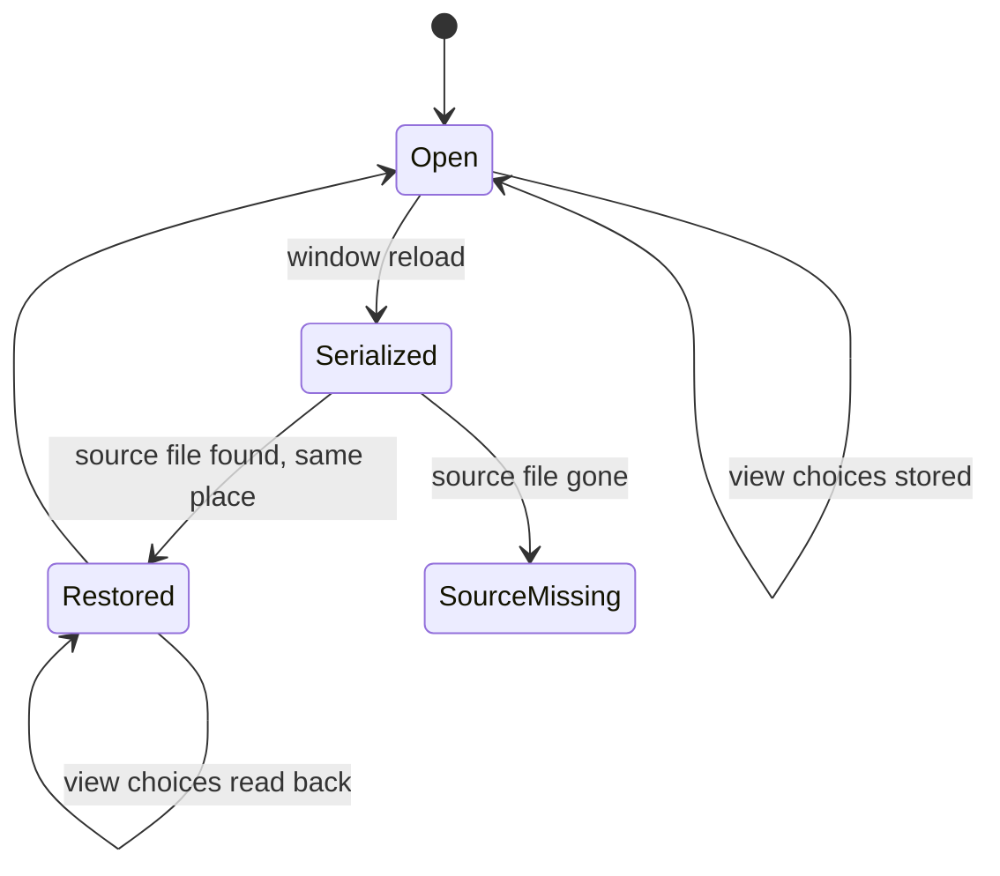

## Previews come back after a reload, and each document keeps its reading place and view choices

### Normative behavior

When VS Code restores its window or a reader returns to a document, the Studio SHALL bring the previews back on their documents at the reading state they had, give each document its own reading place and view choices, and keep the view choices the reader made for the workspace, leaving every file as it was.

### Preserved stakeholder intent

As a reader, I reload the window and my previews come back on the same documents, at the same place, with their open sections. I return to a document and find it at its own place, with its own Description choice. The view choices I made (zoom, width, table of contents and the others) are found again when I reopen a preview of the same workspace.

### Rationale and constraints

- A panel whose saved identity or source is unusable explains why instead of showing a preview.
- Only the newest restored side preview keeps following the active editor.
- A view choice only changes how the preview looks, never the document, so every preview accepts it, whatever the trust.
- A value that is not valid for its choice is refused, and a stored value that is not valid falls back to the default of that choice alone.
- The collapsed toolbar is one of these choices; the meaning of zoom and width is described in the theme-zoom and layout-width scopes.
- The remembered state is bounded so that it never grows without limit.

### Use case diagram

### Main paths

#### Path S1: A reload brings the preview back

1. A preview was open when VS Code restored its panel
   - SwRS-MDOKFSTUDIO-LIFE-127: the panel opens the file its saved state names, at the saved reading position and open sections
   - Option SwRS-MDOKFSTUDIO-LIFE-127 (refusal): a saved state that cannot be restored shows Preview source missing with the reason
2. The panel shows the file at its saved place

#### Path S2: A view choice is remembered

1. The reader changes a view choice on the page
   - SwRS-MDOKFSTUDIO-LIFE-169: the page keeps it in its saved state and the host stores it for the workspace
   - Option SwRS-MDOKFSTUDIO-LIFE-169 (refusal): the host refuses a value outside the table
2. The view choice is stored
   - SwRS-MDOKFSTUDIO-LIFE-170: when a page opens, each choice starts from the saved panel state, else the stored workspace value, else the default
   - Option SwRS-MDOKFSTUDIO-LIFE-170 (refusal): an invalid value is ignored and the next source is used
3. The page opens with the view choice

<!-- okf:links:start -->
### Links

<!-- Generated from the frontmatter relations; edit them instead. -->

- Derived by:
  - [SwRS-MDOKFSTUDIO-FMSCHEMA-014](../../swrs/frontmatter-schema/SwRS-MDOKFSTUDIO-FMSCHEMA-014.md): The Description column collapses and the choice is kept per document
  - [SwRS-MDOKFSTUDIO-LIFE-038](../../swrs/lifecycle-sync/SwRS-MDOKFSTUDIO-LIFE-038.md): Each preview has its own state and only the newest follows
  - [SwRS-MDOKFSTUDIO-LIFE-125](../../swrs/lifecycle-sync/SwRS-MDOKFSTUDIO-LIFE-125.md): The reading state of recent documents is saved within bounds
  - [SwRS-MDOKFSTUDIO-LIFE-127](../../swrs/lifecycle-sync/SwRS-MDOKFSTUDIO-LIFE-127.md): A restored panel reopens its document or explains why it cannot
  - [SwRS-MDOKFSTUDIO-LIFE-136](../../swrs/lifecycle-sync/SwRS-MDOKFSTUDIO-LIFE-136.md): A saved state keeps at most 100 open-section indexes between 0 and 9999
  - [SwRS-MDOKFSTUDIO-LIFE-137](../../swrs/lifecycle-sync/SwRS-MDOKFSTUDIO-LIFE-137.md): A saved state keeps a focused block id of at most 200 characters, a selection of at most 4096 and a boolean Description state
  - [SwRS-MDOKFSTUDIO-LIFE-169](../../swrs/lifecycle-sync/SwRS-MDOKFSTUDIO-LIFE-169.md): A view choice made on the page is stored for the workspace
  - [SwRS-MDOKFSTUDIO-LIFE-170](../../swrs/lifecycle-sync/SwRS-MDOKFSTUDIO-LIFE-170.md): A new page starts each view choice from the panel, stored or default value
<!-- okf:links:end -->
