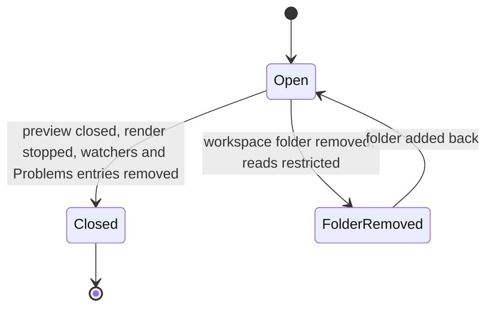

## Closing a preview or a folder leaves nothing behind

### Normative behavior

When a reader closes a preview or a document, removes a workspace folder or deactivates the extension, the Studio SHALL stop the work of the previews concerned, leave no watcher, Problems entry or late result behind, and keep a preview whose workspace folder was removed on its panel with restricted reads.

### Preserved stakeholder intent

As a reader, I close a preview or a document, remove a folder from the workspace or turn the extension off, and no work or warning of that preview lingers. When the folder of a preview I keep open is removed, the preview stays on its panel and still shows its file, with restricted reads.

### Rationale and constraints

- Closing a preview panel or a document stops the preview's render queue, pending render stages, file watchers, subscriptions and Problems entries, so that no late result reaches the panel.
- What another live preview still uses is kept: its watcher and the Problems entries of a file it shows.
- Removing a workspace folder keeps the panel open and shows the file with restricted reads, and the reading state is kept; adding a folder that holds the file back gives the preview its full reads again.
- Deactivating the extension disposes the previews' work and leaves the panels to VS Code, which restores them later.
- No file is ever changed by closing.

### Use case diagram

### Main paths

#### Path 1: Close a preview

1. A preview is open, rendering or idle
   - SwRS-MDOKFSTUDIO-LIFE-143: the reader closes the panel or the document, and the preview stops its render queue, watchers and Problems entries
   - Option SwRS-MDOKFSTUDIO-LIFE-143 (boundary): another live preview of the same root or file keeps its watcher and its Problems entries
2. The preview has left nothing behind

#### Path 2: Remove the folder of a preview

1. A preview shows a file of a workspace folder
   - SwRS-MDOKFSTUDIO-LIFE-143: the reader removes the folder, the preview's work is disposed and the same panel shows the file again with restricted reads
   - Option SwRS-MDOKFSTUDIO-LIFE-143 (boundary): a removed folder with no document to show disposes the preview and its panel
2. The preview shows its file with restricted reads
   - SwRS-MDOKFSTUDIO-LIFE-143: a folder that holds the file is added back and the preview gets full reads again on the same panel
3. The preview has full reads again

<!-- okf:links:start -->
### Links

<!-- Generated from the frontmatter relations; edit them instead. -->

- Derived by:
  - [SwRS-MDOKFSTUDIO-LIFE-143](../../swrs/lifecycle-sync/SwRS-MDOKFSTUDIO-LIFE-143.md): Closing a preview or folder leaves nothing behind
<!-- okf:links:end -->
