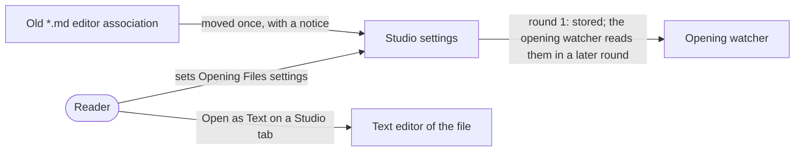

## A reader opens a Markdown file at a searched line and sees that line marked in Studio

### Normative behavior

When a reader opens a Markdown file at a line from a search, Quick Open, a problem or a link, the Studio SHALL show that file in a Studio tab at that line with the line marked, through settings of its own, while leaving diffs, text editors asked for on purpose and the side preview workflow as text editors.

### Preserved stakeholder intent

As a reader, I click a search result, a problem or a link to a Markdown file and land in Studio on that line, with an arrow showing me where it is; I keep my diffs as text, I can still ask for the raw text, and the editor association I set for Markdown keeps working through a Studio setting.

### Rationale and constraints

- Round 1 of the change ships the pieces the reader meets first: the settings group Opening Files, the one-time move of a `*.md` editor association to a Studio setting, the one-time feature introduction, the on-demand "Open as Text" command, and the lazy start of the preview services. The marker, the opening policy and the watcher are specified when they ship.
- Studio never writes a built-in `markdown.preview.*` setting; its only settings write is the association migration.
- A Markdown file alone activates the extension (activation event `onLanguage:markdown`), so the opening watcher can run before any preview exists; the engine, the watchers and the diagnostics stay off until the first Studio preview.

### Use case diagram

### Main paths

#### Path 1: Keep the raw text one command away

1. A Markdown file shows in a Studio tab
   - SwRS-MDOKFSTUDIO-LIFE-177: the reader runs Open as Text and the text editor of the same file opens in the same group, at the line shown
   - Option SwRS-MDOKFSTUDIO-LIFE-177 (refusal): when the active tab is not a Studio tab, a message says so and nothing opens
2. The reader reads and edits the raw text

#### Path 3: Open Studio at a searched line

1. A Studio tab opens for a file at a line (a search result, a link target)
   - SwRS-MDOKFSTUDIO-LIFE-183: the host reveals the Studio tab of the file or opens a new one in the right group
   - SwRS-MDOKFSTUDIO-LIFE-181: the line reaches the page once it is ready and wins over the restored reading place
   - Option SwRS-MDOKFSTUDIO-LIFE-181 (refusal): a line that is not a whole number from 1 is refused and nothing moves
2. The page shows the line marked
   - SwRS-MDOKFSTUDIO-LIFE-178: the page unfolds what hides the line, scrolls to it silently and draws an arrow and a band on it
   - SwRS-MDOKFSTUDIO-LIFE-180: in edit mode the marker covers no handle or action
3. The reader reads on
   - SwRS-MDOKFSTUDIO-LIFE-179: the marker stays through scrolls and layout changes and goes on a pointer press, an edit or a new line

#### Path 4: Follow a link inside Studio

1. A Studio tab shows a Markdown file and Open Markdown files in Studio is on
   - SwRS-MDOKFSTUDIO-LIFE-182: a link, Back or Next to another Markdown file opens Studio at the target line
   - Option SwRS-MDOKFSTUDIO-LIFE-182 (refusal): the side preview, the setting off or a target that is not Markdown opens a text editor as before

#### Path 2: Move to the Studio settings

1. The reader's user or workspace settings hold the `*.md` association to the Studio editor
   - SwRS-MDOKFSTUDIO-LIFE-175: the extension moves it to open.markdownFilesInStudio once per scope and shows one notice
   - Option SwRS-MDOKFSTUDIO-LIFE-175 (refusal): a write that fails keeps the association and tries again at the next start
2. The settings group Opening Files shows the two settings
   - SwRS-MDOKFSTUDIO-LIFE-174: the group lists the settings with their defaults
   - SwRS-MDOKFSTUDIO-LIFE-176: the feature introduction shows once and can be shown again
3. The reader has the Studio settings and the notices

<!-- okf:links:start -->
### Links

<!-- Generated from the frontmatter relations; edit them instead. -->

- Derived by:
  - [SwRS-MDOKFSTUDIO-LIFE-174](../../swrs/lifecycle-sync/SwRS-MDOKFSTUDIO-LIFE-174.md): The Opening Files settings choose when Studio takes the place of a text editor
  - [SwRS-MDOKFSTUDIO-LIFE-175](../../swrs/lifecycle-sync/SwRS-MDOKFSTUDIO-LIFE-175.md): The editor association of Markdown files is migrated to the Studio setting once per scope
  - [SwRS-MDOKFSTUDIO-LIFE-176](../../swrs/lifecycle-sync/SwRS-MDOKFSTUDIO-LIFE-176.md): Feature introductions show once and can be shown again
  - [SwRS-MDOKFSTUDIO-LIFE-177](../../swrs/lifecycle-sync/SwRS-MDOKFSTUDIO-LIFE-177.md): Open as Text replaces a Studio tab by the text editor of the same file
  - [SwRS-MDOKFSTUDIO-LIFE-178](../../swrs/lifecycle-sync/SwRS-MDOKFSTUDIO-LIFE-178.md): The page marks a requested line with an arrow and a band at the line's place
  - [SwRS-MDOKFSTUDIO-LIFE-179](../../swrs/lifecycle-sync/SwRS-MDOKFSTUDIO-LIFE-179.md): The line marker stays through scrolls and layout changes and goes on a pointer press, an edit or a new line
  - [SwRS-MDOKFSTUDIO-LIFE-180](../../swrs/lifecycle-sync/SwRS-MDOKFSTUDIO-LIFE-180.md): The line marker in edit mode covers no handle or action and opens no editor
  - [SwRS-MDOKFSTUDIO-LIFE-181](../../swrs/lifecycle-sync/SwRS-MDOKFSTUDIO-LIFE-181.md): A requested line reaches the page once it is ready and wins over the restored reading place
  - [SwRS-MDOKFSTUDIO-LIFE-182](../../swrs/lifecycle-sync/SwRS-MDOKFSTUDIO-LIFE-182.md): Link and history navigation from a Studio tab opens Studio at the target line when Markdown files open in Studio
  - [SwRS-MDOKFSTUDIO-LIFE-183](../../swrs/lifecycle-sync/SwRS-MDOKFSTUDIO-LIFE-183.md): The host picks the Studio tab to reveal or opens a new one
  - [SwRS-MDOKFSTUDIO-LIFE-184](../../swrs/lifecycle-sync/SwRS-MDOKFSTUDIO-LIFE-184.md): The opening policy keeps a text editor or replaces it by Studio, by nine ordered rules
  - [SwRS-MDOKFSTUDIO-LIFE-185](../../swrs/lifecycle-sync/SwRS-MDOKFSTUDIO-LIFE-185.md): The opening watcher reads each new Markdown text tab and puts Studio in its place after the migration
<!-- okf:links:end -->
