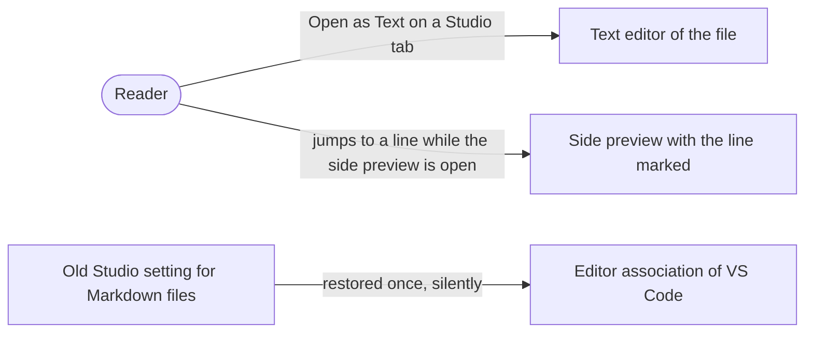

## A reader sees the line of a jump marked in the side preview and gets the raw text on request

### Normative behavior

When a jump moves a Markdown text editor to a line while the side preview follows the editor, the Studio SHALL mark that line in the side preview, and when the reader asks for the raw text of a Markdown file, the Studio SHALL open the text editor and never replace it by a Studio tab, while the reader who wants every Markdown file in Studio uses the editor association of VS Code.

### Preserved stakeholder intent

As a reader, I jump to a line of a Markdown file from a search, a problem or a link and see that line marked in the side preview; I can always ask for the raw text and it stays text; the editor association I set for Markdown keeps working, and an older setting of the Studio for it is turned into that association for me.

### Rationale and constraints

- The Studio never closes or replaces a text tab to put a Studio tab in its place. Opening every Markdown file in Studio is the job of the editor association `workbench.editorAssociations` of VS Code.
- Versions 1.11.0 and 1.12.0 had a setting Open Markdown files in Studio and a watcher that replaced text tabs; this version removes both and writes the `*.md` association back, once and silently, for a reader who had the setting on.
- Studio never writes a built-in `markdown.preview.*` setting; its only settings writes are the one-time restore of the `*.md` association and the removal of the retired Studio settings.
- A Markdown file alone activates the extension (activation event `onLanguage:markdown`), so the restore runs for a reader who has no association yet; the engine, the watchers and the diagnostics stay off until the first Studio preview.
- With the `*.md` association set, a jump opens a Studio tab at the top of the file, and the side preview marks nothing then; the marker works when the file opens in the text editor.

### Use case diagram

### Main paths

#### Path 1: Keep the raw text one command away

1. A Markdown file shows in a Studio tab
   - SwRS-MDOKFSTUDIO-LIFE-177: the reader runs Open as Text and the text editor of the same file opens in the same group, at the line shown, and stays
   - Option SwRS-MDOKFSTUDIO-LIFE-177 (refusal): when the active tab is not a Studio tab, a message says so and nothing opens
2. The reader reads and edits the raw text

#### Path 2: Jump while the side preview is open

1. A search result, a problem or a link takes a text editor to a line while the side preview follows the editor
   - SwRS-MDOKFSTUDIO-LIFE-186: the host tells the jump from a cursor move
   - SwRS-MDOKFSTUDIO-LIFE-187: the side preview that follows the editor marks the line, switching to the file first when it is another one
   - Option SwRS-MDOKFSTUDIO-LIFE-190 (refusal): a cursor move of the keyboard or the mouse marks nothing
2. The side preview places the line
   - SwRS-MDOKFSTUDIO-LIFE-181: the line reaches the page once it is ready, and only once
   - SwRS-MDOKFSTUDIO-LIFE-188: the page scrolls as the anchor setting says
   - SwRS-MDOKFSTUDIO-LIFE-178: the page unfolds what hides the line, scrolls to it silently and draws an arrow and a band on it
   - Option SwRS-MDOKFSTUDIO-LIFE-180 (boundary): in edit mode the marker covers no handle or action
3. The reader reads and edits on
   - SwRS-MDOKFSTUDIO-LIFE-189: the marker stays through scrolls and goes on an edit of the document or a switch of file
   - Option SwRS-MDOKFSTUDIO-LIFE-179 (nominal): the marker stays through layout changes and goes on a pointer press or a new line
   - Option SwRS-MDOKFSTUDIO-LIFE-191 (nominal): a link or Back or Next followed in the side preview marks its target line the same way

#### Path 3: Get the association back from the old setting

1. The reader's user or workspace settings hold the retired setting Open Markdown files in Studio, on
   - SwRS-MDOKFSTUDIO-LIFE-195: the extension writes the `*.md` association in that scope, then removes the retired settings, and shows nothing
   - Option SwRS-MDOKFSTUDIO-LIFE-195 (refusal): a write that fails keeps the retired setting and tries again at the next start
2. The reader's Markdown files open in Studio through the association of VS Code

<!-- okf:links:start -->
### Links

<!-- Generated from the frontmatter relations; edit them instead. -->

- Derived by:
  - [SwRS-MDOKFSTUDIO-LIFE-174](../../swrs/lifecycle-sync/SwRS-MDOKFSTUDIO-LIFE-174.md): The Opening Files settings choose when Studio takes the place of a text editor
  - [SwRS-MDOKFSTUDIO-LIFE-175](../../swrs/lifecycle-sync/SwRS-MDOKFSTUDIO-LIFE-175.md): The editor association of Markdown files is migrated to the Studio setting once per scope
  - [SwRS-MDOKFSTUDIO-LIFE-176](../../swrs/lifecycle-sync/SwRS-MDOKFSTUDIO-LIFE-176.md): Feature introductions show once and can be shown again
  - [SwRS-MDOKFSTUDIO-LIFE-177](../../swrs/lifecycle-sync/SwRS-MDOKFSTUDIO-LIFE-177.md): Open as Text replaces a Studio tab by the text editor of the same file
  - [SwRS-MDOKFSTUDIO-LIFE-178](../../swrs/lifecycle-sync/SwRS-MDOKFSTUDIO-LIFE-178.md): The page marks a requested line with an arrow and a band at the line's place
  - [SwRS-MDOKFSTUDIO-LIFE-179](../../swrs/lifecycle-sync/SwRS-MDOKFSTUDIO-LIFE-179.md): The line marker stays through scrolls and layout changes and goes on a pointer press, an edit or a new line
  - [SwRS-MDOKFSTUDIO-LIFE-180](../../swrs/lifecycle-sync/SwRS-MDOKFSTUDIO-LIFE-180.md): The line marker in edit mode covers no handle or action and opens no editor
  - [SwRS-MDOKFSTUDIO-LIFE-181](../../swrs/lifecycle-sync/SwRS-MDOKFSTUDIO-LIFE-181.md): A requested line reaches the page once it is ready and wins over the restored reading place
  - [SwRS-MDOKFSTUDIO-LIFE-182](../../swrs/lifecycle-sync/SwRS-MDOKFSTUDIO-LIFE-182.md): Link and history navigation from a Studio tab opens Studio at the target line when Markdown files open in Studio
  - [SwRS-MDOKFSTUDIO-LIFE-183](../../swrs/lifecycle-sync/SwRS-MDOKFSTUDIO-LIFE-183.md): The host picks the Studio tab to reveal or opens a new one
  - [SwRS-MDOKFSTUDIO-LIFE-184](../../swrs/lifecycle-sync/SwRS-MDOKFSTUDIO-LIFE-184.md): The opening policy keeps a text editor or replaces it by Studio, by nine ordered rules
  - [SwRS-MDOKFSTUDIO-LIFE-185](../../swrs/lifecycle-sync/SwRS-MDOKFSTUDIO-LIFE-185.md): The opening watcher reads each new Markdown text tab and puts Studio in its place after the migration
  - [SwRS-MDOKFSTUDIO-LIFE-186](../../swrs/lifecycle-sync/SwRS-MDOKFSTUDIO-LIFE-186.md): The host tells a jump from a cursor move
  - [SwRS-MDOKFSTUDIO-LIFE-187](../../swrs/lifecycle-sync/SwRS-MDOKFSTUDIO-LIFE-187.md): The side preview that follows the editor marks the line of a jump
  - [SwRS-MDOKFSTUDIO-LIFE-188](../../swrs/lifecycle-sync/SwRS-MDOKFSTUDIO-LIFE-188.md): The side preview's scroll on a jump follows the anchor setting
  - [SwRS-MDOKFSTUDIO-LIFE-189](../../swrs/lifecycle-sync/SwRS-MDOKFSTUDIO-LIFE-189.md): The line marker of the side preview goes on an edit of the document or a switch of file
  - [SwRS-MDOKFSTUDIO-LIFE-190](../../swrs/lifecycle-sync/SwRS-MDOKFSTUDIO-LIFE-190.md): A cursor move never marks the side preview
  - [SwRS-MDOKFSTUDIO-LIFE-191](../../swrs/lifecycle-sync/SwRS-MDOKFSTUDIO-LIFE-191.md): Links and Back and Next followed in the side preview mark their target line
  - [SwRS-MDOKFSTUDIO-LIFE-192](../../swrs/lifecycle-sync/SwRS-MDOKFSTUDIO-LIFE-192.md): The line marker marks the table row of the line
  - [SwRS-MDOKFSTUDIO-LIFE-193](../../swrs/lifecycle-sync/SwRS-MDOKFSTUDIO-LIFE-193.md): The line marker shows the hidden tabs that hold the line and marks its exact line
  - [SwRS-MDOKFSTUDIO-LIFE-194](../../swrs/lifecycle-sync/SwRS-MDOKFSTUDIO-LIFE-194.md): The line marker marks the front matter property row of the line
  - [SwRS-MDOKFSTUDIO-LIFE-195](../../swrs/lifecycle-sync/SwRS-MDOKFSTUDIO-LIFE-195.md): The editor association of Markdown files is restored once from the retired Studio setting
<!-- okf:links:end -->
