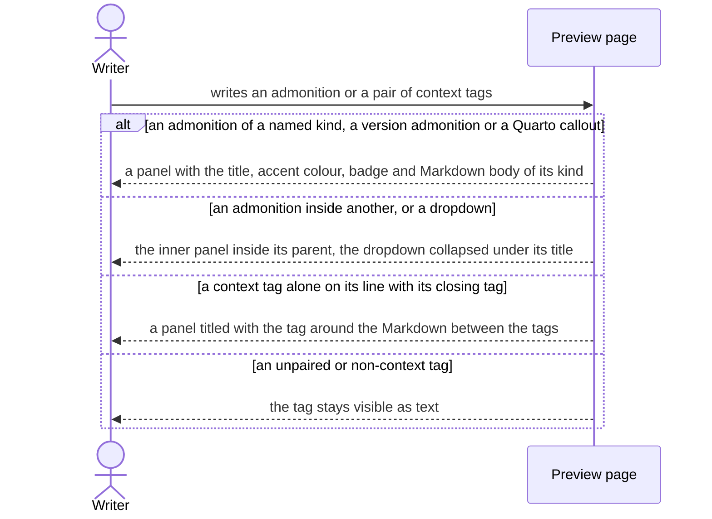

## Admonitions and context tags read as distinct callouts

### Normative behavior

When a document uses a MyST admonition of any kind, including version admonitions and Quarto callouts, or a pasted context tag, the Studio SHALL show it in the preview, without a Sphinx build, as a titled callout whose body stays Markdown, nested and collapsible as written, and SHALL keep a tag it does not group visible as text.

### Preserved stakeholder intent

Writers want every admonition kind, custom title, dropdown and nesting to look like a distinct callout, and pasted context tags to stay readable and inert, so that they can review the document without building.

### Rationale and constraints

- Admonitions: all ten named kinds, custom titles, version admonitions (versionadded, versionchanged, deprecated) and Quarto callouts, shown as a coloured callout with title and body; the same look holds in dark and light themes.
- Nesting and dropdowns: an inner admonition shows inside its parent, and a dropdown collapses under its title.
- Context tags: pasted prompt-style tags are shown as a readable panel, never executed as HTML and never losing content; unknown or unpaired tags stay visible as text.
- Taken from StRS-MDOKFSTUDIO-MYST-001 (admonitions and context tags), which this StRS and three others replace.

### Use case diagram

### Main paths

#### Path 1: An admonition

1. A document holds an admonition directive
   - SwRS-MDOKFSTUDIO-MYST-001: the page renders a panel with the title, accent colour, badge and Markdown body of its kind
   - Option SwRS-MDOKFSTUDIO-MYST-001 (boundary): a kind outside the named list
2. The admonition is drawn as a panel
   - SwRS-MDOKFSTUDIO-MYST-006: an admonition that contains another directive shows the inner panel inside its parent
   - Option SwRS-MDOKFSTUDIO-MYST-006 (boundary): a dropdown admonition collapses under its title
3. Nested directives are drawn as panels inside their parent

#### Path 2: A pasted context tag

1. A document holds a lower-case context tag alone on its line, with its closing tag
   - SwRS-MDOKFSTUDIO-MYST-013: the page renders a panel titled with the literal tag around the Markdown between the tags
   - Option SwRS-MDOKFSTUDIO-MYST-013 (refusal): an unpaired or non-context tag stays visible as text
2. The context is drawn as a titled panel

<!-- okf:links:start -->
### Links

<!-- Generated from the frontmatter relations; edit them instead. -->

- Derived by:
  - [SwRS-MDOKFSTUDIO-MYST-001](../../swrs/myst/SwRS-MDOKFSTUDIO-MYST-001.md): Admonitions render as coloured callouts with a title
  - [SwRS-MDOKFSTUDIO-MYST-006](../../swrs/myst/SwRS-MDOKFSTUDIO-MYST-006.md): Admonitions nest, collapse and map as one block
  - [SwRS-MDOKFSTUDIO-MYST-013](../../swrs/myst/SwRS-MDOKFSTUDIO-MYST-013.md): Context tags render as titled panels
- Supersedes:
  - [StRS-MDOKFSTUDIO-MYST-001](StRS-MDOKFSTUDIO-MYST-001.md): MyST directives and roles render as readable blocks
<!-- okf:links:end -->
