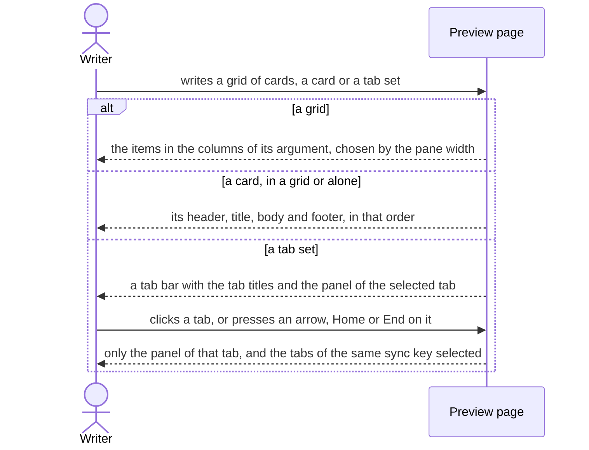

## Grids, cards and tabs lay out a document in the preview

### Normative behavior

When a document uses MyST grids, grid cards, standalone cards or tab sets, the Studio SHALL show them in the preview, without a Sphinx build, as columns that follow the pane width, cards with their header, title, body and footer, and tabs that show one panel at a time and follow the click and the keyboard.

### Preserved stakeholder intent

Writers want card layouts usable in narrow panes, cards that show their parts in grids and alone, and tab sets that show one panel at a time, so that they can lay out the document without building.

### Rationale and constraints

- Grids reflow with the pane width rather than overflow sideways; the columns follow the width of the preview, not of the window.
- Cards show their header, title, body and footer, in a grid or alone, and a card link makes the whole card its click target.
- Tab sets show the panel of the selected tab only; a click or the arrow, Home and End keys select a tab, and tabs with the same sync key follow each other.
- Taken from StRS-MDOKFSTUDIO-MYST-001 (grid cards and Path 2, tabs), which this StRS and three others replace. Its normative text named grid cards only; tabs and standalone cards get their place here.

### Use case diagram

### Main paths

#### Path 1: A grid of cards

1. A document holds a grid with grid-item-card items
   - SwRS-MDOKFSTUDIO-MYST-053: the page lays out the items in the columns of its argument, chosen by the pane width
   - Option SwRS-MDOKFSTUDIO-MYST-053 (refusal): a grid deeper than 8 levels stays an unexpanded placeholder
2. The cards are laid out in columns
   - SwRS-MDOKFSTUDIO-MYST-100: each card shows its header, title, body and footer
   - Option SwRS-MDOKFSTUDIO-MYST-100 (refusal): reserved or malformed class names are dropped
3. The grid shows its cards

#### Path 2: Tabs

1. A document holds a tab set with tab items
   - SwRS-MDOKFSTUDIO-MYST-098: the page renders a tab bar with the tab-item titles and shows the panel of the selected tab
2. The tab bar shows the selected panel
   - SwRS-MDOKFSTUDIO-MYST-099: a click on a tab selects it and shows only its panel
   - Option SwRS-MDOKFSTUDIO-MYST-099 (boundary): the arrow, Home and End keys select a tab and move the focus to it
3. The panel of the clicked tab is shown

<!-- okf:links:start -->
### Links

<!-- Generated from the frontmatter relations; edit them instead. -->

- Derived by:
  - [SwRS-MDOKFSTUDIO-MYST-053](../../swrs/myst/SwRS-MDOKFSTUDIO-MYST-053.md): Grids lay out cards in responsive columns
  - [SwRS-MDOKFSTUDIO-MYST-098](../../swrs/myst/SwRS-MDOKFSTUDIO-MYST-098.md): Tab sets render a tab bar with one panel shown at a time
  - [SwRS-MDOKFSTUDIO-MYST-099](../../swrs/myst/SwRS-MDOKFSTUDIO-MYST-099.md): Tabs follow the keyboard and the click
  - [SwRS-MDOKFSTUDIO-MYST-100](../../swrs/myst/SwRS-MDOKFSTUDIO-MYST-100.md): A card, in a grid or alone, shows header, title, body and footer
- Supersedes:
  - [StRS-MDOKFSTUDIO-MYST-001](StRS-MDOKFSTUDIO-MYST-001.md): MyST directives and roles render as readable blocks
<!-- okf:links:end -->
