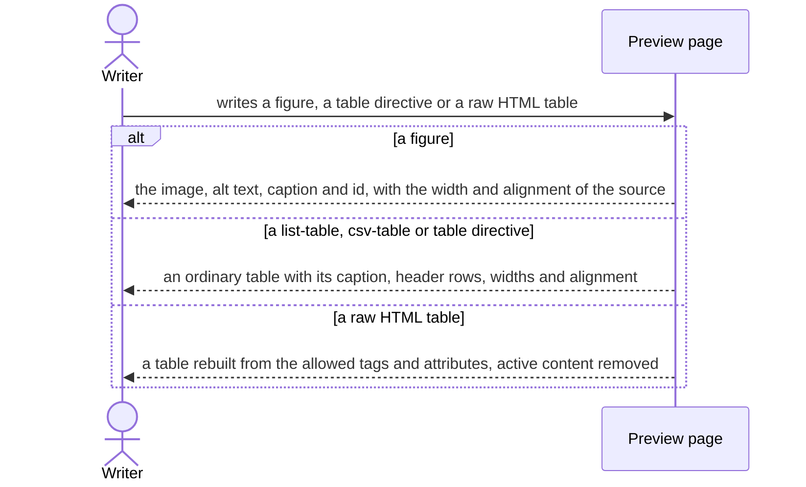

## Figures and tables show as the source sizes and shapes them

### Normative behavior

When a document uses a MyST figure, a table directive or a raw HTML table, the Studio SHALL show it in the preview, without a Sphinx build, with the image, caption, width and alignment the source gives, and as an ordinary table whose content stays as authored.

### Preserved stakeholder intent

Writers want figure sizing reflected immediately and all table forms to look like tables, so that they can review the layout without building.

### Rationale and constraints

- Figures: width and alignment follow what the source says; an invalid width is dropped.
- List, caption and CSV table directives, and raw HTML tables, show as ordinary tables; content stays as authored in the source.
- A raw HTML table keeps only an allow-list of tags and attributes; the rule that guards GitHub Flavored Markdown (StRS-MDOKFSTUDIO-GFM-002) also applies.
- Taken from StRS-MDOKFSTUDIO-MYST-001 (sized figures and table directives), which this StRS and three others replace.

### Use case diagram

### Main paths

#### Path S1: A figure

1. A document holds a figure directive
   - SwRS-MDOKFSTUDIO-MYST-031: the page renders the image with its alt text, caption and id
   - Option SwRS-MDOKFSTUDIO-MYST-031 (refusal): an invalid width is dropped
2. The figure is shown with its width and alignment

#### Path S2: A table

1. A document holds a list-table, csv-table or table directive
   - SwRS-MDOKFSTUDIO-MYST-063: the page renders an ordinary table with the table styles
   - Option SwRS-MDOKFSTUDIO-MYST-063 (refusal): invalid list-table widths are ignored
2. A document holds a raw HTML table
   - SwRS-MDOKFSTUDIO-GFM-031: the page rebuilds it from an allow-list, with its spans
   - Option SwRS-MDOKFSTUDIO-GFM-031 (refusal): active content and unsafe styles are removed
3. The tables are shown as tables

<!-- okf:links:start -->
### Links

<!-- Generated from the frontmatter relations; edit them instead. -->

- Derived by:
  - [SwRS-MDOKFSTUDIO-GFM-031](../../swrs/gfm/SwRS-MDOKFSTUDIO-GFM-031.md): Raw HTML tables are rebuilt from an allow-list
  - [SwRS-MDOKFSTUDIO-MYST-031](../../swrs/myst/SwRS-MDOKFSTUDIO-MYST-031.md): Figures render with image, caption, label, width and alignment
  - [SwRS-MDOKFSTUDIO-MYST-063](../../swrs/myst/SwRS-MDOKFSTUDIO-MYST-063.md): Table directives render as ordinary tables
- Supersedes:
  - [StRS-MDOKFSTUDIO-MYST-001](StRS-MDOKFSTUDIO-MYST-001.md): MyST directives and roles render as readable blocks
<!-- okf:links:end -->
