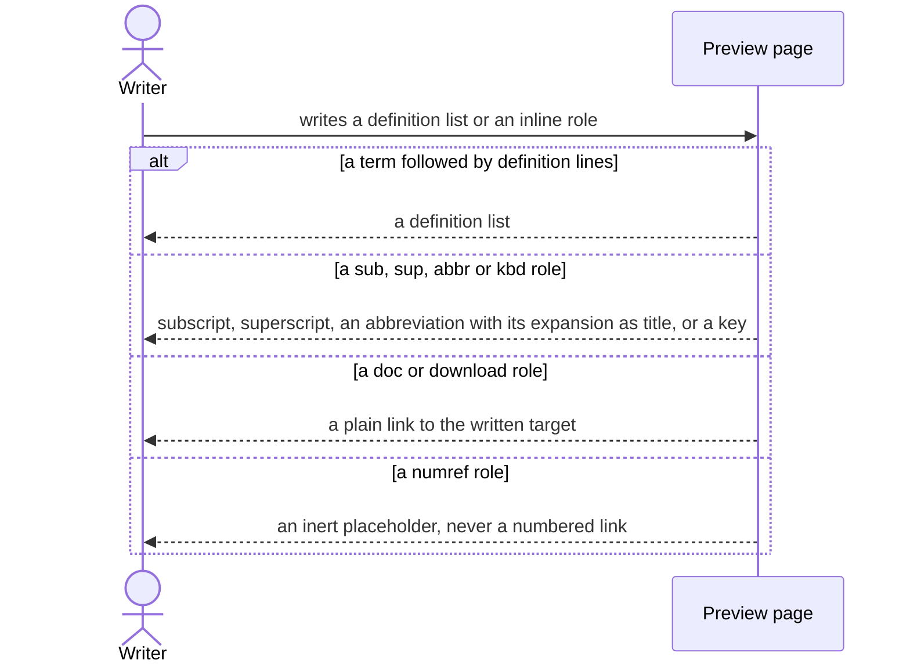

## Definition lists and inline roles are typeset in the preview

### Normative behavior

When a document uses MyST definition lists or the inline roles for subscript, superscript, abbreviations, keys, documents and downloads, the Studio SHALL typeset them in the preview without a Sphinx build, and SHALL keep a numbered reference it cannot number as inert text.

### Preserved stakeholder intent

Writers want definition lists, subscript, superscript, abbreviations and keys typeset in the preview, so that they can check the text without building.

### Rationale and constraints

- Definition lists, subscript, superscript, abbreviations and keys are typeset in the preview without a Sphinx build.
- Document and download roles are plain links to the written target.
- A numbered reference needs a build to get its number; it stays an inert placeholder.
- Taken from StRS-MDOKFSTUDIO-MYST-001 (definition lists and text roles), which this StRS and three others replace.

### Use case diagram

### Main paths

#### Path S1: Text constructs

1. A document holds a definition list or an inline role
   - SwRS-MDOKFSTUDIO-MYST-017: the page renders a definition list, subscript, superscript, an abbreviation or a key
   - Option SwRS-MDOKFSTUDIO-MYST-017 (refusal): a numbered reference stays an inert placeholder
2. The text is typeset

<!-- okf:links:start -->
### Links

<!-- Generated from the frontmatter relations; edit them instead. -->

- Derived by:
  - [SwRS-MDOKFSTUDIO-MYST-017](../../swrs/myst/SwRS-MDOKFSTUDIO-MYST-017.md): Definition lists and inline roles are typeset
- Supersedes:
  - [StRS-MDOKFSTUDIO-MYST-001](StRS-MDOKFSTUDIO-MYST-001.md): MyST directives and roles render as readable blocks
<!-- okf:links:end -->
