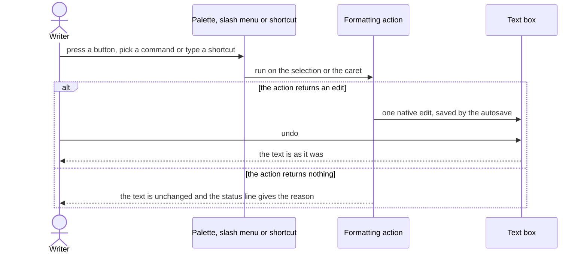

## A writer formats text with buttons and shortcuts

### Normative behavior

When a writer edits a block in edit mode, the Studio SHALL offer palette buttons, slash commands and keyboard shortcuts that format the text at the selection or the caret, each in one undoable step saved with the other text of that editor, or leave the text unchanged and say why when the action cannot apply.

### Preserved stakeholder intent

Writers expect formatting buttons to act on the selection like in any editor, and to be told why when one cannot apply.

As a writer, I format text from buttons, slash commands or keyboard shortcuts without typing the syntax, take any such edit back with a single undo, and am never left with half-written markup.

### Rationale and constraints

- The buttons act on the selection or at the caret of the block text box; they only change the text, the preview renders it afterwards.
- The same actions are reachable from the slash menu and, for a few of them, from keyboard shortcuts; the tooltip of a button shows its shortcut.
- An action that cannot apply, such as a selection that cuts into a marker, produces no edit and the writer is told why.
- A button, a slash command or a keyboard shortcut changes the text in one step that the undo key combination of the text box reverts; the edit is saved with the autosave of the editor like typing.
- The command key is Cmd on macOS and Ctrl elsewhere; the typed letter wins over the physical key, so other keyboard layouts keep their cut, copy and paste.
- Every button of the edit bar shows a tooltip with its title and shortcut.

### Use case diagram

A formatting action is one undoable edit, or no edit with a reason.

### Main paths

#### Path 1: Bold a word, then take it back

1. A block text box is open in edit mode
   - SwRS-MDOKFSTUDIO-PALETTE-001: the palette opens above the text box with the Palette buttons select and the buttons of the mode in registry order
2. The palette is shown above the text box
   - SwRS-MDOKFSTUDIO-PALETTE-276: the writer presses Bold and the selection is wrapped in two asterisks
   - Option SwRS-MDOKFSTUDIO-PALETTE-039 (refusal): an action that makes no edit leaves the text unchanged
3. The selection is wrapped in markers
   - SwRS-MDOKFSTUDIO-PALETTE-039: the writer undoes and the edit is taken back in one step
4. The text is as it was before the button

<!-- okf:links:start -->
### Links

<!-- Generated from the frontmatter relations; edit them instead. -->

- Derived by:
  - [SwRS-MDOKFSTUDIO-PALETTE-002](../../swrs/palette-slash/SwRS-MDOKFSTUDIO-PALETTE-002.md): Every edit bar button shows the slide-in tooltip
  - [SwRS-MDOKFSTUDIO-PALETTE-003](../../swrs/palette-slash/SwRS-MDOKFSTUDIO-PALETTE-003.md): The Table of contents action inserts a \[TOC\] marker
  - [SwRS-MDOKFSTUDIO-PALETTE-039](../../swrs/palette-slash/SwRS-MDOKFSTUDIO-PALETTE-039.md): A palette action edits in one undo step or leaves the text unchanged and says why
  - [SwRS-MDOKFSTUDIO-PALETTE-043](../../swrs/palette-slash/SwRS-MDOKFSTUDIO-PALETTE-043.md): The Heading list sets the heading level of the touched lines
  - [SwRS-MDOKFSTUDIO-PALETTE-045](../../swrs/palette-slash/SwRS-MDOKFSTUDIO-PALETTE-045.md): Bold and Italic toggle their shared asterisk markers
  - [SwRS-MDOKFSTUDIO-PALETTE-048](../../swrs/palette-slash/SwRS-MDOKFSTUDIO-PALETTE-048.md): Strikethrough toggles a double tilde pair
  - [SwRS-MDOKFSTUDIO-PALETTE-049](../../swrs/palette-slash/SwRS-MDOKFSTUDIO-PALETTE-049.md): Blockquote prefixes the touched lines or removes one quote level
  - [SwRS-MDOKFSTUDIO-PALETTE-050](../../swrs/palette-slash/SwRS-MDOKFSTUDIO-PALETTE-050.md): Horizontal rule puts three dashes between blank lines
  - [SwRS-MDOKFSTUDIO-PALETTE-052](../../swrs/palette-slash/SwRS-MDOKFSTUDIO-PALETTE-052.md): Bulleted list toggles a dash prefix, from the slash menu only
  - [SwRS-MDOKFSTUDIO-PALETTE-053](../../swrs/palette-slash/SwRS-MDOKFSTUDIO-PALETTE-053.md): Numbered list numbers the touched non-blank lines
  - [SwRS-MDOKFSTUDIO-PALETTE-083](../../swrs/palette-slash/SwRS-MDOKFSTUDIO-PALETTE-083.md): Cmd or Ctrl with B, I or K runs Bold, Italic or Link on the platform's command key
  - [SwRS-MDOKFSTUDIO-PALETTE-266](../../swrs/palette-slash/SwRS-MDOKFSTUDIO-PALETTE-266.md): Cmd or Ctrl with the slash key toggles a plain HTML comment on the touched lines
  - [SwRS-MDOKFSTUDIO-PALETTE-276](../../swrs/palette-slash/SwRS-MDOKFSTUDIO-PALETTE-276.md): Inline marker buttons toggle their markers around the selection
  - [SwRS-MDOKFSTUDIO-PALETTE-277](../../swrs/palette-slash/SwRS-MDOKFSTUDIO-PALETTE-277.md): Line-prefix buttons toggle their prefix on the touched lines
  - [SwRS-MDOKFSTUDIO-PALETTE-280](../../swrs/palette-slash/SwRS-MDOKFSTUDIO-PALETTE-280.md): The Horizontal rule button is drawn as three dashes
- Depends on:
  - [SwRS-MDOKFSTUDIO-PALETTE-001](../../swrs/palette-slash/SwRS-MDOKFSTUDIO-PALETTE-001.md): The palette mode decides the button sets, in registry order
- Supersedes:
  - [StRS-MDOKFSTUDIO-PALETTE-001](StRS-MDOKFSTUDIO-PALETTE-001.md): A writer formats and inserts Markdown, GFM and MyST constructs from the palette
<!-- okf:links:end -->
