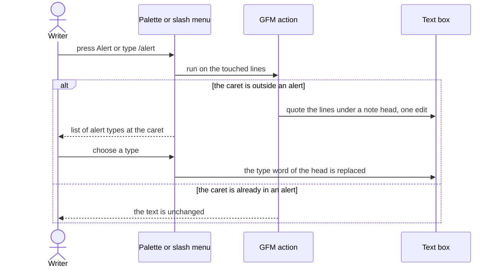

## A writer inserts GitHub Flavored Markdown constructs

### Normative behavior

When a writer works in the GitHub Flavored Markdown or a larger palette mode, the Studio SHALL offer palette buttons and slash commands that write alerts, task list boxes, collapsible sections, footnotes, keyboard keys and choice lists into the block text at the selection, each in one undoable step, or leave the text unchanged and say why when the action cannot apply.

### Preserved stakeholder intent

Writers of GitHub-style documents expect to insert a construct from a button without remembering its syntax.

As a writer of GitHub-style documents, I insert an alert, a task list, a collapsible section or a footnote from a button without remembering the syntax, and take the insertion back with a single undo.

### Rationale and constraints

- These buttons are offered from the GitHub Flavored Markdown mode up: the MyST and Full modes list them too, because the modes add up.
- A construct is written into the text of the block; the preview renders it afterwards.
- An action that cannot apply, such as an alert command inside an alert, produces no edit.
- Each insertion is one undoable edit, saved with the other text of that editor.

### Use case diagram

An alert is one undoable edit followed by a choice of its type.

### Main paths

#### Path 1: Insert an alert

1. The palette is shown above the text box in the GFM mode
   - SwRS-MDOKFSTUDIO-PALETTE-115: the writer presses Alert and the touched lines are quoted under a note head, with a list of the five types at the caret
2. An alert is written and its type list is open
   - SwRS-MDOKFSTUDIO-PALETTE-039: the writer undoes and the edit is taken back in one step
3. The text is as it was before the button

<!-- okf:links:start -->
### Links

<!-- Generated from the frontmatter relations; edit them instead. -->

- Derived by:
  - [SwRS-MDOKFSTUDIO-PALETTE-115](../../swrs/palette-slash/SwRS-MDOKFSTUDIO-PALETTE-115.md): Alert inserts a GitHub alert and offers its type list
  - [SwRS-MDOKFSTUDIO-PALETTE-123](../../swrs/palette-slash/SwRS-MDOKFSTUDIO-PALETTE-123.md): Checkbox toggles a task list box on the touched lines
  - [SwRS-MDOKFSTUDIO-PALETTE-124](../../swrs/palette-slash/SwRS-MDOKFSTUDIO-PALETTE-124.md): Collapsible wraps the touched lines in a details element with a summary
  - [SwRS-MDOKFSTUDIO-PALETTE-125](../../swrs/palette-slash/SwRS-MDOKFSTUDIO-PALETTE-125.md): Footnote adds a numbered reference and an empty definition at the end
  - [SwRS-MDOKFSTUDIO-PALETTE-126](../../swrs/palette-slash/SwRS-MDOKFSTUDIO-PALETTE-126.md): Key wraps the selection in kbd tags, removes them, or inserts a sample
  - [SwRS-MDOKFSTUDIO-PALETTE-267](../../swrs/palette-slash/SwRS-MDOKFSTUDIO-PALETTE-267.md): Option toggles a choice list marker on the touched lines
  - [SwRS-MDOKFSTUDIO-PALETTE-269](../../swrs/palette-slash/SwRS-MDOKFSTUDIO-PALETTE-269.md): Caret on an alert or admonition type lists the types
  - [SwRS-MDOKFSTUDIO-PALETTE-276](../../swrs/palette-slash/SwRS-MDOKFSTUDIO-PALETTE-276.md): Inline marker buttons toggle their markers around the selection
  - [SwRS-MDOKFSTUDIO-PALETTE-277](../../swrs/palette-slash/SwRS-MDOKFSTUDIO-PALETTE-277.md): Line-prefix buttons toggle their prefix on the touched lines
- Depends on:
  - [SwRS-MDOKFSTUDIO-PALETTE-039](../../swrs/palette-slash/SwRS-MDOKFSTUDIO-PALETTE-039.md): A palette action edits in one undo step or leaves the text unchanged and says why
- Supersedes:
  - [StRS-MDOKFSTUDIO-PALETTE-001](StRS-MDOKFSTUDIO-PALETTE-001.md): A writer formats and inserts Markdown, GFM and MyST constructs from the palette
<!-- okf:links:end -->
