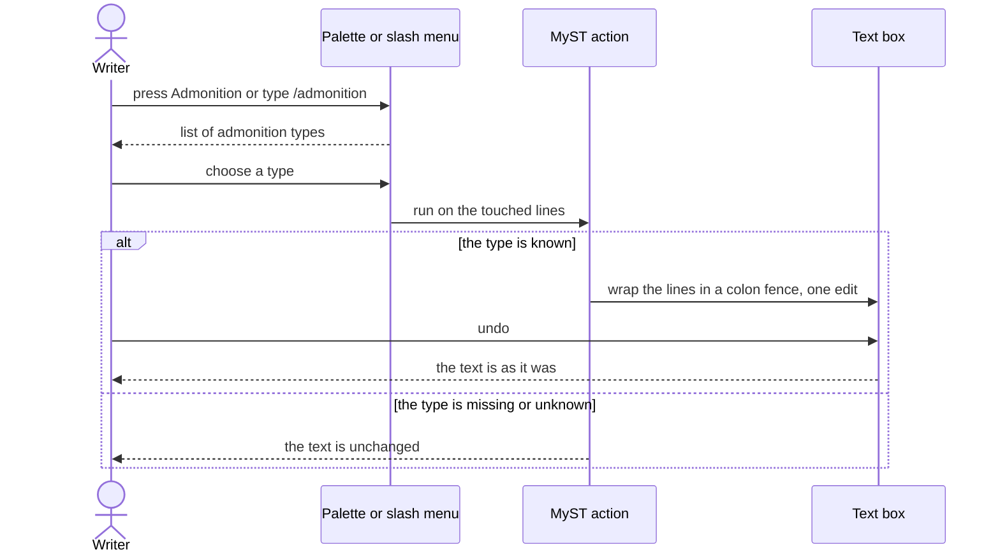

## A writer inserts MyST constructs

### Normative behavior

When a writer works in the MyST or the Full palette mode, the Studio SHALL offer palette buttons and slash commands that write admonitions, definition lists, math, roles, labels, references, citations, figures, tabs and, in the Full mode, charts and diagrams into the block text at the selection, each in one undoable step, or leave the text unchanged and say why when the action cannot apply.

### Preserved stakeholder intent

Writers of Sphinx and MyST documents expect to insert a directive or a role from a button without remembering its syntax.

As a writer of Sphinx and MyST documents, I insert an admonition, a definition list, a formula, a role, a figure or a tab set from a button or the slash menu without remembering the syntax, and take the insertion back with a single undo.

### Rationale and constraints

- These buttons are offered from the MyST mode up; the GitHub buttons are listed there too, because the modes add up, and the Full mode adds the chart and diagram commands.
- Both the GitHub key button (HTML kbd element) and the MyST key button (kbd role) are offered in the MyST mode, and nothing in the Studio tells which of the two to prefer.
- A construct is written into the text of the block; the preview renders it afterwards.
- A selection that a role cannot hold, such as one with a backtick, produces no edit.
- Each insertion is one undoable edit, saved with the other text of that editor.

### Use case diagram

An admonition is one undoable edit around the touched lines.

### Main paths

#### Path S1: Wrap lines in an admonition

1. The palette is shown above the text box in the MyST mode
   - SwRS-MDOKFSTUDIO-PALETTE-127: the writer presses Admonition and chooses a type, and the touched lines are wrapped in a colon fence of that type
   - Option SwRS-MDOKFSTUDIO-PALETTE-127 (refusal): a missing or unknown type produces no edit
2. The lines are wrapped in a fence
   - SwRS-MDOKFSTUDIO-PALETTE-039: the writer undoes and the edit is taken back in one step
3. The text is as it was before the button

<!-- okf:links:start -->
### Links

<!-- Generated from the frontmatter relations; edit them instead. -->

- Derived by:
  - [SwRS-MDOKFSTUDIO-PALETTE-127](../../swrs/palette-slash/SwRS-MDOKFSTUDIO-PALETTE-127.md): Admonition wraps lines in a colon fence of a chosen type
  - [SwRS-MDOKFSTUDIO-PALETTE-130](../../swrs/palette-slash/SwRS-MDOKFSTUDIO-PALETTE-130.md): Custom writes a titled admonition with a class
  - [SwRS-MDOKFSTUDIO-PALETTE-132](../../swrs/palette-slash/SwRS-MDOKFSTUDIO-PALETTE-132.md): Definition list makes the selection a term with a definition
  - [SwRS-MDOKFSTUDIO-PALETTE-133](../../swrs/palette-slash/SwRS-MDOKFSTUDIO-PALETTE-133.md): Math wraps the selection in an inline, display or aligned equation
  - [SwRS-MDOKFSTUDIO-PALETTE-135](../../swrs/palette-slash/SwRS-MDOKFSTUDIO-PALETTE-135.md): Subscript and Superscript wrap the selection in a role
  - [SwRS-MDOKFSTUDIO-PALETTE-136](../../swrs/palette-slash/SwRS-MDOKFSTUDIO-PALETTE-136.md): Label writes one label line above the block
  - [SwRS-MDOKFSTUDIO-PALETTE-137](../../swrs/palette-slash/SwRS-MDOKFSTUDIO-PALETTE-137.md): Dropdown writes a note admonition with the dropdown class
  - [SwRS-MDOKFSTUDIO-PALETTE-138](../../swrs/palette-slash/SwRS-MDOKFSTUDIO-PALETTE-138.md): Key (MyST) wraps the selection in the kbd role
  - [SwRS-MDOKFSTUDIO-PALETTE-265](../../swrs/palette-slash/SwRS-MDOKFSTUDIO-PALETTE-265.md): The Full palette mode adds Vega-Lite and Vega chart commands
  - [SwRS-MDOKFSTUDIO-PALETTE-269](../../swrs/palette-slash/SwRS-MDOKFSTUDIO-PALETTE-269.md): Caret on an alert or admonition type lists the types
  - [SwRS-MDOKFSTUDIO-PALETTE-270](../../swrs/palette-slash/SwRS-MDOKFSTUDIO-PALETTE-270.md): Card form inserts a MyST card
  - [SwRS-MDOKFSTUDIO-PALETTE-271](../../swrs/palette-slash/SwRS-MDOKFSTUDIO-PALETTE-271.md): Grid form inserts a MyST grid of cards
  - [SwRS-MDOKFSTUDIO-PALETTE-272](../../swrs/palette-slash/SwRS-MDOKFSTUDIO-PALETTE-272.md): The Code-block button edits a MyST code-block directive in a form
  - [SwRS-MDOKFSTUDIO-PALETTE-273](../../swrs/palette-slash/SwRS-MDOKFSTUDIO-PALETTE-273.md): The MyST palette mode adds a Content tabs command
  - [SwRS-MDOKFSTUDIO-PALETTE-274](../../swrs/palette-slash/SwRS-MDOKFSTUDIO-PALETTE-274.md): The Full palette mode adds a PlantUML diagram command
  - [SwRS-MDOKFSTUDIO-PALETTE-276](../../swrs/palette-slash/SwRS-MDOKFSTUDIO-PALETTE-276.md): Inline marker buttons toggle their markers around the selection
  - [SwRS-MDOKFSTUDIO-PALETTE-278](../../swrs/palette-slash/SwRS-MDOKFSTUDIO-PALETTE-278.md): Starter blocks insert a chart, a diagram or content tabs
- Depends on:
  - [SwRS-MDOKFSTUDIO-PALETTE-039](../../swrs/palette-slash/SwRS-MDOKFSTUDIO-PALETTE-039.md): A palette action edits in one undo step or leaves the text unchanged and says why
- Supersedes:
  - [StRS-MDOKFSTUDIO-PALETTE-001](StRS-MDOKFSTUDIO-PALETTE-001.md): A writer formats and inserts Markdown, GFM and MyST constructs from the palette
<!-- okf:links:end -->
