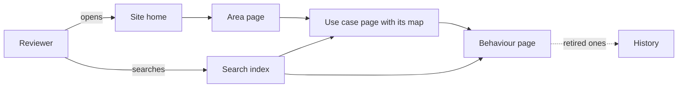

## A reviewer reads the published site and its requirements

### Normative behavior

The Studio SHALL publish a site on GitHub Pages where a reviewer browses use cases, behaviours, coverage and the e2e gallery without building anything.

### Preserved stakeholder intent

A reviewer browses use cases, behaviours, coverage and the e2e gallery on GitHub Pages without building anything.

### Rationale and constraints

- The site is generated from the requirement bundle and published by the release process; the reviewer needs no build.
- Retired requirements stay reachable behind a History section.
- Every page and picture of the site keeps one look.

### Use case diagram

### Main paths

#### Path S1: Find a use case and read it

1. The reviewer opens the site
   - SwRS-MDOKFSTUDIO-CORE-069: the home shows the requirements chain and the report
2. The reviewer picks an area
   - SwRS-MDOKFSTUDIO-CORE-080: the area page lists its use cases
   - Option SwRS-MDOKFSTUDIO-CORE-084 (nominal): the search index finds a use case or a behaviour
3. The reviewer reads a use case
   - SwRS-MDOKFSTUDIO-CORE-081: the map of the use case is drawn from its Main paths
4. The reviewer reads a behaviour
   - SwRS-MDOKFSTUDIO-CORE-082: each behaviour has its page
   - Option SwRS-MDOKFSTUDIO-CORE-083 (nominal): retired requirements stay behind History

<!-- okf:links:start -->
### Links

<!-- Generated from the frontmatter relations; edit them instead. -->

- Derived by:
  - [SwRS-MDOKFSTUDIO-CORE-069](../../swrs/rendering-core/SwRS-MDOKFSTUDIO-CORE-069.md): The site Requirements home shows the requirements chain and the report figures
  - [SwRS-MDOKFSTUDIO-CORE-080](../../swrs/rendering-core/SwRS-MDOKFSTUDIO-CORE-080.md): The site requirements viewer has an area page and a use case list
  - [SwRS-MDOKFSTUDIO-CORE-081](../../swrs/rendering-core/SwRS-MDOKFSTUDIO-CORE-081.md): The site requirements viewer draws the map of a use case from its Main paths
  - [SwRS-MDOKFSTUDIO-CORE-082](../../swrs/rendering-core/SwRS-MDOKFSTUDIO-CORE-082.md): The site requirements viewer has a page for each behaviour
  - [SwRS-MDOKFSTUDIO-CORE-083](../../swrs/rendering-core/SwRS-MDOKFSTUDIO-CORE-083.md): The site requirements viewer keeps retired requirements behind History
  - [SwRS-MDOKFSTUDIO-CORE-084](../../swrs/rendering-core/SwRS-MDOKFSTUDIO-CORE-084.md): The site requirements viewer has a search index
  - [SwRS-MDOKFSTUDIO-CORE-085](../../swrs/rendering-core/SwRS-MDOKFSTUDIO-CORE-085.md): The site requirements viewer has a social card for each page
  - [SwRS-MDOKFSTUDIO-CORE-086](../../swrs/rendering-core/SwRS-MDOKFSTUDIO-CORE-086.md): The published site has one cream look on every page and picture
  - [SwRS-MDOKFSTUDIO-CORE-091](../../swrs/rendering-core/SwRS-MDOKFSTUDIO-CORE-091.md): The site requirements viewer plays a path of a use case map
  - [SwRS-MDOKFSTUDIO-CORE-092](../../swrs/rendering-core/SwRS-MDOKFSTUDIO-CORE-092.md): The site requirements viewer finds a requirement by its ID
  - [SwRS-MDOKFSTUDIO-CORE-093](../../swrs/rendering-core/SwRS-MDOKFSTUDIO-CORE-093.md): The site requirements viewer names every requirement by its full ID
  - [SwRS-MDOKFSTUDIO-CORE-095](../../swrs/rendering-core/SwRS-MDOKFSTUDIO-CORE-095.md): The published site plays a feature clip as a looping video
  - [SwRS-MDOKFSTUDIO-CORE-096](../../swrs/rendering-core/SwRS-MDOKFSTUDIO-CORE-096.md): Each screenshot of the site gallery has its own stable link
<!-- okf:links:end -->
