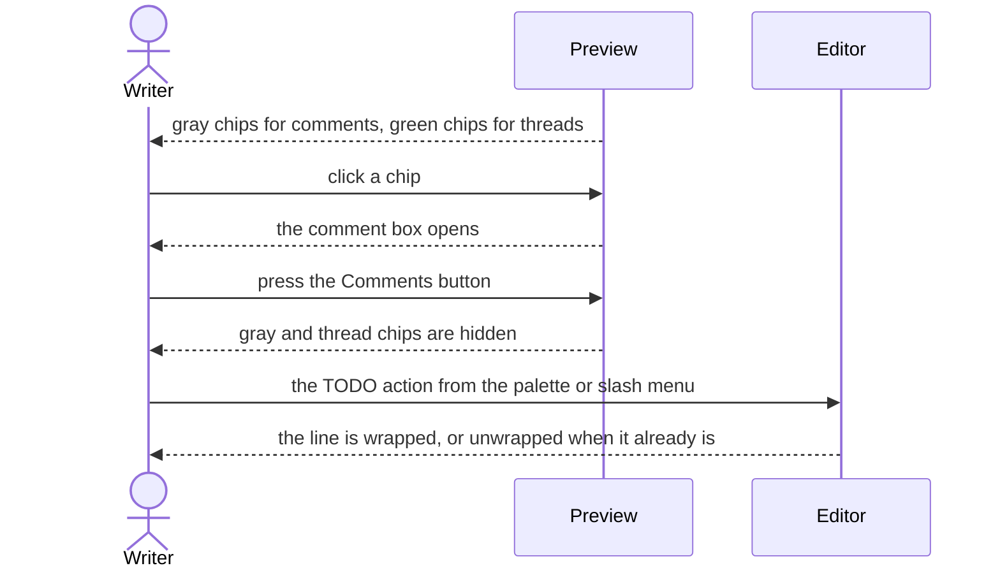

## A writer sees HTML comments and TODO notes as chips and toggles them

### Normative behavior

When a document holds an HTML comment or the word TODO, the Studio SHALL show it as a small chip that opens into a box with the comment text, let the writer hide the gray comment chips while the TODO chips stay, and toggle a TODO comment around the current or selected lines from the edition palette or the slash menu in a block editor.

### Preserved stakeholder intent

As a writer, I see the notes left in the source without opening the source, I read the clean text when I do not need the notes, and I mark a line as a to-do and unmark it without typing the comment markers.

### Rationale and constraints

- Comments used by tools such as linters stay hidden.
- What is open stays open while the writer types.
- Hiding the comments is done with the toolbar button or the setting; the setting is the master switch and removes the toolbar button, and the button choice is kept per workspace.
- The TODO action has no shortcut; Ctrl+/ toggles a plain comment.
- Each TODO toggle is one undo step.

### Use case diagram

### Main paths

#### Path S1: Open a comment chip

1. A document holds an HTML comment
   - SwRS-MDOKFSTUDIO-REVIEW-133: the renderer writes a gray chip labelled comment
   - Option SwRS-MDOKFSTUDIO-REVIEW-139 (nominal): the word TODO shows as a green chip
   - Option SwRS-MDOKFSTUDIO-REVIEW-133 (refusal): a tool comment gets no chip
2. A chip stands in the text
   - SwRS-MDOKFSTUDIO-REVIEW-143: the reader clicks the chip, or presses Enter or Space on it, and its comment box opens
   - Option SwRS-MDOKFSTUDIO-REVIEW-003 (nominal): in edit mode the opened block is titled with the literal tag
   - Option SwRS-MDOKFSTUDIO-REVIEW-152 (nominal): the Comments button hides the gray and thread chips
3. The comment box shows the comment text

#### Path S2: Mark a line as TODO

1. A block editor is open on a line
   - SwRS-MDOKFSTUDIO-REVIEW-160: the writer runs the TODO action from the edition palette or the slash menu and each touched line is wrapped in a TODO comment
   - Option SwRS-MDOKFSTUDIO-REVIEW-160 (nominal): lines that are all wrapped are unwrapped by the same action
   - Option SwRS-MDOKFSTUDIO-REVIEW-160 (refusal): a line that already holds a comment end is never wrapped
2. The touched lines are wrapped in a TODO comment, or unwrapped

<!-- okf:links:start -->
### Links

<!-- Generated from the frontmatter relations; edit them instead. -->

- Derived by:
  - [SwRS-MDOKFSTUDIO-REVIEW-003](../../swrs/review-annotations/SwRS-MDOKFSTUDIO-REVIEW-003.md): Edit mode titles an open comment with its literal tag
  - [SwRS-MDOKFSTUDIO-REVIEW-133](../../swrs/review-annotations/SwRS-MDOKFSTUDIO-REVIEW-133.md): HTML comments show as gray chips carried as data
  - [SwRS-MDOKFSTUDIO-REVIEW-139](../../swrs/review-annotations/SwRS-MDOKFSTUDIO-REVIEW-139.md): TODO words and TODO comments show as green chips
  - [SwRS-MDOKFSTUDIO-REVIEW-143](../../swrs/review-annotations/SwRS-MDOKFSTUDIO-REVIEW-143.md): A click or Enter on a chip toggles its comment box
  - [SwRS-MDOKFSTUDIO-REVIEW-152](../../swrs/review-annotations/SwRS-MDOKFSTUDIO-REVIEW-152.md): The showComments setting and the Comments button hide and show every review mark, and a message of another render changes nothing
  - [SwRS-MDOKFSTUDIO-REVIEW-156](../../swrs/review-annotations/SwRS-MDOKFSTUDIO-REVIEW-156.md): A show-comments message of another render is ignored
  - [SwRS-MDOKFSTUDIO-REVIEW-160](../../swrs/review-annotations/SwRS-MDOKFSTUDIO-REVIEW-160.md): The TODO action wraps or unwraps the touched lines in TODO comments
<!-- okf:links:end -->
