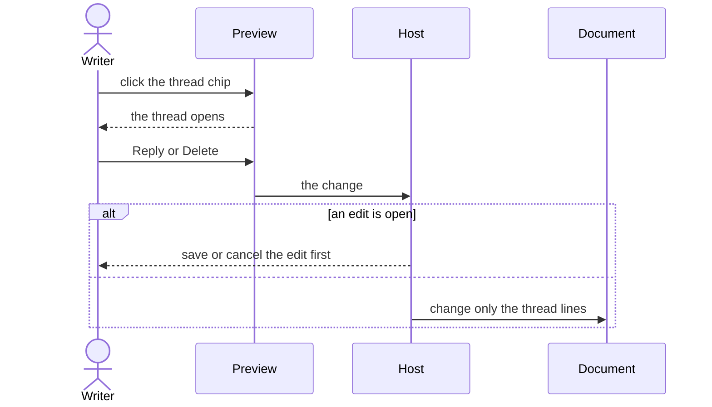

## A writer keeps a discussion in the Markdown source and answers it from the preview

### Normative behavior

When a document holds an inline thread comment, the Studio SHALL show it as a thread chip that opens into its messages and lets the writer reply to it or delete it, and refuse a reply or a deletion while an edit is open, telling the writer to save or cancel the edit first.

### Preserved stakeholder intent

As a writer, I keep a discussion in the file itself and answer it where I read it, and I never have a thread change collide with the text I am typing.

### Rationale and constraints

- Only the lines of the thread change, in one undo step, and the line breaks of the document are kept.
- Every preview offers the thread controls, Restricted Mode and a file outside the workspace included; a file that VS Code holds read-only is not changed and the writer is told.
- The refusal under an open edit is made by the page first; the host refuses again when an edit of the Markdown is open on its side.

### Use case diagram

### Main paths

#### Path 1: Reply to an inline thread

1. A document holds an inline THREAD comment
   - SwRS-MDOKFSTUDIO-REVIEW-167: the renderer writes a green chip with a label, and the open thread lists one entry for each message
2. The thread chip is open with its messages
   - SwRS-MDOKFSTUDIO-REVIEW-171: the reader types in the Reply area and presses Reply, and the trimmed text goes to the host with the source lines of the thread
   - Option SwRS-MDOKFSTUDIO-REVIEW-171 (refusal): the host refuses the change
3. The reply is sent with the lines of the thread
   - SwRS-MDOKFSTUDIO-REVIEW-186: the host appends the reply inside the thread comment under the author
   - Option SwRS-MDOKFSTUDIO-REVIEW-186 (refusal): lines that are not exactly one thread
4. The reply is in the thread comment

#### Path 2: Delete an inline thread

1. The thread chip is open with its messages
   - SwRS-MDOKFSTUDIO-REVIEW-171: the reader presses Delete thread, which asks no confirmation, and the delete goes to the host
2. The delete is sent with the lines of the thread
   - SwRS-MDOKFSTUDIO-REVIEW-192: the host removes the lines of the thread and one surrounding blank line
3. The thread is gone from the document

<!-- okf:links:start -->
### Links

<!-- Generated from the frontmatter relations; edit them instead. -->

- Derived by:
  - [SwRS-MDOKFSTUDIO-PALETTE-114](../../swrs/palette-slash/SwRS-MDOKFSTUDIO-PALETTE-114.md): Thread inserts an empty comment thread after the block with the author and the date
  - [SwRS-MDOKFSTUDIO-REVIEW-167](../../swrs/review-annotations/SwRS-MDOKFSTUDIO-REVIEW-167.md): An inline THREAD comment shows as a thread chip with its messages
  - [SwRS-MDOKFSTUDIO-REVIEW-171](../../swrs/review-annotations/SwRS-MDOKFSTUDIO-REVIEW-171.md): An open inline thread offers Reply and Delete thread
  - [SwRS-MDOKFSTUDIO-REVIEW-178](../../swrs/review-annotations/SwRS-MDOKFSTUDIO-REVIEW-178.md): An inline thread change message carries valid lines and a non-blank text
  - [SwRS-MDOKFSTUDIO-REVIEW-186](../../swrs/review-annotations/SwRS-MDOKFSTUDIO-REVIEW-186.md): The host appends a valid reply inside the thread comment under the author
  - [SwRS-MDOKFSTUDIO-REVIEW-190](../../swrs/review-annotations/SwRS-MDOKFSTUDIO-REVIEW-190.md): An empty or too long reply is refused by the host
  - [SwRS-MDOKFSTUDIO-REVIEW-192](../../swrs/review-annotations/SwRS-MDOKFSTUDIO-REVIEW-192.md): Deleting an inline thread removes whole lines, and a malformed delete message changes nothing
- Depends on:
  - [SwRS-MDOKFSTUDIO-BLOCK-058](../../swrs/block-editing/SwRS-MDOKFSTUDIO-BLOCK-058.md): Every host source edit is one undo step, renders once and reports a failed apply
<!-- okf:links:end -->
