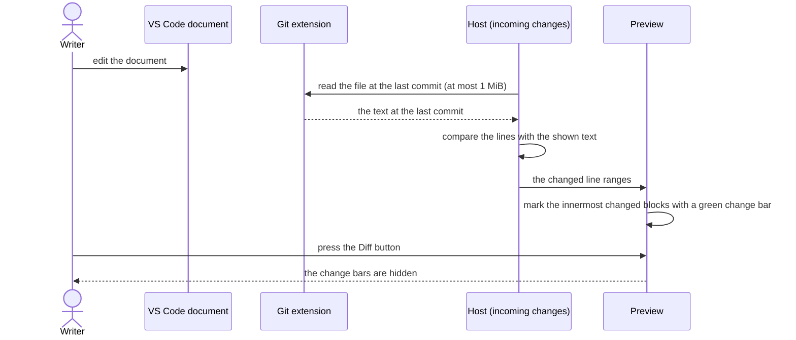

## A writer sees which blocks changed since the last commit

### Normative behavior

When a file tracked by Git differs from its last commit, the Studio SHALL mark each changed block of the preview with a green bar, and stop showing the bars when the writer hides the changes.

### Preserved stakeholder intent

As a writer, I see at a glance what I changed since the last commit, unsaved edits included, and I read the document without the bars when I do not need them.

### Rationale and constraints

- Files that Git does not know, other schemes and untrusted workspaces show nothing.
- The bars never move the text.
- Hiding the changes is done with the toolbar button or the setting; the setting is the master switch and removes the toolbar button, and the button choice is kept per workspace.

### Use case diagram

### Main paths

#### Path 1: See what changed since the last commit

1. A file tracked by Git differs from its last commit
   - SwRS-MDOKFSTUDIO-REVIEW-195: the host posts the line ranges that differ from the file at HEAD
   - Option SwRS-MDOKFSTUDIO-REVIEW-195 (refusal): an untracked file gets no marks
2. The page holds the changed line ranges
   - SwRS-MDOKFSTUDIO-REVIEW-207: the innermost mapped blocks that meet a range get a thin green change bar that moves nothing
   - Option SwRS-MDOKFSTUDIO-REVIEW-207 (refusal): a malformed range is ignored
   - Option SwRS-MDOKFSTUDIO-REVIEW-215 (nominal): a changed or added front matter field gets its own change bar
3. Changed blocks carry a green bar
   - Option SwRS-MDOKFSTUDIO-REVIEW-220 (nominal): the pointer over a bar shows the changed lines of its block in a tooltip
   - Option SwRS-MDOKFSTUDIO-REVIEW-221 (nominal): removed lines with nothing in their place get a red marker between the blocks around them, with a Removed lines tooltip
   - Option SwRS-MDOKFSTUDIO-REVIEW-222 (nominal): a click on a bar or marker shows the side-by-side diff of that block only, a second click or Escape closes it
   - SwRS-MDOKFSTUDIO-REVIEW-214: the reader presses the Diff button and the bars are hidden
4. The change bars are hidden

<!-- okf:links:start -->
### Links

<!-- Generated from the frontmatter relations; edit them instead. -->

- Derived by:
  - [SwRS-MDOKFSTUDIO-REVIEW-005](../../swrs/review-annotations/SwRS-MDOKFSTUDIO-REVIEW-005.md): The word diff reports the added and removed words
  - [SwRS-MDOKFSTUDIO-REVIEW-007](../../swrs/review-annotations/SwRS-MDOKFSTUDIO-REVIEW-007.md): The side-by-side messages are validated and gated
  - [SwRS-MDOKFSTUDIO-REVIEW-010](../../swrs/review-annotations/SwRS-MDOKFSTUDIO-REVIEW-010.md): The line diff reports hunks with both sides
  - [SwRS-MDOKFSTUDIO-REVIEW-195](../../swrs/review-annotations/SwRS-MDOKFSTUDIO-REVIEW-195.md): The host posts the lines that differ from the last commit, read from Git for small files
  - [SwRS-MDOKFSTUDIO-REVIEW-200](../../swrs/review-annotations/SwRS-MDOKFSTUDIO-REVIEW-200.md): The line diff reports added and modified lines
  - [SwRS-MDOKFSTUDIO-REVIEW-203](../../swrs/review-annotations/SwRS-MDOKFSTUDIO-REVIEW-203.md): The HEAD text comes from the built-in Git extension for small files
  - [SwRS-MDOKFSTUDIO-REVIEW-207](../../swrs/review-annotations/SwRS-MDOKFSTUDIO-REVIEW-207.md): Changed blocks get a thin change bar that moves nothing, and malformed ranges are ignored
  - [SwRS-MDOKFSTUDIO-REVIEW-208](../../swrs/review-annotations/SwRS-MDOKFSTUDIO-REVIEW-208.md): Malformed incoming-change ranges are ignored
  - [SwRS-MDOKFSTUDIO-REVIEW-214](../../swrs/review-annotations/SwRS-MDOKFSTUDIO-REVIEW-214.md): The Diff button and the showIncomingChanges setting hide the change bars
  - [SwRS-MDOKFSTUDIO-REVIEW-215](../../swrs/review-annotations/SwRS-MDOKFSTUDIO-REVIEW-215.md): Changed or added front matter fields get their own change bar
  - [SwRS-MDOKFSTUDIO-REVIEW-220](../../swrs/review-annotations/SwRS-MDOKFSTUDIO-REVIEW-220.md): A change bar shows the changed lines in a tooltip while the pointer is over it
  - [SwRS-MDOKFSTUDIO-REVIEW-221](../../swrs/review-annotations/SwRS-MDOKFSTUDIO-REVIEW-221.md): A span of removed lines gets a red marker with a tooltip between the blocks around it
  - [SwRS-MDOKFSTUDIO-REVIEW-222](../../swrs/review-annotations/SwRS-MDOKFSTUDIO-REVIEW-222.md): A click on a change bar or removed-lines marker opens the side-by-side diff of that block only
<!-- okf:links:end -->
