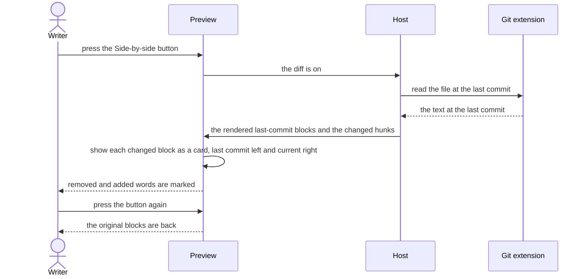

## A writer compares each changed block with its last-commit version side by side

### Normative behavior

When a writer turns on the Side-by-side diff for a file tracked by Git that differs from its last commit, the Studio SHALL show each changed block as a card with the block at the last commit on the left and the current block on the right, mark the removed and the added words, and show the original blocks again when the writer turns the diff off, while the Side-by-side button stays disabled in edit mode.

### Preserved stakeholder intent

As a writer, I read what I changed in a block next to what the block said at the last commit, word by word, unsaved edits included, and I go back to the plain document when I do not need the comparison.

### Rationale and constraints

- Files that Git does not know, other schemes and untrusted workspaces show nothing and have an empty baseline.
- Only the changed blocks become cards; the cards show no editing control, so the button is disabled in edit mode.
- The word marks never change the text of either side.
- Turning the diff off puts the original blocks back untouched.

### Use case diagram

### Main paths

#### Path S1: Compare a changed block with its last-commit version

1. A file tracked by Git differs from its last commit
   - SwRS-MDOKFSTUDIO-REVIEW-008: the writer presses the Side-by-side button and the page tells the host that the diff is on
   - Option SwRS-MDOKFSTUDIO-REVIEW-008 (refusal): the button is disabled in edit mode
2. The host is told the diff is on
   - SwRS-MDOKFSTUDIO-REVIEW-006: the host renders the last-commit text and posts it with the hunks
   - Option SwRS-MDOKFSTUDIO-REVIEW-006 (refusal): an untracked file has an empty baseline
3. The page holds the baseline
   - SwRS-MDOKFSTUDIO-REVIEW-009: each changed block becomes a card, last commit left and current right, with word marks
4. Changed blocks show as cards
   - SwRS-MDOKFSTUDIO-REVIEW-008: pressing the button again turns the diff off
5. The original blocks are back

<!-- okf:links:start -->
### Links

<!-- Generated from the frontmatter relations; edit them instead. -->

- Derived by:
  - [SwRS-MDOKFSTUDIO-REVIEW-006](../../swrs/review-annotations/SwRS-MDOKFSTUDIO-REVIEW-006.md): The host posts the baseline rendering while the side-by-side diff is on and takes only a well-formed switch message
  - [SwRS-MDOKFSTUDIO-REVIEW-008](../../swrs/review-annotations/SwRS-MDOKFSTUDIO-REVIEW-008.md): The Side-by-side button switches the diff and is disabled in edit mode
  - [SwRS-MDOKFSTUDIO-REVIEW-009](../../swrs/review-annotations/SwRS-MDOKFSTUDIO-REVIEW-009.md): A changed block shows as a side-by-side diff with its word marks, cut by line hunks, and a malformed baseline message is dropped
<!-- okf:links:end -->
