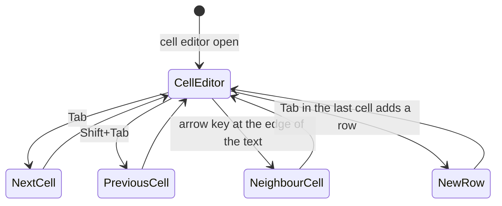

## Tab, arrows and editing keys work in a table cell

### Normative behavior

When a writer presses Tab, Shift+Tab or an arrow key in a table cell editor, the Studio SHALL move the editor to the next cell in that direction, with Tab in the last cell adding a row, and for Home, End, undo, redo, select all or a wrapping marker act on the text of that cell only.

### Preserved stakeholder intent

Writers expect the keyboard to be enough to fill a table.

As a writer, I move through a table with the keyboard, cell by cell, and add a row by pressing Tab in the last cell; I use the keys I know in a cell and they edit the cell, not the page or the source document.

### Rationale and constraints

- Tab and Shift+Tab wrap across rows, the header row included; the arrow keys leave the cell only at the edge of its text, so the caret still moves inside the text.
- With no cell in the arrow direction the key falls to block-to-block navigation: the neighbouring block opens for editing.
- The arrow keys stay native with a selection, with Shift, Alt, Cmd or Ctrl held and during an IME composition.
- Home and End move the caret to the start or end of the cell text and do not scroll the page or a wide table.
- Undo, redo, select all, wrapping a selection with a marker and keeping handled keys away from VS Code work in a cell as in any text box of the block editor, and are specified there (see SwRS-MDOKFSTUDIO-BLOCK-069); keys the editor does not use, such as Ctrl+Tab, still reach VS Code.

### Use case diagram

The cell editor moves between cells with Tab and the arrow keys.

### Main paths

#### Path S1: Move through the cells with the keyboard

1. A cell editor is open
   - SwRS-MDOKFSTUDIO-TABLE-123: the writer presses Tab, Shift+Tab or an arrow key at the edge of the text and the editor moves to the next, previous or neighbouring cell
   - Option SwRS-MDOKFSTUDIO-TABLE-124 (nominal): Tab in the last cell adds a row
   - Option SwRS-MDOKFSTUDIO-TABLE-124 (refusal): the final save cannot be posted
2. The editor is in the neighbouring cell

<!-- okf:links:start -->
### Links

<!-- Generated from the frontmatter relations; edit them instead. -->

- Derived by:
  - [SwRS-MDOKFSTUDIO-BLOCK-003](../../swrs/block-editing/SwRS-MDOKFSTUDIO-BLOCK-003.md): Edit-mode text box follows VS Code undo, redo, select-all and delete-line key bindings
  - [SwRS-MDOKFSTUDIO-BLOCK-069](../../swrs/block-editing/SwRS-MDOKFSTUDIO-BLOCK-069.md): Marker keys wrap a selection; Home, End, select-all and undo stay in the text box
  - [SwRS-MDOKFSTUDIO-TABLE-035](../../swrs/table-editing/SwRS-MDOKFSTUDIO-TABLE-035.md): Tab and the arrow keys move through the table cells
  - [SwRS-MDOKFSTUDIO-TABLE-044](../../swrs/table-editing/SwRS-MDOKFSTUDIO-TABLE-044.md): Typing a marker character over a selection in a cell wraps it as one undoable step
  - [SwRS-MDOKFSTUDIO-TABLE-045](../../swrs/table-editing/SwRS-MDOKFSTUDIO-TABLE-045.md): Undo and redo shortcuts stay in the cell text box
  - [SwRS-MDOKFSTUDIO-TABLE-046](../../swrs/table-editing/SwRS-MDOKFSTUDIO-TABLE-046.md): A key the cell editor handled does not reach VS Code
  - [SwRS-MDOKFSTUDIO-TABLE-047](../../swrs/table-editing/SwRS-MDOKFSTUDIO-TABLE-047.md): Select all in the cell text box selects only the box text
  - [SwRS-MDOKFSTUDIO-TABLE-123](../../swrs/table-editing/SwRS-MDOKFSTUDIO-TABLE-123.md): Tab and the arrow keys move between table cells
  - [SwRS-MDOKFSTUDIO-TABLE-124](../../swrs/table-editing/SwRS-MDOKFSTUDIO-TABLE-124.md): Tab in the last cell adds a row and shows the hint
  - [SwRS-MDOKFSTUDIO-TABLE-125](../../swrs/table-editing/SwRS-MDOKFSTUDIO-TABLE-125.md): The cell left shows its typed text rendered
  - [SwRS-MDOKFSTUDIO-TABLE-126](../../swrs/table-editing/SwRS-MDOKFSTUDIO-TABLE-126.md): The cell editor is revealed in the table's scroll box
<!-- okf:links:end -->
