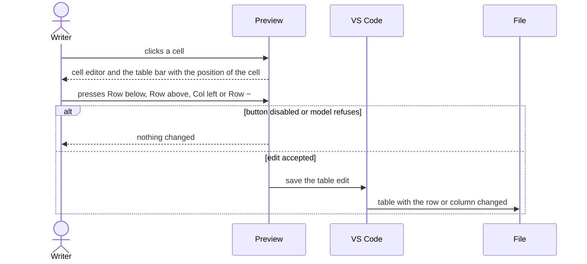

## A table bar locates the writer and edits rows and columns

### Normative behavior

While a writer edits a table cell, the Studio SHALL show a labelled bar of table actions directly above the table with the position of the selected cell, without covering any row, keep it in view for a tall table, and add or remove the row or column next to the selected cell when a row or column button is pressed, keeping the editor open on the new position.

### Preserved stakeholder intent

Writers expect the actions on a table to be visible, named and close to the cell they are editing.

As a writer, I see the table actions with text labels above the table and I always know which header or row and which column I am in; I add or delete a row or a column with one button and keep typing where I was; and I scroll down a long table while editing with the row and column buttons within reach.

### Rationale and constraints

- The bar appears with the first cell editor of a table, stays while the writer moves between cells and is removed when the editor closes.
- It carries seven labelled buttons (Row above, Row below, Row −, Col left, Col right, Col −, List table) in three groups, and a status such as "Header · column 1 of 2" or "Row 1 of 2 · column 2 of 2".
- The header row, the last body row and the last column cannot be deleted from the bar.
- The bar stays just under the sticky band or the preview controls, never past the end of the table; it moves without moving the table text, and a bar that is very tall compared with the pane stays where it is.
- A bar that appears hidden under the sticky headings or the preview controls is scrolled into view when that does not push the selected cell out of the pane.
- Known issue: the separator before the cell formatting group can stay at the end of a line when the group wraps in a narrow pane.

### Use case diagram

The table bar appears with the cell editor and edits rows and columns.

### Main paths

#### Path S1: Add a row below the selected one

1. A table is shown in edit mode
   - SwRS-MDOKFSTUDIO-TABLE-001: the writer clicks a cell and the cell editor opens
2. The cell editor is open
   - SwRS-MDOKFSTUDIO-TABLE-048: a toolbar named Table row and column actions is created directly above the table and tells the position of the selected cell
   - Option SwRS-MDOKFSTUDIO-TABLE-064 (nominal): the bar rides down with a tall table and stays visible
3. The table bar is shown above the table
   - SwRS-MDOKFSTUDIO-TABLE-055: the writer presses Row below and an empty row is inserted after the selected one
   - Option SwRS-MDOKFSTUDIO-TABLE-055 (nominal): Row above inserts an empty row above a body row
   - Option SwRS-MDOKFSTUDIO-TABLE-055 (refusal): Row above on the header row
   - Option SwRS-MDOKFSTUDIO-TABLE-055 (nominal): Col left inserts an empty column to the left
   - Option SwRS-MDOKFSTUDIO-TABLE-055 (nominal): the buttons also edit a plain list-table
   - Option SwRS-MDOKFSTUDIO-TABLE-055 (refusal): disabled buttons and model refusals
4. An empty row is next to the selected one

#### Path S2: Delete a row

1. The table bar is shown above the table
   - SwRS-MDOKFSTUDIO-TABLE-055: the writer presses Row − and the selected row is deleted
2. The selected row is gone

<!-- okf:links:start -->
### Links

<!-- Generated from the frontmatter relations; edit them instead. -->

- Derived by:
  - [SwRS-MDOKFSTUDIO-TABLE-001](../../swrs/table-editing/SwRS-MDOKFSTUDIO-TABLE-001.md): A click on a pipe table cell opens a cell editor in place
  - [SwRS-MDOKFSTUDIO-TABLE-003](../../swrs/table-editing/SwRS-MDOKFSTUDIO-TABLE-003.md): Row above inserts an empty row above the selected body row
  - [SwRS-MDOKFSTUDIO-TABLE-004](../../swrs/table-editing/SwRS-MDOKFSTUDIO-TABLE-004.md): Col left inserts an empty column to the left of the selected column
  - [SwRS-MDOKFSTUDIO-TABLE-005](../../swrs/table-editing/SwRS-MDOKFSTUDIO-TABLE-005.md): The row and column buttons also edit a plain list-table
  - [SwRS-MDOKFSTUDIO-TABLE-048](../../swrs/table-editing/SwRS-MDOKFSTUDIO-TABLE-048.md): A labelled table bar above the table tells the position and holds the buttons
  - [SwRS-MDOKFSTUDIO-TABLE-055](../../swrs/table-editing/SwRS-MDOKFSTUDIO-TABLE-055.md): Row and column buttons add and remove rows and columns
  - [SwRS-MDOKFSTUDIO-TABLE-064](../../swrs/table-editing/SwRS-MDOKFSTUDIO-TABLE-064.md): The table bar rides down with a tall table and stays visible
  - [SwRS-MDOKFSTUDIO-TABLE-118](../../swrs/table-editing/SwRS-MDOKFSTUDIO-TABLE-118.md): A table cell editor that opens late leaves the focus in a field that took it
<!-- okf:links:end -->
