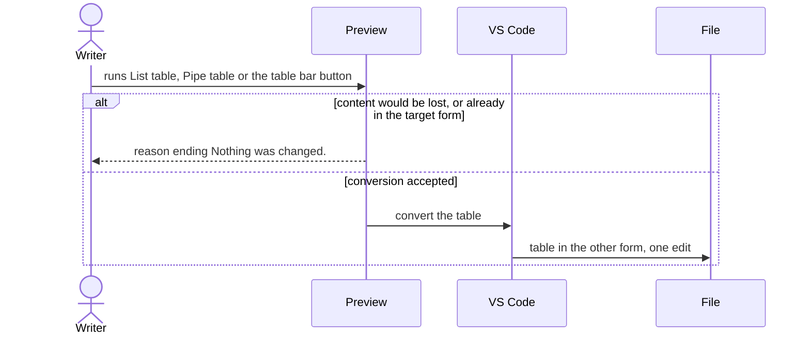

## A writer converts a table between pipe, list-table and HTML forms

### Normative behavior

When a writer asks to convert a table between a Markdown pipe table, a MyST list-table and a simple HTML table, the Studio SHALL write it in the other form without losing content, or change nothing and say why.

### Preserved stakeholder intent

## User Need

As a writer, I convert a table between a Markdown pipe table, a MyST list-table and a simple HTML table, and I am told when a conversion is refused instead of silently losing content.

### Rationale and constraints

- The conversion is available from the table bar (pipe table to list-table) and, in MyST mode, from the palette and the slash menu (List table and Pipe table); it is one edit, so one undo step.
- A conversion that would lose content is refused with a reason ending "Nothing was changed."; presentation (column alignment colons, `:widths:`) is dropped going to a list-table by design.
- The HTML table writer of the HTML table button belongs here as the third form.
- Escaped pipes and cell text are kept across the forms.

### Use case diagram

Converting a table between pipe and list-table forms.

### Main paths

#### Path S1: Convert a table to a list-table and back

1. The caret is on a pipe table in MyST mode
   - SwRS-MDOKFSTUDIO-TABLE-122: the writer runs List table and the table is replaced by a list-table in one edit
   - Option SwRS-MDOKFSTUDIO-TABLE-122 (refusal): a conversion that would lose content, or a table already in the target form, is refused with a reason
2. The table is written as a list-table
   - SwRS-MDOKFSTUDIO-TABLE-122: the writer runs Pipe table and the list-table is replaced by a pipe table in one edit
   - Option SwRS-MDOKFSTUDIO-TABLE-122 (nominal): escaped pipes are kept across forms
3. The table is a pipe table again

#### Path S2: Convert the table being edited

1. A cell editor is open in a pipe table
   - SwRS-MDOKFSTUDIO-TABLE-122: the writer presses List table in the table bar and the table, with the text typed in the current cell, is converted in one final save
   - Option SwRS-MDOKFSTUDIO-TABLE-094 (nominal): an unchanged table gives back the original text
2. The table is written as a list-table

<!-- okf:links:start -->
### Links

<!-- Generated from the frontmatter relations; edit them instead. -->

- Derived by:
  - [SwRS-MDOKFSTUDIO-TABLE-094](../../swrs/table-editing/SwRS-MDOKFSTUDIO-TABLE-094.md): Editing one cell changes exactly one line of the source
  - [SwRS-MDOKFSTUDIO-TABLE-122](../../swrs/table-editing/SwRS-MDOKFSTUDIO-TABLE-122.md): A table converts between pipe, list-table and HTML forms without loss, or is refused with a reason
- Supersedes:
  - [StRS-MDOKFSTUDIO-TABLE-011](StRS-MDOKFSTUDIO-TABLE-011.md): A table converts between forms and a cell edit is a one-line change
<!-- okf:links:end -->
