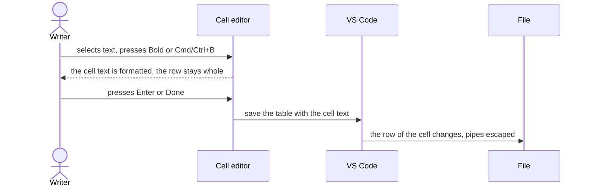

## A writer formats the text of a table cell

### Normative behavior

When a writer applies bold, italic, a link, a colour or another inline format in a table cell editor, from the Cell formatting group of the table bar, a shortcut or the slash menu of the cell, the Studio SHALL change only the text of that cell, keep the row intact and save the cell with its formatted text.

### Preserved stakeholder intent

Writers expect formatting a cell to be as simple as formatting a paragraph.

As a writer, I format text in a table cell from the bar, with a shortcut or from the slash menu as simply as in a paragraph, and the table keeps its shape.

### Rationale and constraints

- The cell formatting group joins the table bar after a separator and offers only the actions that make sense in a cell (never block-only actions).
- A pipe typed in a cell is saved escaped; text inserted from the bar or pasted into the cell cannot split the row.

### Use case diagram

Formatting the text of a cell and saving it.

### Main paths

#### Path 1: Format the text of a cell

1. A cell editor is open
   - SwRS-MDOKFSTUDIO-TABLE-085: the writer presses a button of the Cell formatting group of the table bar and it applies to the cell text
   - Option SwRS-MDOKFSTUDIO-TABLE-085 (refusal): a block-only shortcut does nothing in the cell
   - Option SwRS-MDOKFSTUDIO-TABLE-085 (nominal): the slash menu of a cell offers the commands allowed in a cell
2. The cell text is formatted
   - SwRS-MDOKFSTUDIO-TABLE-018: the writer presses Enter or Done and the cell is committed
   - Option SwRS-MDOKFSTUDIO-TABLE-091 (nominal): pipes of link text and URL inserted from the bar are written as \|
3. The cell is saved with its formatted text

<!-- okf:links:start -->
### Links

<!-- Generated from the frontmatter relations; edit them instead. -->

- Derived by:
  - [SwRS-MDOKFSTUDIO-TABLE-018](../../swrs/table-editing/SwRS-MDOKFSTUDIO-TABLE-018.md): Enter, Done, leaving the cell or a click elsewhere commits the cell
  - [SwRS-MDOKFSTUDIO-TABLE-085](../../swrs/table-editing/SwRS-MDOKFSTUDIO-TABLE-085.md): The table bar's cell group formats the cell text
  - [SwRS-MDOKFSTUDIO-TABLE-091](../../swrs/table-editing/SwRS-MDOKFSTUDIO-TABLE-091.md): Pipes in cell text are escaped and line breaks become spaces
- Supersedes:
  - [StRS-MDOKFSTUDIO-TABLE-012](StRS-MDOKFSTUDIO-TABLE-012.md): Tables and cell text are formatted, inserted, aligned and captioned
<!-- okf:links:end -->
