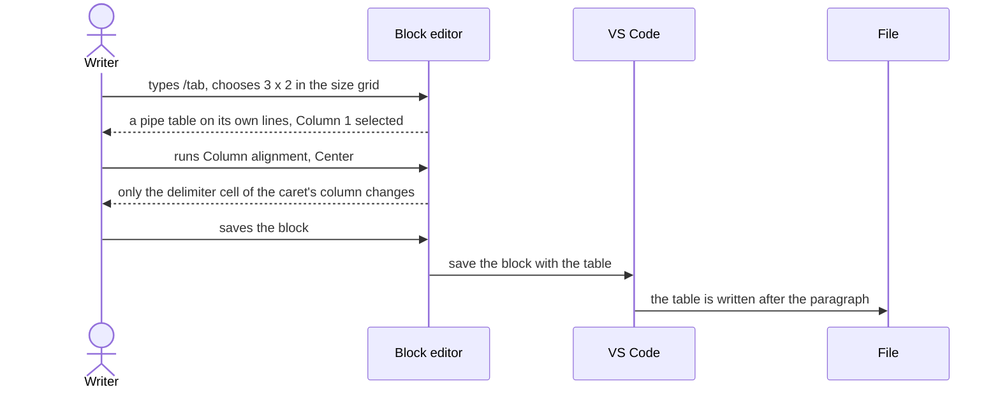

## A writer inserts and shapes a table from the palette

### Normative behavior

When a writer chooses Table, HTML table, Column alignment or Table with caption in the palette or the slash menu of a block editor, the Studio SHALL insert the new table after the selection on its own lines, or change the table at the caret, without the writer typing the Markdown by hand.

### Preserved stakeholder intent

Writers expect a new table to need no hand-written pipes.

As a writer, I insert a table of the size I want, align a column, give the table a caption or turn it into an HTML table without typing the Markdown by hand.

### Rationale and constraints

- Table inserts a pipe table of 1 to 9 rows and 1 to 9 columns (the header counts as a row) after the selection and on its own lines; with the caret inside a pipe table, a `{list-table}` or an HTML table, the new table (Table, HTML table, Table with caption) goes after that table and never splits it.
- Column alignment (GFM and MyST) rewrites only the delimiter cell of the caret's column; Table with caption (MyST) wraps the pipe table at the caret in a `{table}` directive.

### Use case diagram

Inserting a table from the slash menu and aligning a column.

### Main paths

#### Path 1: Insert a table and shape it

1. A block text box is open in edit mode
   - SwRS-MDOKFSTUDIO-TABLE-106: the writer runs Table with a size of R x C and a pipe table is inserted after the end of the selection
   - Option SwRS-MDOKFSTUDIO-TABLE-106 (refusal): a missing, malformed or out-of-range size
2. A pipe table is in the text
   - SwRS-MDOKFSTUDIO-TABLE-111: the writer runs Column alignment and only the delimiter cell of the caret's column is rewritten
   - Option SwRS-MDOKFSTUDIO-TABLE-115 (nominal): Table with caption wraps the pipe table in a table directive
   - Option SwRS-MDOKFSTUDIO-TABLE-117 (nominal): HTML table replaces the pipe table with an HTML table
3. The column is aligned

<!-- okf:links:start -->
### Links

<!-- Generated from the frontmatter relations; edit them instead. -->

- Derived by:
  - [SwRS-MDOKFSTUDIO-PALETTE-031](../../swrs/palette-slash/SwRS-MDOKFSTUDIO-PALETTE-031.md): Palette popovers open in the frame, one at a time, and Escape or typing closes them
  - [SwRS-MDOKFSTUDIO-TABLE-106](../../swrs/table-editing/SwRS-MDOKFSTUDIO-TABLE-106.md): The Table action inserts a pipe table of the chosen size on its own lines
  - [SwRS-MDOKFSTUDIO-TABLE-111](../../swrs/table-editing/SwRS-MDOKFSTUDIO-TABLE-111.md): Column alignment sets the colons of the caret's column
  - [SwRS-MDOKFSTUDIO-TABLE-115](../../swrs/table-editing/SwRS-MDOKFSTUDIO-TABLE-115.md): Table with caption wraps the table at the caret in a table directive
  - [SwRS-MDOKFSTUDIO-TABLE-117](../../swrs/table-editing/SwRS-MDOKFSTUDIO-TABLE-117.md): HTML table converts or inserts an HTML table
- Supersedes:
  - [StRS-MDOKFSTUDIO-TABLE-012](StRS-MDOKFSTUDIO-TABLE-012.md): Tables and cell text are formatted, inserted, aligned and captioned
<!-- okf:links:end -->
