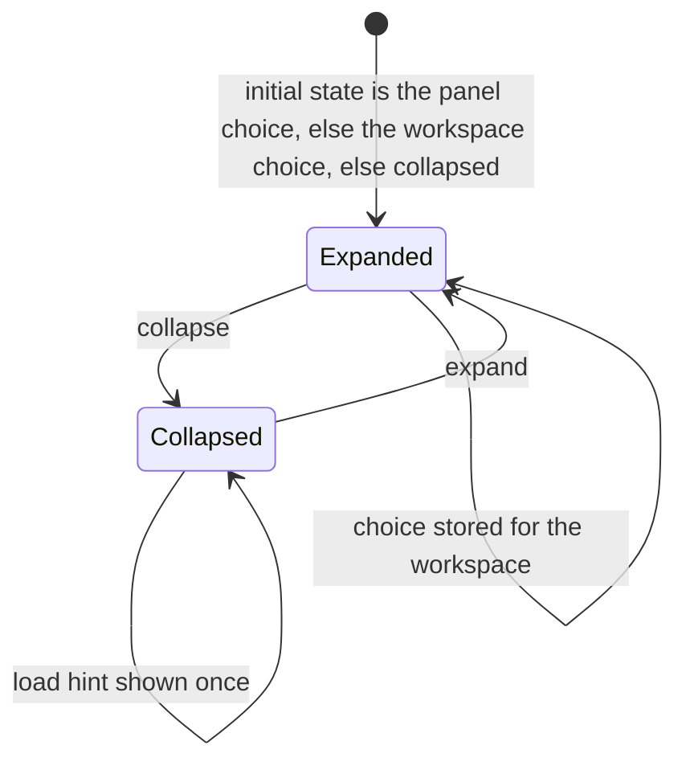

## The toolbar groups its controls, collapses and remembers its collapsed state

### Normative behavior

When a reader opens a preview, the Studio SHALL show its controls in four clearly grouped rows that never overlap each other, and let the reader collapse them to the first row, keeping the collapsed choice for the workspace, in Restricted Mode and for standalone files too.

### Preserved stakeholder intent

As a reader, I find the preview controls in four clear rows. I fold the toolbar down to its first row to free the top of the pane and unfold it again, and a collapsed toolbar stays collapsed when I reopen a preview of the same workspace, in Restricted Mode and for a standalone file too. The toolbar and its tooltips move softly (not at all when my system asks for reduced motion), and a newly opened collapsed toolbar shows briefly that it can expand. My other view choices (zoom, width, table of contents, incoming-change marks, comments) are kept by the rule of the previews that come back after a reload.

### Rationale and constraints

- Row 1 holds Refresh, Edit, Export to HTML and the collapse button; row 2 holds Anchor, Theme, Back and Next; row 3 holds Width, Fold, Zoom out and Zoom in; row 4 holds Table of contents, Side-by-side, Diff and Comments. Every row holds four buttons, no wider than the first row, so the toolbar stays narrow and covers little of the page.
- A preview in Restricted Mode or of a standalone file shows the same rows, with the Edit button enabled.
- The rows stay inside the pane at narrow and wide widths, at the zoom limits, in the light, dark, white and cream themes, expanded or collapsed.
- Pressing the chevron of the toolbar hides or shows rows 2 to 4, and the choice is kept for the workspace.
- A workspace that has stored no choice opens with the toolbar collapsed.
- Hidden rows are skipped by the Tab key, so keyboard users reach only what is shown.
- The state of a restored panel wins over the workspace choice, which wins over the default.
- Only the collapsed toolbar is remembered here. The other view choices (zoom, width mode, table of contents, incoming-change marks, comments) are kept and read back by the rule of StRS-MDOKFSTUDIO-LIFE-014, whatever the trust of the workspace; the meaning of zoom and width is described in the theme-zoom and layout-width scopes.
- Known issue: the toolbar floats over the page, so text that scrolls under it is covered; only the first element of a document gets room under it (see the first-element gap of the layout-width scope).
- When the workspace storage cannot be written, the choice is kept for the session and the reader gets one short warning that it will not survive a restart.

### Use case diagram

### Main paths

#### Path 1: Collapse the toolbar and find it collapsed

1. A preview page is built
   - SwRS-MDOKFSTUDIO-TOOLBAR-001: the toolbar is drawn as four rows of titled buttons, inside the pane and without overlap
2. The toolbar is expanded
   - SwRS-MDOKFSTUDIO-TOOLBAR-007: the reader presses the collapse button and the rows of navigation and view are hidden
   - Option SwRS-MDOKFSTUDIO-TOOLBAR-007 (boundary): when collapsed, the hidden rows are out of the Tab order
3. The toolbar is collapsed
   - SwRS-MDOKFSTUDIO-TOOLBAR-007: the collapsed choice is kept for the workspace and a new page starts from it
   - Option SwRS-MDOKFSTUDIO-LIFE-169 (refusal): a message with a value that is not a boolean is dropped without an answer
   - Option SwRS-MDOKFSTUDIO-LIFE-170 (boundary): a stored value that is not valid is skipped and the next source is used
4. A new preview of the workspace opens collapsed
   - SwRS-MDOKFSTUDIO-TOOLBAR-130: the rows unroll once and roll up again, and a load hint shows that the toolbar can expand, without changing the saved choice
5. The toolbar is collapsed and shows that it can expand

<!-- okf:links:start -->
### Links

<!-- Generated from the frontmatter relations; edit them instead. -->

- Derived by:
  - [SwRS-MDOKFSTUDIO-TOOLBAR-001](../../swrs/toolbar-navigation/SwRS-MDOKFSTUDIO-TOOLBAR-001.md): The toolbar has four rows of four titled buttons that float over the page
  - [SwRS-MDOKFSTUDIO-TOOLBAR-007](../../swrs/toolbar-navigation/SwRS-MDOKFSTUDIO-TOOLBAR-007.md): The chevron collapses the toolbar to its first row
  - [SwRS-MDOKFSTUDIO-TOOLBAR-013](../../swrs/toolbar-navigation/SwRS-MDOKFSTUDIO-TOOLBAR-013.md): The host accepts only a known view preference with a valid value
  - [SwRS-MDOKFSTUDIO-TOOLBAR-129](../../swrs/toolbar-navigation/SwRS-MDOKFSTUDIO-TOOLBAR-129.md): Toolbar, edit bar and table menu tooltips slide in from the left
  - [SwRS-MDOKFSTUDIO-TOOLBAR-130](../../swrs/toolbar-navigation/SwRS-MDOKFSTUDIO-TOOLBAR-130.md): The toolbar rows unroll as one block and a load hint shows them
  - [SwRS-MDOKFSTUDIO-TRUST-006](../../swrs/trust-security/SwRS-MDOKFSTUDIO-TRUST-006.md): A preview with restricted reads keeps every viewing action
- Depends on:
  - [SwRS-MDOKFSTUDIO-LIFE-169](../../swrs/lifecycle-sync/SwRS-MDOKFSTUDIO-LIFE-169.md): A view choice made on the page is stored for the workspace
  - [SwRS-MDOKFSTUDIO-LIFE-170](../../swrs/lifecycle-sync/SwRS-MDOKFSTUDIO-LIFE-170.md): A new page starts each view choice from the panel, stored or default value
<!-- okf:links:end -->
