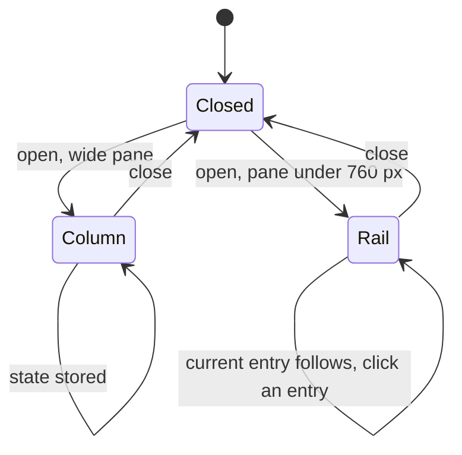

## The reader uses a table of contents beside the document

### Normative behavior

When a reader presses the Table of contents button, the Studio SHALL show or hide a column that lists the document's headings and, when the writer turns on the setting, the list items under them, each cut to its first line or about 80 characters, mark the section being read, let the reader fold sections and jump to a heading, and keep the text, the tables and the pinned headings clear of the column.

### Preserved stakeholder intent

As a reader, I open a table of contents next to a long document when I want an overview. I close it when I want the room, and the preview remembers my choice. In the table of contents I see where I am, I fold the sections I do not need, and I click a heading to go there without leaving the document. I read the document and the table of contents side by side, and neither hides part of the other.

### Rationale and constraints

- The column is off by default; a stored workspace choice opens it; the state of a restored panel wins.
- On a narrow pane the column is hidden while the button stays pressed, and the text keeps its width.
- Entries are indented by heading level; the column lists h1 to h4 (and, with the setting on, the items of top-level lists, one level below the heading before them) and says "No headings" for an empty document; headings inside admonitions and the properties table are not listed.
- The folded sections are remembered for the panel; the current section stays visible in the column.
- The text stays clear of the column in Margin, Auto and Full width mode and at the highest zoom, with no sideways scrolling of the page.
- The column starts below the toolbar and stays inside the pane.
- The pane width at which the column appears is specified in the software requirements.

### Use case diagram

### Main paths

#### Path S1: Open the table of contents and jump

1. The page is shown without the table of contents
   - SwRS-MDOKFSTUDIO-TOOLBAR-033: the reader presses the Table of contents button and the column opens
   - Option SwRS-MDOKFSTUDIO-TOOLBAR-033 (boundary): the initial state of the column
2. The column is open
   - SwRS-MDOKFSTUDIO-TOOLBAR-040: the column lists the headings h1 to h4 that have text, in document order
   - Option SwRS-MDOKFSTUDIO-TOOLBAR-040 (refusal): a document with no headings
3. The headings are listed
   - SwRS-MDOKFSTUDIO-TOOLBAR-045: the reading line marks the current entry, and a click on an entry scrolls its heading to the reading line below the band
   - Option SwRS-MDOKFSTUDIO-TOOLBAR-045 (boundary): the parent of the current entry is folded
4. The reader is at the heading they chose

#### Path S2: Narrow pane

1. The page is shown without the table of contents
   - SwRS-MDOKFSTUDIO-TOOLBAR-033: the reader presses the Table of contents button and the column opens
2. The column is open
   - SwRS-MDOKFSTUDIO-TOOLBAR-037: on a pane narrower than 760 pixels, a rail with one tick per heading is shown instead
   - Option SwRS-MDOKFSTUDIO-TOOLBAR-037 (nominal): the content is padded for the rail
3. A rail with one tick per heading is shown

<!-- okf:links:start -->
### Links

<!-- Generated from the frontmatter relations; edit them instead. -->

- Derived by:
  - [SwRS-MDOKFSTUDIO-TOOLBAR-025](../../swrs/toolbar-navigation/SwRS-MDOKFSTUDIO-TOOLBAR-025.md): The sticky band is fixed, aligned with the column and clear of the toolbar
  - [SwRS-MDOKFSTUDIO-TOOLBAR-033](../../swrs/toolbar-navigation/SwRS-MDOKFSTUDIO-TOOLBAR-033.md): The Table of contents button shows and hides the column
  - [SwRS-MDOKFSTUDIO-TOOLBAR-037](../../swrs/toolbar-navigation/SwRS-MDOKFSTUDIO-TOOLBAR-037.md): The column sits below the toolbar on the right and never covers the text
  - [SwRS-MDOKFSTUDIO-TOOLBAR-040](../../swrs/toolbar-navigation/SwRS-MDOKFSTUDIO-TOOLBAR-040.md): The column lists the h1 to h4 headings with folding
  - [SwRS-MDOKFSTUDIO-TOOLBAR-045](../../swrs/toolbar-navigation/SwRS-MDOKFSTUDIO-TOOLBAR-045.md): The column marks the section being read and jumps on click
  - [SwRS-MDOKFSTUDIO-TOOLBAR-133](../../swrs/toolbar-navigation/SwRS-MDOKFSTUDIO-TOOLBAR-133.md): The narrow-pane rail keeps the text and the other Escape handlers clear
  - [SwRS-MDOKFSTUDIO-TOOLBAR-138](../../swrs/toolbar-navigation/SwRS-MDOKFSTUDIO-TOOLBAR-138.md): The column lists the items of top-level lists when a setting asks
<!-- okf:links:end -->
