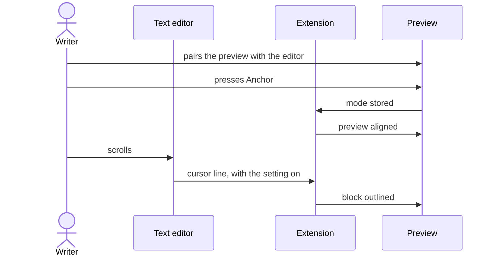

## The reader decides how the panes scroll together and sees the cursor block

### Normative behavior

When a reader presses the Anchor button, the Studio SHALL switch, for that preview panel, whether the preview and the text editor scroll together, and when the reader turns on the setting that marks the editor selection, outline in the preview the block that matches the text editor's cursor line.

### Preserved stakeholder intent

As a reader, I choose per preview panel whether scrolling the text editor scrolls the preview, the button tells me when there is no text editor to follow, and I see in the preview which block I am working on in the text editor, even when the preview does not follow the editor's scroll.

### Rationale and constraints

- The first scroll mode comes from the setting `markdownOkfSchemaStudio.preview.scrollPreviewWithEditor`; the button overrides it for the panel.
- The button is disabled and never looks pressed while no text editor shows the file.
- The cursor mark is controlled by the setting `markdownOkfSchemaStudio.preview.markEditorSelection`, off by default.
- The mark goes to the block that contains the cursor line.
- The mark is refreshed when the editor scrolls or the preview is rendered again, not on every cursor move.

### Use case diagram

### Main paths

#### Path S1: Scroll the two panes together

1. The Anchor button is enabled
   - SwRS-MDOKFSTUDIO-TOOLBAR-120: the reader presses it, the button shows the anchor mode and the pairing, and the preview is aligned with the first visible line of each text editor that shows its document
   - Option SwRS-MDOKFSTUDIO-TOOLBAR-120 (refusal): no text editor shows the file, so the button is disabled
2. The preview and the text editor scroll together
   - SwRS-MDOKFSTUDIO-TOOLBAR-120: the choice is kept for the panel
   - Option SwRS-MDOKFSTUDIO-TOOLBAR-120 (refusal): a value that is not a boolean is not accepted by the host
3. The panel keeps the choice

#### Path S2: See the cursor in the preview

1. The setting that marks the editor selection is on
   - SwRS-MDOKFSTUDIO-TOOLBAR-128: the host sends the cursor line and the preview outlines the block that contains it
   - Option SwRS-MDOKFSTUDIO-TOOLBAR-128 (refusal): with the setting off or no editor, nothing is outlined
2. The block that matches the cursor line is outlined

<!-- okf:links:start -->
### Links

<!-- Generated from the frontmatter relations; edit them instead. -->

- Derived by:
  - [SwRS-MDOKFSTUDIO-TOOLBAR-120](../../swrs/toolbar-navigation/SwRS-MDOKFSTUDIO-TOOLBAR-120.md): The Anchor button switches whether the preview follows the editor
  - [SwRS-MDOKFSTUDIO-TOOLBAR-122](../../swrs/toolbar-navigation/SwRS-MDOKFSTUDIO-TOOLBAR-122.md): A pairing message for another document is ignored
  - [SwRS-MDOKFSTUDIO-TOOLBAR-126](../../swrs/toolbar-navigation/SwRS-MDOKFSTUDIO-TOOLBAR-126.md): The host accepts only a boolean anchor mode
  - [SwRS-MDOKFSTUDIO-TOOLBAR-128](../../swrs/toolbar-navigation/SwRS-MDOKFSTUDIO-TOOLBAR-128.md): The block at the editor cursor is outlined when the setting is on
<!-- okf:links:end -->
